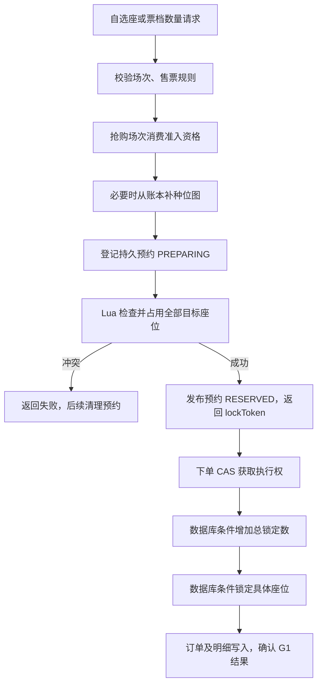

# 亮点一：Redis 与数据库双层防超卖

本文依据 2026-10-24 当前源码，回答“多个人抢同一张座位，如何决定谁成功”。配套 [简历描述](项目亮点与简历描述.md)，全链路见 [高并发购票实现与源码导读](高并发购票实现与源码导读.md)。源码链接带编写时行号，后续代码移动时可按方法名搜索。

## 1. 简历上这一条怎么写

> 基于 Redis Bitmap 与 Lua 实现多座位原子校验、占用及连座分配，结合 MySQL 库存条件更新、座位状态和订单归属校验，构建总量与单座两层防超卖保护。

这里有两个不同的正确性要求：整场已售加锁定不能超过容量；同一张具体座位不能同时属于两个订单。一场有 100 个座位，两笔订单买了同一座位，即使总数只有 2，也已经发生错误。

## 2. 为什么先查再改会出错

假设 A、B 都要买座位 10：

| 时刻 | A 的操作 | B 的操作 |
| --- | --- | --- |
| t1 | 读到座位 10 空闲 | |
| t2 | | 也读到座位 10 空闲 |
| t3 | 把座位 10 设为占用，返回成功 | |
| t4 | | 把座位 10 设为占用，也返回成功 |

“读取空闲”和“写入占用”分别正确，组合起来却留下了竞争窗口。当前实现把它们放进同一段 Lua 仲裁；进入正式下单时，数据库也独立进行条件更新。



普通自选场次不需要排队资格；抢购场次强制系统分配，不能走自选入口绕过准入。`SeatMapService.lockSeats()` 和 `assignSeats()` 汇入相同的预约与下单流程。[源码][seat-lock-java]、[源码][seat-assign]、[资格消费][seat-admission]。

## 3. Redis 中如何表示一张座位

| 数据结构 | Key 示例 | 含义 |
| --- | --- | --- |
| Bitmap | `seat:map:<scheduleId>` | 按座位索引记录 0 可选、1 不可选 |
| Hash | `seat:owner:<scheduleId>` | 索引对应 `lockToken` 或 `SOLD:lockToken` |
| Set | `seat:order:<lockToken>` | 该预约持有的座位索引 |
| ZSet | `seat:delay:<scheduleId>` | 预约对应的固定截止时间 |
| Set | `seat:active` | 需要过期扫描的场次 |

尖括号表示实际编号，并非 key 中的字面字符。2000 个连续索引座位的原始位数组约为 250 字节，但 owner、订单索引、key 与 Redis 对象还有额外内存。

Bitmap 的一个 1 无法区分“锁定未付款”和“已经卖出”，所以需要 owner 与数据库状态。不能根据位图得出它属于哪个用户，也不能仅靠位图完成订单管理。[源码][bitmap-service]、[key 定义][constants-keys]。

## 4. Lua 怎样实现多座位一起占用

`seat_lock.lua` 分两轮执行。下列是核心代码摘录，省略参数与截止时间检查：

```lua
for i = firstSeat, lastSeat do
    local seatIndex = tonumber(ARGV[i])
    if redis.call('GETBIT', mapKey, seatIndex) == 1 then
        return {0, seatIndex}
    end
end

for i = firstSeat, lastSeat do
    local seatIndex = tonumber(ARGV[i])
    redis.call('SETBIT', mapKey, seatIndex, 1)
    redis.call('HSET', ownerKey, seatIndex, orderNo)
    redis.call('SADD', orderKey, seatIndex)
end
```

第一轮只检查，任何一座冲突就结束；全通过才在第二轮写入。正常执行时，其他 Redis 命令无法插入两轮之间，因此两个请求竞争相同座位，只能先执行成功的请求拿到它。

例如 A 要座位 10、11，其中 11 已占用，脚本会在写入之前返回冲突，不会留下 A 没有确认过的单独座位 10。原子多座位占用减少了“抢到一半再补释放”的中间情况。

脚本还用 Redis `TIME` 检查固定截止时间，登记 delay ZSet 与活跃场次，并根据位图更新售罄标志。[完整脚本][seat-lock-lua]、[两轮仲裁][seat-lock-pass]、[到期索引][seat-delay]。

注意：Lua 原子表示执行不被其他命令插入。脚本发生运行时错误，不会像数据库事务一样自动撤销此前全部写入；Redis 与 MySQL 也没有因此变成同一个事务。参数、数据类型和脚本容量仍需约束。

## 5. 自动分配与连座怎么做

`assignSeats()` 接收票档、数量和连座要求。Java 先取得票档的座位布局，由 `SeatRuns.plan()` 规划候选段；随后 `seat_allocate.lua` 按执行时的位图寻找空位，找到足够数量后才写入。

连座要求同时满足同一排、列号连续、座位索引连续。例如索引 19 和 20 即使数字连续，也可能分别处于两排，不能直接判定为连座；两座中间有过道也不能拼接。

Java 规划的是静态布局，空闲情况由 Lua 最终决定。即使两个实例规划了同一段座位，后执行的脚本仍能看到先前写入。连座不足时返回失败及最长空闲连座长度；允许拆分时则可以跨候选段凑够空位。

脚本使用 `GETRANGE` 读取候选覆盖的字节区域，在 Lua 中解析 bit，以减少逐座调用 Redis 命令。但扫描时间仍随候选规模变化，长脚本会影响 Redis 的其他请求。[分配入口][seat-assign]、[候选规划][seat-runs]、[位图读取][seat-allocate-read]、[最终写入][seat-allocate-write]。

## 6. Redis 已经抢到了，为什么下单还要查数据库

Redis 可能因重启、淘汰或故障切换丢失数据，程序也可能出现状态偏差。如果仅凭 Redis 返回成功就直接建单，数据库没有独立能力阻止错误售票。

当前下单通过 `OrderService.createReserved()` 核验预约持有关系，再调用库存服务。票价按实际座位票档从服务端计算，优惠金额取锁券分支结果；订单号沿用 `lockToken`。[下单入口][order-create]。

### 6.1 总量关卡：条件更新库存

`SessionMapper.occupySeats()` 的关键条件，以下为节选：

```sql
UPDATE t_event_session
SET locked_seat = locked_seat + #{count}, update_time = NOW(3)
WHERE id = #{sessionId}
  AND locked_seat + sold_seat + #{count} <= total_seat
```

完整 SQL 还检查场次状态、开售时间、开始时间、抢购时间、数量为正以及每单限购。

最后只剩 1 张票时，两个订单各要 1 张，InnoDB 会协调对同一行的并发修改。先成功的请求增加锁定数，后来的更新不再满足库存条件，影响行数为 0。调用方检查必须等于 1，否则抛异常。[完整 SQL][stock-occupy]、[行数检查][movie-occupy]。

### 6.2 单座关卡：条件更新具体座位

`t_event_session_seat` 的状态为 `0=可售、1=锁定、2=已售`。`lockSeats()` 核心逻辑可以简化为：

```sql
-- 便于理解的伪 SQL；实际实现使用动态 IN 列表并更新其他字段
UPDATE t_event_session_seat
SET status = 1, lock_order_no = :orderNo
WHERE session_id = :sessionId
  AND seat_id IN (:seatIds)
  AND status = 0;
```

请求 N 个座位时，调用方要求影响行数恰好为 N。只成功修改一部分也会抛异常，交给事务回滚已执行的数据库分支，不能把部分占用当成功。

座位唯一键保证 `(session_id, seat_id)` 或 `(session_id, seat_index)` 不产生重复行；竞争同一现有行的仲裁靠状态条件。仅增加唯一键不足以阻止两个订单先后无条件覆盖同一行。[座位 SQL][ledger-lock]、[行数核验][movie-occupy]、[唯一键][ledger-unique]。

### 6.3 支付时还要确认订单归属

支付将账本从锁定变已售时，要求：

```sql
-- markSold() 中的关键 WHERE 条件
AND status = 1
AND lock_order_no = #{orderNo}
```

如果 A 的占用已经释放，座位随后由 B 持有，A 的迟到请求就不满足 `lock_order_no=A`。释放锁定或已售座位也分别检查原订单归属。[转已售][ledger-sold]、[释放锁定][ledger-release-lock]、[释放已售][ledger-release-sold]。

## 7. 数据库写了一半怎么办

创建订单的 G1 涉及库存、座位账本、可选优惠券和订单主从表。订单服务本地事务与 Seata AT 协调这些数据库分支；库存接口和远端返回值都要检查，业务失败要转换为异常，否则 HTTP 200 可能被错误当成成功。

例如总量增加 2 成功，但单座只锁到 1 个，分支抛异常并要求事务回滚。回滚结果明确后预约允许重试；若全局结果未知，不能先清 Redis。这个恢复过程详见 [亮点二](亮点二-下单幂等与未决事务恢复.md)。[事务入口][creation-transactions]、[创建业务][order-create]、[返回值检查][order-require-ok]。

## 8. 排队与防超卖如何配合

Redis ZSet 保存等待用户；调度器默认每 200 毫秒按余座和未消费资格计算放行量。默认目标资格数是余座的 1.5 倍，每轮最多计划 500 人，Lua 在写入前复核共享配额，消费脚本比较 token 后删除资格。

排队减少同时进入锁座的请求，座位原子占用与数据库条件更新决定交易是否合法。资格按用户计算，消费后就移出 inflight，因此不能把 inflight 当作整个下单、支付链路的并发数，也不能把这套机制称为通用 QPS 令牌桶。[配额计算][dispatch-quota]、[发放脚本][queue-admit-lua]、[消费脚本][queue-consume]。

## 9. 当前实现的边界

- 冷位图从数据库账本合并补种占用，尚未覆盖 Redis 整体丢失后全部未建单预约的恢复；恢复期间也需要准入闸门。
- 多 key Lua 尚需完善 Redis Cluster 同槽设计，不能直接宣称支持任意集群部署。
- 场次库存单行是热点；Lua 分配扫描也有容量上限。准入不能消除这些瓶颈。
- 当前有限制每单购票数量，尚不能据此承诺实名或用户跨订单累计限购。
- 完整成交吞吐需要覆盖建单、数据库事务、支付和回收的压测。售罄拒绝吞吐不代表成交能力。

现状依据：[补种实现][bitmap-seed]、[实施记录](第二轮优化实施记录.md)、[压测报告](压测报告.md)。

## 10. 源码阅读与面试追问

阅读顺序：[SeatMapService.lockSeats()][seat-lock-java] → [seat_lock.lua][seat-lock-pass] → [assignSeats()][seat-assign] 与 [seat_allocate.lua][seat-allocate-read] → [OrderService.createReserved()][order-create] → [MovieInternalController.occupy()][movie-occupy] → [总量条件][stock-occupy] 与 [座位条件][ledger-lock]。

面试可以这样解释：

> 我把抢座正确性分成 Redis 业务占用和数据库最终校验。Redis 用 Bitmap 减少座位状态存储，通过 Lua 把多座检查与占用放在一次原子执行里。正式下单时，数据库同时限制总锁定量和单座状态，并严格检查影响行数。支付或释放还要核对座位属于哪笔订单，避免迟到请求操作新占用。Redis 更新不在数据库事务中，所以异常情况需要预约记录和补偿机制协调。

可以自测三个问题：为什么 `GETBIT` 后单独 `SETBIT` 不安全；请求两座却只更新一行时应怎么处理；为什么总量不超卖仍可能把同一座位卖给两个人。

<!-- source-references -->

[seat-lock-java]: ../maipiao-service/maipiao-seat/src/main/java/com/maipiao/seat/service/SeatMapService.java#L209

[seat-assign]: ../maipiao-service/maipiao-seat/src/main/java/com/maipiao/seat/service/SeatMapService.java#L272
[seat-admission]: ../maipiao-service/maipiao-seat/src/main/java/com/maipiao/seat/service/SeatMapService.java#L356
[bitmap-service]: ../maipiao-service/maipiao-seat/src/main/java/com/maipiao/seat/service/SeatBitmapService.java#L31
[constants-keys]: ../maipiao-common/common-core/src/main/java/com/maipiao/common/core/constant/CommonConstants.java#L55
[seat-lock-lua]: ../maipiao-service/maipiao-seat/src/main/resources/lua/seat_lock.lua#L27
[seat-lock-pass]: ../maipiao-service/maipiao-seat/src/main/resources/lua/seat_lock.lua#L56
[seat-delay]: ../maipiao-service/maipiao-seat/src/main/resources/lua/seat_lock.lua#L75
[seat-runs]: ../maipiao-service/maipiao-seat/src/main/java/com/maipiao/seat/service/SeatRuns.java#L49
[seat-allocate-read]: ../maipiao-service/maipiao-seat/src/main/resources/lua/seat_allocate.lua#L92
[seat-allocate-write]: ../maipiao-service/maipiao-seat/src/main/resources/lua/seat_allocate.lua#L162
[order-create]: ../maipiao-service/maipiao-order/src/main/java/com/maipiao/order/service/OrderService.java#L57
[stock-occupy]: ../maipiao-service/maipiao-movie/src/main/java/com/maipiao/movie/mapper/SessionMapper.java#L100
[movie-occupy]: ../maipiao-service/maipiao-movie/src/main/java/com/maipiao/movie/controller/MovieInternalController.java#L54
[ledger-lock]: ../maipiao-service/maipiao-movie/src/main/java/com/maipiao/movie/mapper/SessionSeatMapper.java#L65
[ledger-unique]: ../docs/sql/schema/04_event.sql#L217
[ledger-sold]: ../maipiao-service/maipiao-movie/src/main/java/com/maipiao/movie/mapper/SessionSeatMapper.java#L95
[ledger-release-lock]: ../maipiao-service/maipiao-movie/src/main/java/com/maipiao/movie/mapper/SessionSeatMapper.java#L116
[ledger-release-sold]: ../maipiao-service/maipiao-movie/src/main/java/com/maipiao/movie/mapper/SessionSeatMapper.java#L136
[creation-transactions]: ../maipiao-service/maipiao-order/src/main/java/com/maipiao/order/service/CreationTransactions.java#L11
[order-require-ok]: ../maipiao-service/maipiao-order/src/main/java/com/maipiao/order/service/OrderService.java#L422
[dispatch-quota]: ../maipiao-service/maipiao-queue/src/main/java/com/maipiao/queue/service/AdmissionDispatcher.java#L45
[queue-admit-lua]: ../maipiao-service/maipiao-queue/src/main/resources/lua/queue_admit.lua#L43
[queue-consume]: ../maipiao-service/maipiao-queue/src/main/resources/lua/queue_consume.lua#L3
[bitmap-seed]: ../maipiao-service/maipiao-seat/src/main/java/com/maipiao/seat/service/SeatMapService.java#L144
