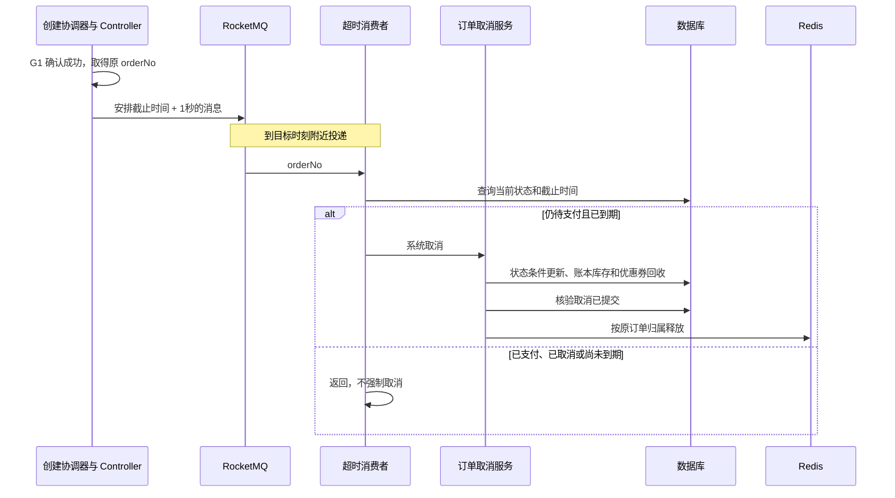

# 亮点三：RocketMQ 超时取消与支付回收协调

本文依据 2026-10-24 当前源码，讲解订单到期后如何触发检查，以及重复消息、支付竞争和资源同步失败时如何处理。配套 [简历描述](项目亮点与简历描述.md)，预约未决处理见 [亮点二](亮点二-下单幂等与未决事务恢复.md)。源码行号对应编写时版本。

## 1. 简历上这一条怎么写

> 使用 RocketMQ 定时消息触发未支付订单检查，结合定时扫表补漏；通过支付、取消的状态条件和事务协调，以及座位归属校验，实现重复触发下的幂等回收，并通过持久同步标记及补偿任务处理支付后 Redis 更新失败。

需要掌握的难点是：时间到了不代表一定能取消；收到重复通知不能重复操作；数据库提交后调用 Redis 失败，也需要有恢复依据。

## 2. 订单、支付、预约不是同一张状态表

| 对象 | 当前关键状态 | 表达的事实 |
| --- | --- | --- |
| 预约 | PROCESSING、SUCCEEDED 等 | 创建订单的尝试是否已确认结果 |
| 订单 | 0 待支付、1 支付中、2 已支付、3 已完成、4 已取消、5 退款中、6 已退款 | 用户购买业务进度 |
| 支付 | 0 待支付、1 成功、2 失败、3 关闭 | 本地支付记录的渠道结算状态 |
| Redis 座位 owner | token 或 `SOLD:token` | 临时占用或已售的座位归属标记 |

订单的已支付是 2，支付表的成功是 1，不能把 SQL 中的状态数字混用。支付成功也不代表 Redis 更新已经成功，后者由同步标记表达。[订单状态][order-status]、[支付状态更新][payment-cas]、[预约处理][reservation-create]。

## 3. RocketMQ 为什么适合这里

锁座默认有 15 分钟期限，创建订单沿用这个截止时间。每笔订单需要在到期附近检查一次，否则未付款用户会持续占座。

定时扫表默认 60 秒一次，刚错过扫描的订单需要再等一轮。RocketMQ 5 的定时消息允许指定投递时刻，正常情况下能更及时触发回收；扫描继续补处理没有成功发出或收到的通知。

例如 12:00 锁座，12:03 才建单，消息安排在原截止 12:15 再加 1 秒，而不是 12:18。创建订单不会把锁座期限重置。

当前 Redis ZSet 负责抢购入口排队准入，RocketMQ 负责订单超时触发。项目没有让所有购票请求通过 MQ 异步建单，因此简历应按实际用途介绍。[期限来源][reservation-create]、[定时消息发送][timeout-producer]、[排队调度][dispatch-quota]。

## 4. 消息怎样发送

`OrderController.create()` 调用预约创建服务，只有结果包含 `orderNo` 才安排消息。查询原创建结果的 `creationStatus()` 也有相同处理，所以同一订单可能被安排多次。

生产者核心代码摘录：

```java
long deliverAt = expireTime.atZone(ZoneId.systemDefault()).toInstant().toEpochMilli()
        + SAFETY_MARGIN_MS;
Message<String> message = MessageBuilder.withPayload(orderNo)
        .setHeader(RocketMQHeaders.KEYS, orderNo)
        .build();
rocketMQTemplate.syncSendDeliverTimeMills(topic, message, deliverAt);
```

`SAFETY_MARGIN_MS=1000`。同步发送表示当前线程等待发送结果，不会阻塞到截止时间才返回。Broker 保存后，在目标时刻附近投递；积压、故障及处理耗时仍可能使取消延后。

载荷只有订单号，`KEYS` 也使用订单号以便检索。KEYS 不会自动替业务去重。消费者必须查询数据库当前状态，不能直接按消息里的旧业务快照取消。

| 配置项 | 当前默认值 |
| --- | --- |
| topic | `maipiao-order-timeout` |
| consumer group | `maipiao-order-timeout-consumer` |
| producer group | `maipiao-order-producer` |
| 发送超时 | 5000 毫秒 |
| 同步发送失败重试次数 | 2 |
| 客户端、Docker Broker 版本 | 5.3.1 |
| RocketMQ Spring Boot Starter | 2.3.1 |

源码使用绝对时间 API；经典 delayLevel 档位包含 10 和 20 分钟，没有正好 15 分钟。部署时还需验证 Broker 定时能力与时钟同步，代码存在不等于已完成环境验证。[发送入口][order-controller]、[生产者][timeout-producer]、[客户端配置][mq-config]、[依赖][mq-dependencies]、[Docker][mq-compose]、[Broker 配置][mq-broker-config]。

## 5. 为什么确认创建成功后才发消息

Seata AT 分支先本地提交，再协调全局结果。Spring 本地 `afterCommit` 只能证明本地提交，不能证明 G1 最终提交。因此当前由创建协调器确认结果，再让 Controller 安排消息。

这个顺序仍有故障窗口：订单已成功，但进程在发送前崩溃，消息就没有发出；发送失败也仅记日志。因此当前实现没有保证数据库与超时消息强原子，扫描是必需的补漏路径。[创建结果确认][reservation-create]、[Controller][order-controller]、[生产者异常处理][timeout-producer]。



## 6. 消费者到底检查什么

`OrderTimeoutConsumer.onMessage()` 的步骤是：查询订单 → 核对可取消状态 → 核对截止时间 → 调用统一取消入口。当前 CANCELLABLE 仅包含订单状态 0。

已支付订单收到旧消息，直接结束；尚未到期的消息也结束，留给扫表处理。消费者不会主动为提前消息再安排一条新消息。查不到订单时记录日志并返回。

这些预查可以避免无用操作，但不能单独解决支付竞争：读完状态之后用户仍可能付款，所以最终还要依赖取消服务中的状态条件、行锁和事务。[消费者][timeout-consumer]、[可取消状态][order-status]、[取消服务][order-cancel]。

## 7. 同一消息来两次，为什么不会回收两次库存

取消业务分两段：

1. `OrderCancellationService.cancel()` 经代理执行全局及本地事务：订单 `FOR UPDATE`，按预期状态转取消，回收账本、库存和优惠券，检查远端返回。
2. `OrderService.cancel()` 在确认取消状态已提交后调用 Redis 释放，Redis 失败记录日志，后续任务继续恢复。

订单已经取消时，代码仍可以进入幂等资源补回收。数据库先按 `lock_order_no` 查账本并条件释放，按实际释放数量减少库存；没有匹配座位就不再减计数。只保证库存不减到负数，无法识别这笔订单是否已经回收过。

消费者执行异常可以交给客户端重投；正常返回就意味着本次消费完成。因此幂等要落在业务状态与归属，而不能依赖“消息只会来一次”。[取消入口][order-cancel-entry]、[取消事务与提交核验][order-cancel]、[账本释放][ledger-release-lock]、[按实际行数回收][movie-release]。

## 8. 付款与超时取消同时发生怎么办

正常支付路径由 `PaymentTxService.markPaid()` 的 G2 协调：支付记录 `FOR UPDATE` → 核验订单、金额和渠道身份 → 支付成功 CAS → 订单状态迁移 → 账本已售 → 出票。

订单支付接受待支付和支付中状态；取消只接受待支付。竞争中需要数据库条件与 Seata 全局锁协调，不能让两个请求各自读取状态后无条件覆盖。

| 竞争结果 | 当前处理 |
| --- | --- |
| 支付已成功提交后处理超时 | 订单不再属于可取消状态，不回收已售座位 |
| 取消成功后收到合法迟到收款 | 创建仅退款意图，不出票，也不再次释放座位 |
| 尚无法确认创建事务是否结束 | PROCESSING 预约阻止取消释放，继续核对 |
| 订单处于 PAYING=1 | 当前超时取消不接管；完整渠道协调流程仍需完善 |

迟到收款退款记录的 `releaseSeat=0`，表示只退钱。座位可能已被其他用户购买，不能再按原订单释放一次，也不能把取消订单重新恢复成已支付。[支付事务][pay-tx]、[订单支付迁移][state-paid]、[取消状态机][order-status]、[预约关闭][reservation-close]。

当前方案仍可能让用户经历先扣款再退款。更完整的支付中取消协议需要渠道查单、关单、未知状态重查，以及必要的人工处理；不能只靠本地时间到期就断定没有收款。

## 9. 支付回调重复或乱序怎样处理

创建支付前，服务读取后端订单快照核对用户、金额、状态和截止时间。`PaymentIntentService` 在独立事务中保存稳定 `paymentNo`，支付表对 `order_no` 有唯一约束；渠道响应丢失时继续查询或复用原支付身份。

回调入口先验签，核对支付号、订单号、渠道类型、渠道交易号和金额，事务内再次核验并加行锁。金额来自下单快照，前端金额不能参与计费。

成功更新的关键条件摘录如下：

```sql
WHERE payment_no = #{paymentNo}
  AND status IN (0, 2)
  AND amount = #{amount}
  AND channel_trade_no = #{channelTradeNo}
```

允许失败状态 2 接受后续合法成功；失败更新只接受状态 0，因此不能覆盖成功。回调日志用于审计，不能因为同一交易号曾有失败日志，就跳过后来成功通知。

已成功的支付重复通知会返回，不重复推进出票；已有票号的明细也会跳过。但“先查票号再写入”本身不构成任意并发入口下的完整保护，正常入口还依赖支付记录行锁、CAS 和事务。[支付创建与回调][payment-create]、[稳定支付意图][payment-intent]、[支付唯一约束][payment-unique]、[成功 CAS][payment-cas]、[事务核验][pay-tx]、[出票][issue-tickets]。

## 10. 旧释放请求为什么不会清掉新买家的座位

设 A 已取消并正常释放座位 10，随后 B 占用座位 10；A 的旧取消任务最后又重试到达。如果只按座位号 `SETBIT 0`，B 的占用就会被清掉。

`seat_release.lua` 的核心代码摘录：

```lua
local mine  = owner == orderNo
local wasMine = includeSold and owner == ('SOLD:' .. orderNo)

if mine or wasMine or (force and not owner) then
    redis.call('SETBIT', mapKey, seatIndex, 0)
    redis.call('HDEL', ownerKey, seatIndex)
    released = released + 1
end
```

当前 owner 是 B，A 就不满足条件。普通取消不允许清 SOLD；退款才显式允许释放本订单已售占用。正常流程不启用修复参数 force。[释放脚本][seat-release-lua]、[数据库归属条件][ledger-release-lock]、[退款归属条件][ledger-release-sold]。

整个场次 Bitmap 也不能统一设置 15 分钟 TTL：不同预约到期时间不同，位图还包含已售座位。项目使用 delay ZSet 按预约查过期，经过业务确认后逐单释放。

## 11. 数据库成功而 Redis 更新失败，如何继续

Redis 不会跟着数据库事务自动回滚，因此已售确认放在 G2 结果核验之后。确认已售时，Bitmap 的 1 保持不变，owner 转为 `SOLD:orderNo`，移出 delay ZSet，订单座位索引保留一周。

支付表的 `seat_synced` 与退款表的 `seat_released` 是恢复依据。`SeatSyncJob` 按持久标记查未同步项，核验订单状态，远端明确成功后才记完成；失败保留待处理。退款中或已退款订单不再被补打成 SOLD。

这使恢复不只依赖进程内待办。服务重启后仍能从数据库找到未完成同步。但它解决的是已记录任务的重试，不能替代 Redis 整体丢失后的全量恢复设计。[支付后调用][payment-create]、[提交核验][order-confirm]、[Redis 已售标记][seat-confirm-lua]、[持久补偿][seat-sync]。

## 12. 各种补偿任务分别做什么

| 任务 | 默认间隔 | 职责 |
| --- | --- | --- |
| OrderTimeoutJob | 60 秒 | 分批查过期待支付订单，补触发取消 |
| SeatExpiryJob | 30 秒 | 查 Redis delay 过期预约，确认可关闭后放座 |
| OrderCreationService.recover | 30 秒 | 核对 XID、关闭可关闭预约、补释放 |
| PaymentReconcileJob | 10 秒 | 主动查原支付，处理回调或预创建响应丢失 |
| SeatSyncJob | 10 秒 | 补已售同步和退款后的 Redis 释放 |
| RefundRequestDispatcher | 10 秒 | 投递持久退款申请，未确认则重试 |

支付查单及座位补同步还通常要求记录至少 30 秒未更新；多个任务用 ShedLock 减少多实例重复调度。调度锁不能代替状态和归属幂等，默认间隔也不是故障恢复的绝对上限。

主动查单遇到过期 PENDING 才尝试渠道关单，明确 CLOSED 才关本地，未知结果保持未决。不能把接口超时解释成渠道没收到钱。[订单扫描][timeout-job]、[扫描索引][order-expire-index]、[座位扫描][seat-expiry]、[预约恢复][reservation-recover]、[主动查单][pay-reconcile]、[同步任务][seat-sync]。

退款申请把订单进入退款中与 outbox 写入放在同一本地事务，定时派发通过服务调用支付侧，后者先持久化稳定退款号。它当前没有借助 RocketMQ 投递；超时消息也没有接入 RocketMQ 事务消息。Broker 配置里存在事务回查参数不能证明业务已经使用事务消息。[退款申请][refund-start]、[派发器][refund-dispatch]、[退款意图][refund-intent]。

## 13. 失败场景与当前边界

| 场景 | 当前恢复依据 | 尚需关注 |
| --- | --- | --- |
| 提交订单后、发送消息前崩溃 | 订单扫描 | 可加强持久待投递记录 |
| 发消息响应丢失或消费重复 | 取消状态与资源归属幂等 | 排查重复量和积压 |
| 消费异常、重试耗尽 | 数据库扫描另行触发 | 死信告警、人工重放 |
| 取消提交后 Redis 不可用 | delay 索引和持久预约 | 积压告警及长期故障恢复 |
| 支付回调丢失 | 稳定支付号及主动查单 | 真实渠道语义与沙箱验证 |
| 事务或渠道结果未知 | 持久状态、XID 或原支付身份 | 人工核对及审计 |

开发配置中的单 Broker、异步刷盘不能视为生产高可用保证。业务扫描提供另一条触发路径，也不能据此承诺零丢失或必在一个周期内恢复。PAYING 取消协议、长期未决处理、定时消息部署验证和全链路压测都仍需完善。[Broker 配置][mq-broker-config]、[实施记录](第二轮优化实施记录.md)。

## 14. RocketMQ 与 Kafka 的选型怎样回答

当前代码能支持的直接理由是：需求需要按订单截止时间投递，RocketMQ 5 提供相应 API，项目围绕它接入成本较低。常规 Kafka Topic 与消费者要实现同样业务，需要额外设计到期调度、延迟主题或外部调度设施，避免为一条未来消息长期阻塞分区。

不能因此推断 Kafka 无法可靠处理业务消息，也没有本项目下两者性能对比的数据。选型应看投递方式、现有基础设施和运维能力；两者都不自动保证业务只执行一次。

## 15. 源码阅读与面试表达

阅读顺序：[Controller][order-controller] → [Producer][timeout-producer] → [Consumer][timeout-consumer] → [统一取消入口][order-cancel-entry] 与 [取消事务][order-cancel] → [seat_release.lua][seat-release-lua] → [PaymentTxService][pay-tx] → [PaymentReconcileJob][pay-reconcile] 与 [SeatSyncJob][seat-sync]。

可以这样介绍：

> 我使用 RocketMQ 定时消息在订单截止后触发检查，消费者重新查库，再进入统一取消事务。发送和消费都可能重复或失败，因此取消通过状态条件和账本归属实现幂等，并保留扫描补漏。数据库取消确认提交后才释放 Redis，旧任务必须匹配原 owner。支付侧使用稳定支付号、行锁和 CAS 防重，回调丢失主动查单，已售同步失败通过持久标记补偿。支付中订单的完整关单协调目前还需要继续完善。

重点准备：同步发送为什么不等 15 分钟；消息 KEYS 为什么不能去重；已付款为什么仍会收到超时消息；取消后迟到收款为什么只退钱；为什么清 Redis 必须晚于取消结果确认；定时消息失败后哪张表能帮助恢复。

<!-- source-references -->

[order-status]: ../maipiao-service/maipiao-order/src/main/java/com/maipiao/order/entity/OrderStatus.java#L53
[payment-cas]: ../maipiao-service/maipiao-pay/src/main/java/com/maipiao/pay/mapper/PaymentMapper.java#L88
[reservation-create]: ../maipiao-service/maipiao-order/src/main/java/com/maipiao/order/service/OrderCreationService.java#L92
[timeout-producer]: ../maipiao-service/maipiao-order/src/main/java/com/maipiao/order/mq/OrderTimeoutProducer.java#L81
[dispatch-quota]: ../maipiao-service/maipiao-queue/src/main/java/com/maipiao/queue/service/AdmissionDispatcher.java#L45
[order-controller]: ../maipiao-service/maipiao-order/src/main/java/com/maipiao/order/controller/OrderController.java#L50
[mq-config]: ../maipiao-service/maipiao-order/src/main/resources/application.yml#L54
[mq-dependencies]: ../pom.xml#L127
[mq-compose]: ../docker/docker-compose.yml#L168
[mq-broker-config]: ../docker/config/rocketmq/broker.conf#L2
[timeout-consumer]: ../maipiao-service/maipiao-order/src/main/java/com/maipiao/order/mq/OrderTimeoutConsumer.java#L56
[order-cancel]: ../maipiao-service/maipiao-order/src/main/java/com/maipiao/order/service/OrderCancellationService.java#L28
[order-cancel-entry]: ../maipiao-service/maipiao-order/src/main/java/com/maipiao/order/service/OrderService.java#L128
[ledger-release-lock]: ../maipiao-service/maipiao-movie/src/main/java/com/maipiao/movie/mapper/SessionSeatMapper.java#L116
[movie-release]: ../maipiao-service/maipiao-movie/src/main/java/com/maipiao/movie/controller/MovieInternalController.java#L118
[pay-tx]: ../maipiao-service/maipiao-pay/src/main/java/com/maipiao/pay/service/PaymentTxService.java#L30
[state-paid]: ../maipiao-service/maipiao-order/src/main/java/com/maipiao/order/service/OrderStateMachine.java#L52
[reservation-close]: ../maipiao-service/maipiao-order/src/main/java/com/maipiao/order/service/OrderCreationService.java#L189
[payment-create]: ../maipiao-service/maipiao-pay/src/main/java/com/maipiao/pay/service/PaymentService.java#L62
[payment-intent]: ../maipiao-service/maipiao-pay/src/main/java/com/maipiao/pay/service/PaymentIntentService.java#L21
[payment-unique]: ../docs/sql/schema/03_pay.sql#L60
[issue-tickets]: ../maipiao-service/maipiao-order/src/main/java/com/maipiao/order/controller/OrderInternalController.java#L102
[seat-release-lua]: ../maipiao-service/maipiao-seat/src/main/resources/lua/seat_release.lua#L58
[ledger-release-sold]: ../maipiao-service/maipiao-movie/src/main/java/com/maipiao/movie/mapper/SessionSeatMapper.java#L136
[order-confirm]: ../maipiao-service/maipiao-order/src/main/java/com/maipiao/order/service/OrderService.java#L230
[seat-confirm-lua]: ../maipiao-service/maipiao-seat/src/main/resources/lua/seat_confirm.lua#L20
[seat-sync]: ../maipiao-service/maipiao-pay/src/main/java/com/maipiao/pay/job/SeatSyncJob.java#L25
[timeout-job]: ../maipiao-service/maipiao-order/src/main/java/com/maipiao/order/job/OrderTimeoutJob.java#L62
[order-expire-index]: ../docs/sql/schema/02_order.sql#L72
[seat-expiry]: ../maipiao-service/maipiao-seat/src/main/java/com/maipiao/seat/job/SeatExpiryJob.java#L75
[reservation-recover]: ../maipiao-service/maipiao-order/src/main/java/com/maipiao/order/service/OrderCreationService.java#L241
[pay-reconcile]: ../maipiao-service/maipiao-pay/src/main/java/com/maipiao/pay/job/PaymentReconcileJob.java#L25
[refund-start]: ../maipiao-service/maipiao-order/src/main/java/com/maipiao/order/service/OrderRefundService.java#L112
[refund-dispatch]: ../maipiao-service/maipiao-order/src/main/java/com/maipiao/order/service/RefundRequestDispatcher.java#L19
[refund-intent]: ../maipiao-service/maipiao-pay/src/main/java/com/maipiao/pay/service/RefundIntentService.java#L26
