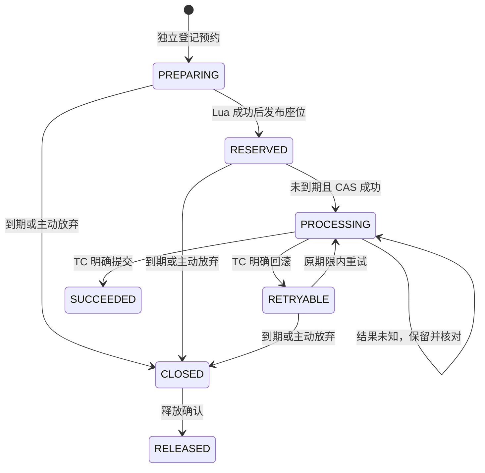
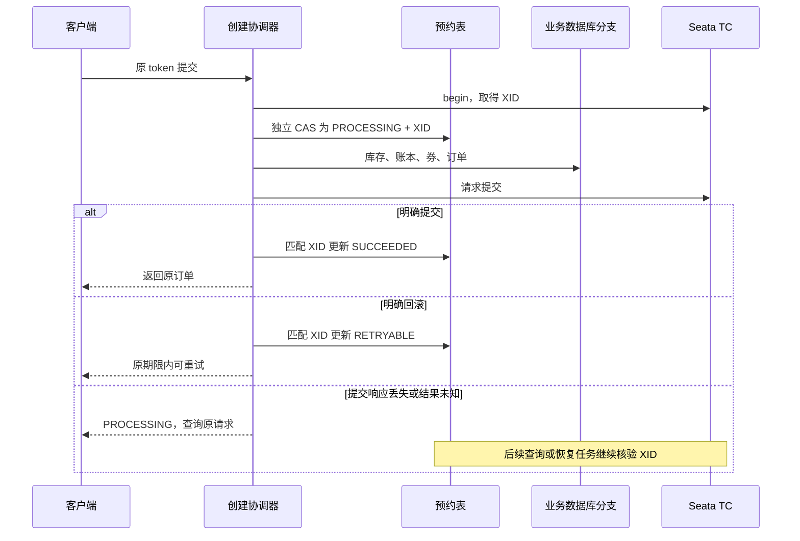

# 亮点二：下单幂等与未决事务恢复

本文依据 2026-10-24 当前源码，讲解重复提交、响应丢失、Seata 结果未知时，项目怎样保护预约并恢复。配套 [简历描述](项目亮点与简历描述.md)，座位竞争见 [亮点一](亮点一-Redis与数据库双层防超卖.md)。源码行号对应编写时版本。

## 1. 简历上这一条怎么写

> 设计持久预约状态机，以锁座 token 作为稳定订单号，通过 CAS 控制下单执行权，并使用 Seata 协调数据库分支；对结果未知的事务保留预约，通过 XID 查询与恢复任务核对结果，避免重复执行或误释放座位。

这一条重点是对“不确定结果”的处理。收到成功或明确回滚都容易决定下一步；请求超时却无法确认数据库最终结果，才需要额外的协调设计。

## 2. 为什么请求超时不能直接判失败

假设客户端提交订单 A，后台已经完成创建，但返回网络包丢失。客户端看到超时，实际却已有订单。

如果马上释放座位，B 可能获得 A 已有订单的座位；如果让 A 换新订单号再来一次，又可能形成多笔业务操作。当前流程要求继续查询同一 `lockToken` 对应的结果，结果未知期间保留预约。

| 看到的现象 | 不能直接推断什么 | 应核对的信息 |
| --- | --- | --- |
| HTTP 请求超时 | 订单一定失败 | 持久预约状态和原 XID 结果 |
| 查到订单行 | Seata 全局一定提交 | 全局事务提交决定 |
| 预约已超过截止时间 | 未决事务可以忽略并放座 | 当前状态是否仍为 PROCESSING |
| TC 查不到或返回不明确 | 一定回滚 | 保持未决，继续恢复或人工核对 |

Seata AT 的分支可以先本地提交，再等待全局决定，因此“订单行存在”与“全局已成功”之间存在区别。[创建协调器][reservation-create]、[事务适配器][creation-transactions]。

## 3. 三种身份要分清

| 身份 | 稳定范围 | 作用 |
| --- | --- | --- |
| `queueToken` | 一次抢购准入资格 | 允许进入锁座，消费一次后失效 |
| `lockToken` / `orderNo` | 同一座位预约及业务请求 | 重试、查单、资源归属沿用它 |
| `XID` | 某次下单全局事务尝试 | 询问 TC 这一轮到底提交还是回滚 |

同一预约在明确回滚后重试，业务 token 不变，但新一轮事务有新的 XID。数据库完成更新需要匹配 XID，防止旧尝试的迟到结果覆盖当前尝试。[订单号来源][order-create]、[创建与完成][reservation-create]、[CAS SQL][reservation-claim]。

## 4. 为什么新增持久预约表

`t_order_reservation` 在正式订单创建之前保存预约协调信息，包括 token、用户、场次、座位、固定截止时间、状态、请求摘要和 XID。

如果只有 Redis 和订单表，订单还没创建时缺少一条能可靠回答“谁正在尝试下单、是否允许清扫”的持久记录。预约表补上了这个阶段。[表结构][reservation-schema]。

| 状态 | 含义 | 允许的主要后续动作 |
| --- | --- | --- |
| PREPARING | 已登记 token，尚未成功发布座位清单 | 锁座后发布，或安全关闭 |
| RESERVED | 已发布预约，等待用户下单 | 截止前获取执行权，或安全关闭 |
| PROCESSING | 某 XID 已获得执行权，正在执行或结果未决 | 查询 TC，不能被新请求接管或直接清扫 |
| SUCCEEDED | 已确认创建事务提交 | 返回原订单，按订单状态处理后续 |
| RETRYABLE | 已确认上轮回滚 | 原期限内重试，或安全关闭 |
| CLOSED | 已阻止该预约继续下单 | 允许执行座位释放 |
| RELEASED | 关闭后的释放已被恢复流程确认 | 不再继续创建订单 |

这是预约状态；订单支付状态仍在订单表，不能把 `SUCCEEDED` 理解成用户已付款。



## 5. 锁座阶段怎样登记和发布

座位服务按以下顺序操作：生成 token 与固定截止时间 → `prepareHold()` 登记 PREPARING → 执行 Redis Lua 占座 → `publishHold()` 发布座位清单并转为 RESERVED → 返回结果。

登记先于占座，让服务在 Redis 修改前已有协调身份；发布晚于占座，因为自动分配的具体结果只有 Lua 执行后才知道。若发布响应丢失，服务无法仅凭异常断定发布失败，因此保留占用，交给查询和恢复流程核对。

`prepare()` 校验 token、用户、场次和期限；`publish()` 规范化座位及标签，并校验重复发布是否一致。锁座默认 15 分钟，期限在锁座阶段确定，提交或重试不会重新起算。[座位服务协调入口][hold-prepare]、[prepare()/publish()][reservation-prepare]、[锁座配置][seat-config]。

## 6. 重复下单如何争取执行权

`create()` 先核对登录用户、场次、规范化座位清单，并对场次、排序后的座位和优惠券生成 SHA-256 请求摘要。这样同一个 token 不能被另一份参数悄悄复用。

真正决定哪一个请求能执行业务的是 `claim()`：

```sql
UPDATE t_order_reservation SET state='PROCESSING', xid=#{xid}, request_hash=#{hash}
WHERE token=#{token} AND state IN ('RESERVED','RETRYABLE') AND expires_at>#{now}
  AND (request_hash IS NULL OR request_hash=#{hash} OR (state='RETRYABLE' AND #{revise}=TRUE))
```

A、B 同时用原 token 下单：A 更新一行，把状态改为 PROCESSING；B 不再满足预期状态，影响行数为 0，只能查询原结果。代码只允许获胜者进入 `createReserved()`。

“先查是否存在订单”本身不够，因为两个请求可以同时查到不存在。唯一订单号也只是一层约束，不能单独替代执行权控制和跨服务资源协调。[创建方法][reservation-create]、[claim SQL][reservation-claim]、[订单唯一键][order-unique]。

请求摘要改变通常被拒绝。只有已经明确回滚为 RETRYABLE，且用户显式指定修改重试，才允许受控调整优惠券等参数；它不是在结果未知时替换原请求的入口。

## 7. 为什么 PROCESSING 记录要独立提交

这条记录是“已经启动某轮业务尝试”的事实。如果跟业务一起回滚，恢复进程就可能不知道原尝试存在，也无法查原 XID。

当前 `outside()` 的核心代码为：

```java
private <T> T outside(Supplier<T> operation) {
    requireNoLocalTransaction();
    String xid = RootContext.unbind();
    try { return operation.get(); }
    finally { if (xid != null) RootContext.bind(xid); }
}
```

入口拒绝加入 Spring 本地事务；暂时解绑 Seata XID 后执行预约 SQL，使其独立自动提交，再恢复上下文。仅解绑 XID 不能让已加入的 Spring 本地事务自动独立，所以检查本地事务状态是必要条件。

实际顺序是：开启 G1 → 取得 XID → 独立提交 PROCESSING 与 XID → 执行业务分支。只有登记执行权成功才调用库存、优惠券和订单业务。[outside()][reservation-outside]、[创建协调][reservation-create]、[开启 G1][creation-transactions]。

## 8. 提交、回滚和未知结果怎样区分



`commitRequested` 是关键标志。一旦已经向 TC 请求提交，响应超时可能只是回包丢失，不能随即改发回滚。提交前的业务异常可以尝试回滚，但只有确认回滚结果后才能标为 RETRYABLE。

当前明确识别：`Committed / AsyncCommitting` 为提交决定；`Rollbacked / TimeoutRollbacked` 为已回滚。其他状态、查询失败或不明确结果保持未决。`AsyncCommitting` 在 AT 下已决定提交，剩余异步清理 undo log。

`finish()` 的 SQL 同时匹配 `token、PROCESSING、xid`。例如旧 XID 已结束后收到迟到更新，如果预约已经进入新 XID，旧结果便无法覆盖它。[创建异常处理][reservation-create]、[reconcile()][reservation-reconcile]、[完成条件][reservation-claim]。

## 9. 清扫为什么不能看到过期就放座

预约的截止时间表示“正常业务可用到什么时候”，不能证明正在进行的全局事务最终失败。若状态仍是 PROCESSING，`close()` 返回 false；座位服务只有拿到明确可关闭结果才执行 Lua 释放。

关闭 SQL 只允许 PREPARING、RESERVED、RETRYABLE，在到期或主动放弃条件成立时转 CLOSED。它与 claim 的状态竞争由数据库仲裁：关闭先成功，后续 claim 不满足条件；claim 先成功，清扫就不能接管 PROCESSING。

对真正缺失的孤儿预约，`closeOrphan()` 先写 CLOSED 墓碑，再读状态，阻止迟到的 prepare 重新建立可执行预约。服务异常或 TC 不可用也不会当成“没有订单”。[close()][reservation-close]、[关闭与墓碑 SQL][reservation-claim]、[座位清扫][seat-expiry]。

## 10. 后台怎样恢复，用户看到什么

用户调用 `GET /requests/{token}` 查询原请求。`status()` 会尝试核对未决 XID；只有 SUCCEEDED 才返回订单信息，PROCESSING 返回“下单结果确认中，请查询原请求”。RETRYABLE 还会核验原座位是否仍保留。

后台 `recover()` 默认每 30 秒运行，按更新时间分批读取最多 200 条待处理记录：核对 XID → 尝试安全关闭 → 明确允许时调用座位释放 → 远端明确成功后标记 RELEASED。逐条异常不会打断全部恢复。

它没有依赖一个“超时自动失效的执行锁”来接管旧事务，而是持续查询原事务结果。多实例竞争仍靠状态条件与 XID 匹配防护。[查询入口][order-query]、[恢复任务][reservation-recover]、[扫描 SQL][reservation-claim]。

## 11. 当前边界和代价

- 优先保护未决预约会暂时降低可售库存；长期未决需要告警、人工核对及操作审计。
- TC 查询返回不明确、历史结果无法确认时，当前不会自行推断回滚，需要进一步恢复手段。
- 预约写入增加数据库往返；抢购准入应在它之前削减流量，并对预约表做容量和索引验证。
- 这套设计没有将 Redis、MySQL 与外部支付渠道合并为一个事务，也没有完成 Redis 整体丢失后的全部预约恢复。
- 恢复默认间隔不是收敛时间保证，故障、积压和永久坏记录都可能延长恢复。

实现与部署现状见 [第二轮优化实施记录](第二轮优化实施记录.md)，已有库使用前需按 [SQL 说明](sql/README.md) 迁移。

## 12. 源码阅读与面试表达

阅读顺序：[SeatMapService 预约登记][hold-prepare] → [预约表][reservation-schema] → [OrderCreationService.create()][reservation-create] → [claim SQL][reservation-claim] → [CreationTransactions][creation-transactions] → [reconcile()][reservation-reconcile] → [close()][reservation-close] 与 [recover()][reservation-recover]。

可以这样介绍：

> 下单超时可能是业务失败，也可能是成功响应丢失，所以我把锁座 token 作为稳定业务身份，并在正式订单前建立持久预约。CAS 保证同一预约只有一轮事务执行业务，PROCESSING 和 XID 独立保存。明确提交返回原订单，明确回滚才允许原期限内重试；结果未知时查询原事务，并阻止清扫释放。后台恢复继续核对，避免靠换订单号或执行锁过期来重新下单。

重点准备：token 和 XID 为什么不能混用；为什么只查订单表不够；为什么 PROCESSING 不能加入同一个回滚事务；提交超时后为什么不能直接 rollback；旧尝试的完成结果如何避免覆盖新尝试。

<!-- source-references -->

[reservation-create]: ../maipiao-service/maipiao-order/src/main/java/com/maipiao/order/service/OrderCreationService.java#L92
[creation-transactions]: ../maipiao-service/maipiao-order/src/main/java/com/maipiao/order/service/CreationTransactions.java#L11
[order-create]: ../maipiao-service/maipiao-order/src/main/java/com/maipiao/order/service/OrderService.java#L57
[reservation-claim]: ../maipiao-service/maipiao-order/src/main/java/com/maipiao/order/mapper/OrderReservationMapper.java#L28
[reservation-schema]: ../docs/sql/schema/07_order_reservation.sql#L3
[hold-prepare]: ../maipiao-service/maipiao-seat/src/main/java/com/maipiao/seat/service/SeatMapService.java#L442
[reservation-prepare]: ../maipiao-service/maipiao-order/src/main/java/com/maipiao/order/service/OrderCreationService.java#L47
[seat-config]: ../maipiao-service/maipiao-seat/src/main/resources/application.yml#L70
[order-unique]: ../docs/sql/schema/02_order.sql#L70
[reservation-outside]: ../maipiao-service/maipiao-order/src/main/java/com/maipiao/order/service/OrderCreationService.java#L296
[reservation-reconcile]: ../maipiao-service/maipiao-order/src/main/java/com/maipiao/order/service/OrderCreationService.java#L230
[reservation-close]: ../maipiao-service/maipiao-order/src/main/java/com/maipiao/order/service/OrderCreationService.java#L189
[seat-expiry]: ../maipiao-service/maipiao-seat/src/main/java/com/maipiao/seat/job/SeatExpiryJob.java#L75
[order-query]: ../maipiao-service/maipiao-order/src/main/java/com/maipiao/order/controller/OrderController.java#L57
[reservation-recover]: ../maipiao-service/maipiao-order/src/main/java/com/maipiao/order/service/OrderCreationService.java#L241
