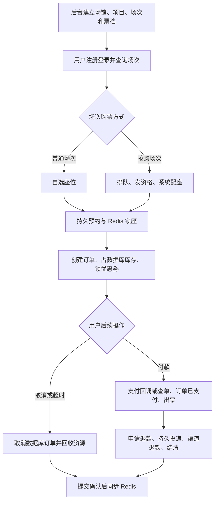

# 后端从零实现教程：一步一步写出票务系统

> 根据当前仓库源码编写，整理日期：2026-10-25。以后端实现为主，前端只介绍接口接入。

## 这份教程怎么用

把自己想象成刚新建了一个工程：先让用户能注册，再让后台能创建场次，接着让用户选座、下单、付款，最后补上并发控制、超时回收和故障恢复。

每一步按“要做的功能 → 新增什么文件 → 关键代码怎么写 → 如何接上调用方 → 怎样验证”展开。可以在独立练习工程中照着做；本仓库已经有对应实现，用链接核对完整类。

**代码约定：**标为“实际代码片段”的内容取自当前源码，可能只是一个类中的方法或连续代码块，省略的类头、注入字段、import 应从链接中的完整文件补齐；标为“教学骨架”的代码用于解释编写顺序，不能替换当前项目的完整实现。本文不会重复粘贴每个实体的全部字段，但会写清它们何时创建、如何连接业务。

按顺序完成：第 1—9 步搭好基础和登录，第 10—12 步提供可卖的场次，第 13—19 步获得座位和购票资格，第 20—25 步创建与取消订单，第 26—31 步处理支付、出票、退款，第 32—35 步补齐管理、前端接入和验证。

## 35 步编码目录

- [第 1 步：先定数据归属，再建库](#step-1)
- [第 2 步：建立 Maven 父工程和服务模块](#step-2)
- [第 3 步：先写启动类和本地配置](#step-3)
- [第 4 步：写返回对象、业务异常和统一异常处理](#step-4)
- [第 5 步：把公共配置真正装配进每个服务](#step-5)
- [第 6 步：按 Entity → Mapper → DTO → Service → Controller 写注册](#step-6)
- [第 7 步：写登录和 JWT，退出时写黑名单](#step-7)
- [第 8 步：写网关路由，再写身份过滤器](#step-8)
- [第 9 步：让下游拿到用户身份，并让 Feign 传递上下文](#step-9)
- [第 10 步：写项目、场馆、场地和座位模板](#step-10)
- [第 11 步：按“场次 → 票档 → 座位”的顺序写创建逻辑](#step-11)
- [第 12 步：写公开查询，再组装座位图](#step-12)
- [第 13 步：定义 Redis 键，写 Bitmap 锁座脚本](#step-13)
- [第 14 步：在 Java 封装脚本执行和返回值](#step-14)
- [第 15 步：在订单服务写持久预约 prepare 和 publish](#step-15)
- [第 16 步：接通普通场次的自选锁座接口](#step-16)
- [第 17 步：先写抢购排队的加入与查询](#step-17)
- [第 18 步：写准入调度和一次性 token 消费](#step-18)
- [第 19 步：写系统配座，把排队接到真实业务入口](#step-19)
- [第 20 步：先写优惠券锁定和数据库库存条件更新](#step-20)
- [第 21 步：写订单状态和持久预约的执行权](#step-21)
- [第 22 步：先配置 Seata，再写下单分支事务](#step-22)
- [第 23 步：写创建协调器，区分失败与结果未知](#step-23)
- [第 24 步：先写安全取消，再写按 owner 释放 Redis](#step-24)
- [第 25 步：把 RocketMQ 接到订单到期流程，再补扫描](#step-25)
- [第 26 步：先定义支付渠道接口，再实现模拟渠道](#step-26)
- [第 27 步：从订单取金额，先落稳定支付身份再调用渠道](#step-27)
- [第 28 步：写验签回调，再在全局事务中确认支付与出票](#step-28)
- [第 29 步：补主动查单与提交后的座位同步任务](#step-29)
- [第 30 步：先持久化退款申请，再向支付服务投递](#step-30)
- [第 31 步：复用退款号，查明渠道结果后结清订单与库存](#step-31)
- [第 32 步：补订单查询、后台管理和开发演示功能](#step-32)
- [第 33 步：前端只接接口、状态和结果查询](#step-33)
- [第 34 步：按顺序启动，再用最小请求串联后端](#step-34)
- [第 35 步：用竞争和故障验证，而不只点一次成功](#step-35)

## 最终要写出的业务链



这里有三个容易混淆的编号，先固定含义：

| 名称 | 表示什么 | 是否能代替另外两个 |
| --- | --- | --- |
| JWT | 当前是谁在访问 | 不能拿它占座 |
| queueToken | 某用户在某场次获得的一次准入资格 | 不能直接当订单号 |
| lockToken | 本次锁座的身份，后续同时作为 orderNo | 不能拿它证明用户已付款 |

`scheduleId` 是接口沿用的叫法，业务上对应 `Session`，数据库列通常叫 `session_id`。`Film/Cinema/Hall` 这些 Java 类名也沿用了电影业务名称，但表结构已经扩展为项目、场馆、场地，支持演出。

---

# 第一阶段：先让一个普通接口正常工作

<a id="step-1"></a>

## 第 1 步：先定数据归属，再建库

**目标：**明确一张票从哪来，最终记在哪，避免从 Controller 开始堆代码。

### 1.1 先写业务对象

在纸上写下：一个项目有多场演出；每场在一个场地举行；每场有独立座位和票档；一笔订单可以买多个座位；订单付款后，每个明细可以有自己的票号。

| 所属服务 | 库和主要表 | 现在要考虑的约束 |
| --- | --- | --- |
| user | maipiao_user：t_user_user、t_user_coupon、t_user_coupon_template | 手机号唯一，优惠券归属用户 |
| movie | maipiao_event：t_event_project、t_event_venue、t_event_place、t_event_session、t_event_session_seat、t_event_price_tier | 每场独立库存，每座独立状态 |
| order | maipiao_order：t_order_order、t_order_item、t_order_status_log、t_order_reservation、t_order_refund_request | 订单号唯一、预约 token 唯一、退款请求可恢复 |
| pay | maipiao_pay：t_pay_payment、t_pay_refund、通知审计等 | 一个订单复用稳定支付身份，退款身份也稳定 |

先创建 `docs/sql/schema` 里的结构脚本。新库按文件名顺序执行，四个业务库都要有 Seata AT 使用的 `undo_log`。它记录分支事务的回滚信息，不能用普通业务日志代替。

### 1.2 先理解座位表为什么必须存在

只存“还剩 100 张”不够。用户买的是“第 3 排第 5 座”，数据库必须能记录这一个座位当前可售、锁定还是已售。给 `(session_id, seat_index)` 等定位列建唯一约束，避免为同一个座位插入两行；后续用状态条件决定已有行能不能被购买。

**接下一步：**数据库对象确定后，再为每个库创建对应 Maven 服务。

**验证：**检查一场演出对应多少条座位行，是否与 `total_seat` 一致；同一场的同一座位不能插入重复行。建库和已有库升级的执行方式见 [数据库脚本说明](sql/README.md)，已有库不能直接重跑含 `DROP TABLE` 的初始化脚本。

结构脚本出处：[01_user.sql](../docs/sql/schema/01_user.sql#L1)、[02_order.sql](../docs/sql/schema/02_order.sql#L1)、[03_pay.sql](../docs/sql/schema/03_pay.sql#L1)、[04_event.sql](../docs/sql/schema/04_event.sql#L1)、[05_seata_undo_log.sql](../docs/sql/schema/05_seata_undo_log.sql#L1)。

<a id="step-2"></a>

## 第 2 步：建立 Maven 父工程和服务模块

**目标：**先解决所有服务如何共享依赖和公共代码。

### 2.1 先创建根 pom.xml

父工程的 `packaging` 写 `pom`，本身不启动服务。先声明版本和模块，再在 `dependencyManagement` 里管理依赖。这里的版本是当前项目的组合，不是要求你逐个升级到最新。

写入位置：[pom.xml](../pom.xml#L32)。下面是该文件的实际代码片段，按后文说明接入。

```xml
<properties>
  <java.version>21</java.version>
  <maven.compiler.release>21</maven.compiler.release>
  <project.build.sourceEncoding>UTF-8</project.build.sourceEncoding>
  <project.reporting.outputEncoding>UTF-8</project.reporting.outputEncoding>

  <spring-boot.version>3.2.12</spring-boot.version>
  <spring-cloud.version>2023.0.3</spring-cloud.version>
  <spring-cloud-alibaba.version>2023.0.3.2</spring-cloud-alibaba.version>

  <seata.version>2.2.0</seata.version>
  <mybatis-plus.version>3.5.7</mybatis-plus.version>
  <rocketmq-spring.version>2.3.1</rocketmq-spring.version>
  <redisson.version>3.27.2</redisson.version>
  <shedlock.version>5.13.0</shedlock.version>
  <springdoc.version>2.3.0</springdoc.version>
  <hutool.version>5.8.32</hutool.version>
  <mapstruct.version>1.5.5.Final</mapstruct.version>
  <jjwt.version>0.12.6</jjwt.version>
  <testcontainers.version>1.19.8</testcontainers.version>

  <maven-compiler-plugin.version>3.13.0</maven-compiler-plugin.version>
  <lombok.version>1.18.34</lombok.version>
  <lombok-mapstruct-binding.version>0.2.0</lombok-mapstruct-binding.version>
</properties>

<modules>
  <module>maipiao-common/common-core</module>
  <module>maipiao-common/common-redis</module>
  <module>maipiao-common/common-web</module>
  <module>maipiao-gateway</module>
  <module>maipiao-mock-pay</module>
  <module>maipiao-service/maipiao-user</module>
  <module>maipiao-service/maipiao-movie</module>
  <module>maipiao-service/maipiao-seat</module>
  <module>maipiao-service/maipiao-order</module>
  <module>maipiao-service/maipiao-pay</module>
  <module>maipiao-service/maipiao-queue</module>
</modules>
```

### 2.2 再写每个子模块的 pom.xml

例如 `maipiao-user` 需要 Web、参数校验、MyBatis Plus、MySQL，以及公共模块。顺序是：声明继承父工程 → 引用公共模块 → 添加自己真正需要的 starter → 配置 Boot 打包插件。`dependencyManagement` 只管理版本，不会自动把依赖加到子模块。

公共模块按职责写：`common-core` 放返回对象、异常、JWT 和 DTO；`common-web` 放 Servlet 拦截器、异常处理、Feign 配置；`common-redis` 放 Redis 配置、Lua 加载和任务锁。

网关是 WebFlux 应用，不要给它混入 Servlet MVC 的运行方式。服务间访问用 OpenFeign，服务寻址用 Nacos。

**验证：**在仓库根目录执行 `mvn -DskipTests package`；这一步验证依赖和打包，不代表业务已经能运行。

实际依赖以 [用户服务 pom](../maipiao-service/maipiao-user/pom.xml) 和 [网关 pom](../maipiao-gateway/pom.xml) 为准。

<a id="step-3"></a>

## 第 3 步：先写启动类和本地配置

**目标：**让服务有名字、有端口、能连接数据库并被其他服务找到。

### 3.1 新建 Application 类

下面是订单服务的启动类。其他服务照这个结构建立，但包名和类名按模块修改；需要 Feign、定时任务的服务才启用相应能力。

写入位置：[MaipiaoOrderApplication.java](../maipiao-service/maipiao-order/src/main/java/com/maipiao/order/MaipiaoOrderApplication.java#L1)。下面是该文件的实际代码片段，按后文说明接入。

```java
package com.maipiao.order;

import org.mybatis.spring.annotation.MapperScan;
import org.springframework.boot.SpringApplication;
import org.springframework.boot.autoconfigure.SpringBootApplication;
import org.springframework.cloud.client.discovery.EnableDiscoveryClient;
import org.springframework.cloud.openfeign.EnableFeignClients;
import org.springframework.scheduling.annotation.EnableScheduling;

/**
 * order-service：订单创建、状态机，以及超时取消。
 *
 * <p>它是 G1（订单创建）的事务管理者。它开启全局事务，并驱动 movie-service 和
 * user-service 里的各个分支；Redis 里的座位占用靠显式补偿来撤销，
 * 因为 Redis 不是事务性资源。
 */
@SpringBootApplication
@EnableDiscoveryClient
@EnableFeignClients
@EnableScheduling
@MapperScan("com.maipiao.order.mapper")
public class MaipiaoOrderApplication {

    public static void main(String[] args) {
        SpringApplication.run(MaipiaoOrderApplication.class, args);
    }
}
```

### 3.2 再写 application.yml

先填四件事：`server.port`、`spring.application.name`、数据源、Nacos 地址。后面接 Redis 和 Seata。当前本地端口如下：

| 服务 | 端口 | 主要作用 |
| --- | --- | --- |
| gateway | 9000 | 外部入口 |
| user / movie / seat / order / pay | 9001 / 9002 / 9003 / 9004 / 9005 | 用户、场次、锁座、订单、支付 |
| mock-pay / queue | 9007 / 9008 | 模拟外部支付、排队 |
| MySQL / Redis / Nacos | 3309 / 6381 / 8858 | 基础设施；Nacos gRPC 还需 9858 |

开发环境用 `docker/docker-compose.yml` 启动基础设施：

```powershell
docker compose -f docker/docker-compose.yml up -d
docker compose -f docker/docker-compose.yml ps
```

MySQL 只在空数据卷第一次启动时自动执行挂载的 schema。已有卷的表结构需要按数据库说明迁移。

**接下一步：**服务能启动后，先做公共返回和异常，后面的业务接口直接复用。

**验证：**Nacos 能看到启动的服务；日志不再持续报数据库、Redis 或 TC 连接失败。配置里的默认密码仅用于本地练习，实际部署用环境变量配置。

配置范例：[订单服务配置](../maipiao-service/maipiao-order/src/main/resources/application.yml)；基础设施：[Compose 文件](../docker/docker-compose.yml)。

<a id="step-4"></a>

## 第 4 步：写返回对象、业务异常和统一异常处理

**目标：**让“登录密码错误”和“服务执行出错”都有可识别的结果。

### 4.1 先写 R<T>

在 `common-core/result` 新建 `R`，统一 `code/message/data/timestamp`。`T` 表示 `data` 的类型，例如用户对象、订单列表。成功码约定为 `0`。

写入位置：[R.java](../maipiao-common/common-core/src/main/java/com/maipiao/common/core/result/R.java#L18)。下面是该文件的实际代码片段，按后文说明接入。

```java
public class R<T> implements Serializable {

    @Serial
    private static final long serialVersionUID = 1L;

    /** 0 表示成功；其余取值见 {@link ErrorCode}。 */
    private int code;

    private String message;

    private T data;

    /** 服务端的 epoch 毫秒，排查客户端时钟偏差时好用。 */
    private long timestamp;

    public R() {
        this.timestamp = System.currentTimeMillis();
    }

    public R(int code, String message, T data) {
        this.code = code;
        this.message = message;
        this.data = data;
        this.timestamp = System.currentTimeMillis();
    }

    // ------------------------------------------------------------
    // 成功
    // ------------------------------------------------------------

    public static <T> R<T> ok() {
        return new R<>(ErrorCode.SUCCESS.getCode(), ErrorCode.SUCCESS.getMessage(), null);
    }

    public static <T> R<T> ok(T data) {
        return new R<>(ErrorCode.SUCCESS.getCode(), ErrorCode.SUCCESS.getMessage(), data);
    }

    public static <T> R<T> ok(T data, String message) {
        return new R<>(ErrorCode.SUCCESS.getCode(), message, data);
    }

    // ------------------------------------------------------------
    // 失败
    // ------------------------------------------------------------

    public static <T> R<T> fail(ErrorCode errorCode) {
        return new R<>(errorCode.getCode(), errorCode.getMessage(), null);
    }

    public static <T> R<T> fail(ErrorCode errorCode, String message) {
        return new R<>(errorCode.getCode(), message, null);
    }

    public static <T> R<T> fail(int code, String message) {
        return new R<>(code, message, null);
    }
```

### 4.2 再写 BizException 和 GlobalExceptionHandler

业务判断失败时抛 `BizException(ErrorCode.XXX)`，不要在每个接口里都重复 `try/catch`。`@RestControllerAdvice` 统一处理业务异常、参数异常和未预期异常。Controller 的 `@Valid` 配合 DTO 的约束负责检查输入格式；座位是否可售、金额是否可信等业务条件仍由 Service 判断。

### 4.3 最后补远端结果检查

本项目的 HTTP 200 也可能带着失败业务码。写 Feign 调用时必须检查返回封装，下面这个小工具让每个关键写入都能明确失败。

写入位置：[RemoteResult.java](../maipiao-common/common-core/src/main/java/com/maipiao/common/core/result/RemoteResult.java#L6)。下面是该文件的实际代码片段，按后文说明接入。

```java
public final class RemoteResult {
    private RemoteResult() {}

    public static <T> T requireSuccess(R<T> result, String operation) {
        if (result == null || !result.isSuccess()) {
            throw new BizException(ErrorCode.SERVICE_UNAVAILABLE, operation + "失败，请稍后核对重试");
        }
        return result.getData();
    }
}
```

**为什么这行代码影响事务：**远端返回失败但调用方继续执行，就可能出现订单已付、出票没成功的分裂状态。抛异常才能让事务按失败处理。

**验证：**提交缺少必填字段的注册请求，得到清晰的参数错误；让一个内部写接口返回非 0 业务码，调用方应停止后续写入。

异常处理出处：[BizException.java](../maipiao-common/common-core/src/main/java/com/maipiao/common/core/exception/BizException.java#L1)、[GlobalExceptionHandler.java](../maipiao-common/common-web/src/main/java/com/maipiao/common/web/exception/GlobalExceptionHandler.java#L1)。

<a id="step-5"></a>

## 第 5 步：把公共配置真正装配进每个服务

**目标：**避免“公共类写好了，但 Spring 根本没加载”。

### 5.1 创建自动配置类

在 `common-web` 写 `CommonWebAutoConfiguration`，通过 `@Bean` 提供密码编码器、JWT 工具、异常处理等。用 `@ConditionalOnWebApplication(SERVLET)` 限定 Servlet 服务，避免把 MVC 配置装进网关。

### 5.2 创建自动配置清单

新建 `common-web/src/main/resources/META-INF/spring/org.springframework.boot.autoconfigure.AutoConfiguration.imports`，逐行写类名：

```text
com.maipiao.common.web.config.CommonWebAutoConfiguration
com.maipiao.common.web.config.CommonWebFeignConfiguration
com.maipiao.common.web.config.MybatisPaginationConfig
```

自动配置生效后，业务服务引入依赖就能使用这些 Bean，不必把扫描范围无限扩大。

### 5.3 处理 Long 返回值精度

雪花 ID 可能有 19 位，JavaScript 数值不能精确表示全部值。现在就把 Long 序列化成字符串，否则后面用户把订单号传回来时可能已经变了。

写入位置：[CommonWebAutoConfiguration.java](../maipiao-common/common-web/src/main/java/com/maipiao/common/web/config/CommonWebAutoConfiguration.java#L72)。下面是该文件的实际代码片段，按后文说明接入。

```java
public Jackson2ObjectMapperBuilderCustomizer longToStringCustomizer() {
    return builder -> {
        builder.serializerByType(Long.class, ToStringSerializer.instance);
        builder.serializerByType(Long.TYPE, ToStringSerializer.instance);
    };
}
```

该方法需要配上源码里的 `@Bean`。它同时处理包装类型 `Long.class` 和基本类型 `long`。

**验证：**返回一个超过 `2^53-1` 的 ID，响应 JSON 中应带引号，前端原样回传；不要再对它做 `Number(id)`。

# 第二阶段：把用户和身份链路写完整

<a id="step-6"></a>

## 第 6 步：按 Entity → Mapper → DTO → Service → Controller 写注册

**目标：**实现第一个有完整分层的业务。

### 6.1 先映射用户表

新建 `User`，用 `@TableName("t_user_user")` 指向表，用 `@TableId` 声明 ID。字段对应手机号、密码哈希、昵称、状态和角色。再创建 Mapper：

```java
// 教学骨架：放在 user/mapper/UserMapper.java
@Mapper
public interface UserMapper extends BaseMapper<User> {
}
```

### 6.2 再声明注册入参

在 `UserDtos` 写 `RegisterRequest`。手机号格式、密码长度在 DTO 约束；不让客户端提交 `role=ADMIN`，角色由后端管理。响应使用不含密码的 `UserVO`，不要直接把带密码哈希的实体返回。

### 6.3 写 Service 的注册方法

写入位置：[UserService.java](../maipiao-service/maipiao-user/src/main/java/com/maipiao/user/service/UserService.java#L35)。下面是该文件的实际代码片段，按后文说明接入。

```java
public Long register(UserDtos.RegisterRequest request) {
    // 快路径：给出一个读得懂的错误，而不是一个约束冲突。
    // 这个检查不构成保证 —— 两个并发注册都能通过它，真正拦住第二个的是唯一索引。
    // 见下面的 catch。
    Long existing = userMapper.selectCount(
            Wrappers.<User>lambdaQuery().eq(User::getPhone, request.phone()));
    if (existing != null && existing > 0) {
        throw new BizException(ErrorCode.USER_PHONE_EXISTS);
    }

    User user = new User();
    user.setPhone(request.phone());
    user.setPassword(passwordEncoder.encode(request.password()));
    user.setNickname(
            request.nickname() == null || request.nickname().isBlank()
                    ? maskPhone(request.phone())
                    : request.nickname());
    user.setAvatar("");
    user.setStatus(1);

    try {
        userMapper.insert(user);
    } catch (DuplicateKeyException e) {
        // 在同一个手机号的并发注册中输掉了。在这里翻译成业务异常，
        // 能让 API 契约保持一致，不管重复是被哪条路径发现的。
        throw new BizException(ErrorCode.USER_PHONE_EXISTS);
    }

    log.info("user registered: id={}, phone={}", user.getId(), maskPhone(user.getPhone()));
    return user.getId();
}
```

按代码顺序理解：先查询是为了给出友好提示；`passwordEncoder.encode` 把密码变成 BCrypt 哈希；插入撞到手机号唯一键时，再统一返回手机号已注册。两个请求都可能通过第一次查询，真正决定“只能注册一次”的是唯一约束。

### 6.4 接 Controller

新建 `@RestController @RequestMapping("/user")`，注入 `UserService`，注册方法接 `@Valid @RequestBody UserDtos.RegisterRequest`，返回 `R.ok(userService.register(request))`。

**验证：**合法手机号注册成功；同手机号重复注册失败；数据库密码不等于输入的明文；请求里额外放 `role=ADMIN` 不能注册出管理员。

完整分层：[User.java](../maipiao-service/maipiao-user/src/main/java/com/maipiao/user/entity/User.java#L1)、[UserMapper.java](../maipiao-service/maipiao-user/src/main/java/com/maipiao/user/mapper/UserMapper.java#L1)、[UserDtos.java](../maipiao-service/maipiao-user/src/main/java/com/maipiao/user/dto/UserDtos.java#L1)、[UserController.java](../maipiao-service/maipiao-user/src/main/java/com/maipiao/user/controller/UserController.java#L1)。

<a id="step-7"></a>

## 第 7 步：写登录和 JWT，退出时写黑名单

**目标：**把手机号密码换成后续请求能使用的身份凭据。

### 7.1 先写 login

写入位置：[UserService.java](../maipiao-service/maipiao-user/src/main/java/com/maipiao/user/service/UserService.java#L71)。下面是该文件的实际代码片段，按后文说明接入。

```java
public UserDtos.LoginResponse login(UserDtos.LoginRequest request) {
    User user = userMapper.selectOne(
            Wrappers.<User>lambdaQuery().eq(User::getPhone, request.phone()));

    // 「没有这个用户」和「密码错误」故意返回同一个错误：把它们区分开，
    // 等于让攻击者能枚举出哪些手机号已经注册过。
    if (user == null || !passwordEncoder.matches(request.password(), user.getPassword())) {
        throw new BizException(ErrorCode.USER_PASSWORD_WRONG);
    }
    if (user.getStatus() == null || user.getStatus() != 1) {
        throw new BizException(ErrorCode.USER_DISABLED);
    }

    // 用账号自己的角色签发。换成别的做法，就等于由这个服务来决定 token 能碰到什么，
    // 而那不是它该管的事。
    boolean admin = JwtUtil.ROLE_ADMIN.equals(user.getRole());
    String token = admin
            ? jwtUtil.generateAdminToken(user.getId(), user.getPhone())
            : jwtUtil.generateUserToken(user.getId(), user.getPhone());
    log.info("user logged in: id={}, admin={}", user.getId(), admin);

    return new UserDtos.LoginResponse(
            token, user.getId(), user.getPhone(), user.getNickname(), user.getAvatar());
}
```

`matches(明文, 哈希)` 负责比较密码，不能再对输入密码调用一次 `encode` 后做字符串比较，因为 BCrypt 会使用盐。不存在和密码错误返回相同提示。管理员身份从数据库角色读取，登录请求不能自己决定角色。

### 7.2 写 JWT 签发与解析

在 `JwtUtil.generate` 写用户 ID、角色、签发时间、到期时间、唯一的 `jti`，再签名。`parse` 验证签名、签发方和期限，不能只 Base64 解码后直接信任载荷。JWT 是签名凭据，载荷通常能被客户端读到，因此不要放密码。

写入位置：[JwtUtil.java](../maipiao-common/common-core/src/main/java/com/maipiao/common/core/util/JwtUtil.java#L58)。下面是该文件的实际代码片段，按后文说明接入。

```java
public String generate(Long userId, String phone, String role, long expireMinutes) {
    Instant now = Instant.now();
    Instant expiry = now.plusSeconds(expireMinutes * 60);

    return Jwts.builder()
            .subject(String.valueOf(userId))
            // jti 给登出黑名单提供了一个稳定的抓手
            .id(UUID.randomUUID().toString().replace("-", ""))
            .claim(CLAIM_PHONE, phone)
            .claim(CLAIM_ROLE, role)
            .issuer(properties.getIssuer())
            .issuedAt(Date.from(now))
            .expiration(Date.from(expiry))
            .signWith(key, Jwts.SIG.HS256)
            .compact();
}
```

### 7.3 让退出立即生效

用户退出时解析 token，把 `jti` 写入 Redis 黑名单，TTL 等于它剩余有效时间。后续网关每次查黑名单，过期后 Redis 自动清理；无需永久保存。

写入位置：[TokenBlacklistService.java](../maipiao-service/maipiao-user/src/main/java/com/maipiao/user/service/TokenBlacklistService.java#L40)。下面是该文件的实际代码片段，按后文说明接入。

```java
public void revoke(String rawToken) {
    Claims claims = jwtUtil.parse(rawToken);
    if (claims == null || claims.getId() == null) {
        return;
    }

    long remainingMillis = jwtUtil.getExpireAtMillis(claims) - System.currentTimeMillis();
    if (remainingMillis <= 0) {
        return;
    }

    stringRedisTemplate.opsForValue().set(
            CommonConstants.TOKEN_BLACKLIST_KEY + claims.getId(),
            "1",
            remainingMillis,
            TimeUnit.MILLISECONDS);

    log.debug("token revoked: jti={}, ttl={}ms", claims.getId(), remainingMillis);
}

/** @return token 已被吊销、必须拒绝时为 true。 */
public boolean isRevoked(String jti) {
    if (jti == null || jti.isBlank()) {
        return false;
    }
    return Boolean.TRUE.equals(
            stringRedisTemplate.hasKey(CommonConstants.TOKEN_BLACKLIST_KEY + jti));
}
```

**接下一步：**返回 JWT 还不算完成认证，接着让网关验它。

**验证：**登录成功能拿到 token；篡改载荷后验签失败；退出后同一 token 不能继续访问需要登录的接口。当前角色变更不等于所有旧 JWT 立即失效，短有效期和撤销机制需要结合使用。

<a id="step-8"></a>

## 第 8 步：写网关路由，再写身份过滤器

**目标：**所有外部业务请求经过统一入口，不能由客户端伪造身份。

### 8.1 先写一条路由

```yaml
# 教学骨架：合并到 gateway 的 spring.cloud.gateway.routes
- id: maipiao-user
  uri: lb://maipiao-user
  predicates:
    - Path=/api/user/**
  filters:
    - StripPrefix=1
```

用户请求 `/api/user/login`，网关删掉第一段 `/api`，用户服务收到 `/user/login`。按同样规则增加 movie、seat、order、pay、queue 路由。

### 8.2 写 JwtAuthFilter 的处理顺序

先删外部请求里的 `X-User-Id/X-User-Role/X-Internal-Call`，再拒绝 `/api/*/inner/**`，之后才匹配公开白名单。登录、注册和明确列出的 GET 查询允许匿名；管理员接口不因白名单而跳过认证。

需要登录时：取 Bearer token → 解析 JWT → 判断角色 → 查撤销黑名单 → 把验证过的用户 ID 注入下游头。下面按这个顺序实现整个过滤方法。

写入位置：[JwtAuthFilter.java](../maipiao-gateway/src/main/java/com/maipiao/gateway/filter/JwtAuthFilter.java#L65)。下面是该文件的实际代码片段，按后文说明接入。

```java
public Mono<Void> filter(ServerWebExchange exchange, GatewayFilterChain chain) {
    ServerHttpRequest request = exchange.getRequest();
    String path = request.getPath().value();

    // ---- 1. 剥掉客户端自带的身份头，任何情况下都做 ----
    ServerHttpRequest sanitized = request.mutate()
            .headers(headers -> {
                headers.remove(CommonConstants.HEADER_USER_ID);
                headers.remove(CommonConstants.HEADER_INTERNAL_CALL);
                headers.remove(HEADER_USER_ROLE);
            })
            .build();

    // ---- 2. 内部接口永远不能从外部路由到 ----
    // 先于白名单检查，而且是刻意的：/api/movie/** 为了浏览而公开，它同时也
    // 会匹配上 /api/movie/inner/schedule/occupy —— 也就是给订单事务预留库存
    // 的那个分支。任何人不用带 token 就能调它。
    //
    // 白名单表达不了"公开，但这些除外"，所以这条规则单独拎出来，并且先跑。
    // 服务之间的调用走 Feign 直连目标服务，根本不经过网关，所以这里不会挡下
    // 任何合法调用。
    if (isInternal(path)) {
        log.warn("blocked external call to internal endpoint: {} {}", request.getMethod(), path);
        // 返回 404 而不是 403：403 等于承认这个接口存在。
        return notFound(exchange);
    }

    // ---- 3. CORS 预检请求按设计就不带 token ----
    if (HttpMethod.OPTIONS.equals(request.getMethod())) {
        return chain.filter(withRequest(exchange, sanitized));
    }

    // ---- 4. 公开接口 ----
    // 不管白名单怎么写，管理端路径都算不上公开，所以让它们跳过这一步，而不是
    // 指望白名单里永远不会有哪个模式覆盖到它们。
    if (!isAdminPath(path) && isWhitelisted(path)
            && (HttpMethod.GET.equals(request.getMethod())
            || (HttpMethod.POST.equals(request.getMethod())
            && ("/api/user/login".equals(path) || "/api/user/register".equals(path))))) {
        return chain.filter(withRequest(exchange, sanitized));
    }

    // ---- 5. 必须有 token ----
    String token = extractToken(sanitized);
    if (token == null) {
        return unauthorized(exchange, ErrorCode.UNAUTHORIZED);
    }

    Claims claims = jwtUtil.parse(token);
    if (claims == null) {
        // parse() 会把原因记进 debug 日志：过期、签名不对、issuer 不对。
        // 这些一点都不告诉客户端，因为这个区分对攻击者的用处大于对合法调用方。
        return unauthorized(exchange, ErrorCode.UNAUTHORIZED);
    }

    String userId = claims.getSubject();
    if (userId == null) {
        return unauthorized(exchange, ErrorCode.UNAUTHORIZED);
    }

    // ---- 6. 管理端接口需要管理员角色 ----
    // 角色从一开始就写进了 X-User-Role，却没有任何人去读，所以每个管理端接口
    // 任何已登录用户都能访问。token 仅仅有效，不等于已获授权。
    //
    // 放在黑名单检查之前，因为它不需要查任何东西；对一个本来就不会被放行的
    // 请求做吊销检查，是白费功夫。
    if (isAdminPath(path) && !jwtUtil.isAdmin(claims)) {
        log.warn("non-admin token rejected for admin path: path={}, userId={}", path, userId);
        return forbidden(exchange);
    }

    // ---- 7. 登出黑名单 ----
    if (!authProperties.isCheckBlacklist()) {
        return chain.filter(withIdentity(exchange, sanitized, userId, claims));
    }

    String blacklistKey = CommonConstants.TOKEN_BLACKLIST_KEY + claims.getId();
    return redisTemplate.hasKey(blacklistKey)
            .defaultIfEmpty(Boolean.FALSE)
            .flatMap(revoked -> {
                if (Boolean.TRUE.equals(revoked)) {
                    log.debug("rejected revoked token: jti={}", claims.getId());
                    return unauthorized(exchange, ErrorCode.UNAUTHORIZED);
                }
                return chain.filter(withIdentity(exchange, sanitized, userId, claims));
            })
            // Redis 挂了：fail closed。把故障当成"未被吊销"，等于把 Redis 的
            // 一次抖动变成一个窗口，窗口期内已登出的 token 照样好使。
            .onErrorResume(e -> {
                log.error("blacklist lookup failed, rejecting request", e);
                return unauthorized(exchange, ErrorCode.SERVICE_UNAVAILABLE);
            });
}
```

不要仅凭路径包含 `/admin` 就放行。管理员请求必须有通过验签且包含管理员角色的 token。Redis 黑名单查询失败时当前代码拒绝认证，避免把 Redis 故障变成“撤销失效”。

**验证：**不带 token 访问用户信息失败；普通用户访问 `/api/movie/admin/projects` 失败；手工加 `X-User-Id` 不能冒充别人；外部访问 inner 接口得到拒绝。内部服务端口仍需要网络隔离，网关过滤器无法保护被绕过网关的直连。

<a id="step-9"></a>

## 第 9 步：让下游拿到用户身份，并让 Feign 传递上下文

**目标：**Controller 不必每次解析 token，跨服务调用仍能追踪用户和事务。

### 9.1 写 UserContext 和拦截器

`UserContext` 用 ThreadLocal 保存当前 Servlet 请求的用户 ID。拦截器从网关注入的头读取它，请求结束调用 `clear()`；线程会复用，不清理可能串用户。业务层需要登录时调用 `UserContext.require()`。

写入位置：[UserContextInterceptor.java](../maipiao-common/common-web/src/main/java/com/maipiao/common/web/context/UserContextInterceptor.java#L20)。下面是该文件的实际代码片段，按后文说明接入。

```java
@Override
public boolean preHandle(HttpServletRequest request, HttpServletResponse response, Object handler) {
    String raw = request.getHeader(CommonConstants.HEADER_USER_ID);
    if (raw != null && !raw.isBlank()) {
        try {
            UserContext.set(Long.valueOf(raw.trim()));
        } catch (NumberFormatException e) {
            // 当作匿名处理；不要为了这个把公开接口搞崩。
            UserContext.clear();
        }
    }
    return true;
}

@Override
public void afterCompletion(HttpServletRequest request, HttpServletResponse response,
                            Object handler, Exception ex) {
    UserContext.clear();
}
```

### 9.2 写 Feign 拦截器

从 `UserContext` 取用户 ID，并传内部调用标识和 traceId。Feign 客户端用服务名寻址，不要让前端控制内部服务 URL。Seata XID 的传播由相应集成负责，普通用户头不能代替 XID。

写入位置：[FeignRequestInterceptor.java](../maipiao-common/common-web/src/main/java/com/maipiao/common/web/feign/FeignRequestInterceptor.java#L26)。下面是该文件的实际代码片段，按后文说明接入。

```java
public void apply(RequestTemplate template) {
    Long userId = UserContext.get();
    if (userId != null) {
        template.header(CommonConstants.HEADER_USER_ID, String.valueOf(userId));
    }

    template.header(CommonConstants.HEADER_INTERNAL_CALL, "true");

    String traceId = MDC.get(MDC_TRACE_ID);
    if (traceId == null || traceId.isBlank()) {
        // 上游没有 trace：起一个，好让下游的日志行仍然串得起来。
        traceId = UUID.randomUUID().toString().replace("-", "").substring(0, 16);
        MDC.put(MDC_TRACE_ID, traceId);
    }
    template.header(CommonConstants.HEADER_TRACE_ID, traceId);
}
```

**验证：**用户 A 请求结束后，同一线程再处理匿名请求不会保留 A 的身份；订单服务调用下游时日志能关联同一用户与 traceId。ThreadLocal 不会自动跨线程，定时任务和异步线程不能假定有登录上下文。

# 第三阶段：先造出可以卖的场次

<a id="step-10"></a>

## 第 10 步：写项目、场馆、场地和座位模板

**目标：**让后台能创建一场真实有座位可卖的活动。

### 10.1 先写六个实体和 Mapper

在 movie 模块依次创建 `Film`、`Cinema`、`Hall`、`Session`、`PriceTier`、`SessionSeat`。各自映射项目、场馆、场地、场次、票档、逐座账本。Mapper 继承 `BaseMapper<对应实体>`，公共 CRUD 先复用框架，有并发条件的更新再自己写 SQL。

`Hall.seatTemplate` 保存布局；`SessionSeat` 保存这一场实际生成的座位。模板后来改变，不应该改变已经在卖的场次。

### 10.2 先写“场馆带场地”的创建事务

新建 `AdminPerformanceService`，一个本地事务中写场馆和它的场地，避免只写成一半。场地分配座位数、座位模式和模板；参数用 `AdminDtos` 的请求对象接收。

写入位置：[AdminPerformanceService.java](../maipiao-service/maipiao-movie/src/main/java/com/maipiao/movie/service/AdminPerformanceService.java#L202)。下面是该文件的实际代码片段，按后文说明接入。

```java
public Map<String, Object> createVenueWithPlaces(AdminDtos.CreateVenueWithPlacesRequest request) {
    Long venueId = createVenue(request.venue());

    List<Long> placeIds = new ArrayList<>();
    if (request.places() != null) {
        for (AdminDtos.PlaceSpec place : request.places()) {
            // 前端可能只填了场馆、场地留空；空名字的整条跳过，不当成错误。
            if (place.name() == null || place.name().isBlank()) {
                continue;
            }
            placeIds.add(createPlace(venueId, place));
        }
    }

    return Map.of("venueId", venueId, "placeIds", placeIds);
}

@Transactional(rollbackFor = Exception.class)
public Long createPlace(AdminDtos.PlaceRequest request) {
    return createPlace(request.venueId(), new AdminDtos.PlaceSpec(
            request.name(), request.placeType(), request.seatingMode(),
            request.rowCount(), request.colCount(), request.seatTemplate(),
            request.seatCount(), request.status()));
}
```

该 Service 方法上有 `@Transactional(rollbackFor = Exception.class)`。接着写 `createProject`，把标题、分类、艺人等资料写到项目表。Controller 在 `/movie/admin/venues/full` 和 `/movie/admin/projects` 暴露接口；走网关时前面加 `/api`。

### 10.3 写布局解析器

新建 `SessionSeatFactory.layoutOf`：按行列遍历，遇到过道列或坏座跳过，情侣座写类型。站席模式把容量单位映射成可分配项。

连续的 `seat_index=0,1,2...` 是存储编号，`row_num/col_num` 才是实际几何位置。过道左右两座的 index 可以差 1，但不能据此说它们相邻。

**验证：**建立一个 3 行 6 列、第三列为过道的场地，应生成 15 个可用位置；没有新增坏座时，每行 5 个。改场地模板不能改旧场次的座位行。

对象字段与布局出处：[Hall.java](../maipiao-service/maipiao-movie/src/main/java/com/maipiao/movie/entity/Hall.java#L1)、[SessionSeat.java](../maipiao-service/maipiao-movie/src/main/java/com/maipiao/movie/entity/SessionSeat.java#L1)、[AdminDtos.java](../maipiao-service/maipiao-movie/src/main/java/com/maipiao/movie/dto/AdminDtos.java#L1)、[SessionSeatFactory.java](../maipiao-service/maipiao-movie/src/main/java/com/maipiao/movie/service/SessionSeatFactory.java#L62)。

<a id="step-11"></a>

## 第 11 步：按“场次 → 票档 → 座位”的顺序写创建逻辑

**目标：**一次创建后，库存、票价和座位图有相同的依据。

### 11.1 写 createSession 本地事务

参数里选项目、场地、日期、开始时间、票档区间和价格。先确认项目与场地存在，检查排期和票档规则，再计算布局。库存取布局的真实数量，不能直接接受前端提交的总数。

写入位置：[AdminPerformanceService.java](../maipiao-service/maipiao-movie/src/main/java/com/maipiao/movie/service/AdminPerformanceService.java#L96)。下面是该文件的实际代码片段，按后文说明接入。

```java
public AdminDtos.SessionCreated createSession(AdminDtos.CreateSessionRequest request) {
    Film project = filmMapper.selectById(request.projectId());
    if (project == null) {
        throw new BizException(ErrorCode.PARAM_ERROR, "项目不存在");
    }

    Hall place = hallMapper.selectById(request.placeId());
    if (place == null) {
        throw new BizException(ErrorCode.PARAM_ERROR, "场馆不存在");
    }

    LocalDateTime startTime = LocalDateTime.of(request.showDate(), request.startTime());
    requirePlaceFree(place, startTime);
    validateTiers(request.tierSpecs());

    List<SessionSeatFactory.SeatPosition> layout = seatFactory.layoutOf(place);
    if (layout.isEmpty()) {
        throw new BizException(ErrorCode.PARAM_ERROR, "该场馆没有可用座位");
    }

    Session session = buildSession(project, place, startTime, layout.size(), request);
    sessionMapper.insert(session);

    List<PriceTier> tiers = insertTiers(session.getId(), request.tierSpecs());

    // 票档先写：每个座位都要从它们那里确定自己的档，先写座位会让每个座位都没有价。
    List<SessionSeat> seats = seatFactory.buildSeats(session.getId(), tiers, layout);
    seatFactory.insert(seats);

    log.info("session created: id={}, project={}, place={}, seats={}, tiers={}, starts={}",
            session.getId(), project.getId(), place.getId(), seats.size(), tiers.size(), startTime);

    return new AdminDtos.SessionCreated(session.getId(), place.getId(),
            venueNameOf(place), place.getName(), request.showDate(),
            request.startTime(), seats.size(), tiers.size());
}
```

注意编写顺序：`sessionMapper.insert` 先产生场次 → `insertTiers` 给每个票档分配 ID → `buildSeats` 给每个座位绑定票档 → 批量写入座位。整个方法放在同一本地事务内，不能场次成功了、座位只写一半。

### 11.2 再写 buildSeats

写入位置：[SessionSeatFactory.java](../maipiao-service/maipiao-movie/src/main/java/com/maipiao/movie/service/SessionSeatFactory.java#L133)。下面是该文件的实际代码片段，按后文说明接入。

```java
public List<SessionSeat> buildSeats(Long sessionId, List<PriceTier> tiers,
                                    List<SeatPosition> layout) {
    List<SessionSeat> seats = new ArrayList<>(layout.size());

    for (int index = 0; index < layout.size(); index++) {
        SeatPosition position = layout.get(index);

        SessionSeat seat = new SessionSeat();
        seat.setId(SnowflakeIdGenerator.next());
        seat.setSessionId(sessionId);
        seat.setSeatIndex(index);
        seat.setRowNum(position.row());
        seat.setColNum(position.col());
        seat.setSeatId(position.row() + "_" + position.col());
        seat.setSeatType(position.type());
        seat.setTierId(tierForRow(tiers, position.row()));
        seat.setStatus(SessionSeat.STATUS_AVAILABLE);
        seat.setVersion(0);
        seats.add(seat);
    }

    return seats;
}
```

逐行看这段：ID 用于主键；sessionId 确定它属于哪一场；seatIndex 是 Bitmap 偏移；row/col 和 seatId 用于展示、定位和账本更新；tierId 决定价格；初始状态可售。`insert` 每 1000 条分批写，避免一条 INSERT 无限变大。

**验证：**创建成功后查场次、票档、座位三张表：每个座位有票档，座位条数等于总库存，初始 locked/sold 为 0。故意传错项目或不合法票档，不能留下半个场次。

<a id="step-12"></a>

## 第 12 步：写公开查询，再组装座位图

**目标：**先让用户能看到“买什么”，再提供“买下来”的写接口。

### 12.1 先写影片、场馆、场次查询

`FilmService` 查项目列表和详情，`CinemaService` 查场馆。`SessionService` 负责场次；项目、场馆、场地的标题由 Mapper 的 JOIN 补齐。Controller 只收参数、调 Service、包装 `R.ok`。

写入位置：[SessionService.java](../maipiao-service/maipiao-movie/src/main/java/com/maipiao/movie/service/SessionService.java#L25)。下面是该文件的实际代码片段，按后文说明接入。

```java
public List<SessionVO> list(Long projectId, Long venueId, LocalDate showDate) {
    LocalDate target = showDate != null ? showDate : LocalDate.now();
    return sessionMapper.selectScheduleList(projectId, venueId, target);
}

public SessionVO detail(Long sessionId) {
    SessionVO schedule = sessionMapper.selectScheduleDetail(sessionId);
    if (schedule == null) {
        throw new BizException(ErrorCode.SCHEDULE_NOT_FOUND);
    }
    return schedule;
}
```

对外接口包括 `GET /api/movie/film/list`、`GET /api/movie/film/{projectId}`、`GET /api/movie/cinema/list`、`GET /api/movie/schedule/list`、`GET /api/movie/schedule/{sessionId}`。列表里的“尚余多少”是展示信息，提交时必须重新判定。

### 12.2 再写座位图查询

在 seat 模块的 `SeatQueryMapper` 查场次、逐座位置和票档；`SeatMapService.getSeatMap` 把数据库布局、价格与 Redis 实时占用合并到 `SeatMapVO`。大整数 ID 按前面约定返回字符串。

最初可以先展示数据库座位状态，等第 13 步写好 Bitmap 封装后接入 Redis 占用。这样先确认布局和票价正确，再排查并发占座。

**验证：**查询不存在场次得到明确错误；有过道的场次在返回行列中确实有空档；同一票档座位的价格来源一致。座位图刚显示空闲不代表下一秒一定能锁定，写接口必须处理冲突。

源码位置：[MovieController.java](../maipiao-service/maipiao-movie/src/main/java/com/maipiao/movie/controller/MovieController.java#L1)、[FilmService.java](../maipiao-service/maipiao-movie/src/main/java/com/maipiao/movie/service/FilmService.java#L1)、[CinemaService.java](../maipiao-service/maipiao-movie/src/main/java/com/maipiao/movie/service/CinemaService.java#L1)、[SeatMapService.java](../maipiao-service/maipiao-seat/src/main/java/com/maipiao/seat/service/SeatMapService.java#L67)、[SeatMapVO.java](../maipiao-service/maipiao-seat/src/main/java/com/maipiao/seat/dto/SeatMapVO.java#L1)。

# 第四阶段：先写占座原语，再接普通购票和抢购

<a id="step-13"></a>

## 第 13 步：定义 Redis 键，写 Bitmap 锁座脚本

**目标：**两个用户同时选择同一个座位时，只允许一个先获得占用。

### 13.1 先画出 Redis 数据结构

| 数据 | 结构 | 为什么要写 |
| --- | --- | --- |
| seat:map:场次ID | Bitmap | 第 N 位为 1，表示锁定或已售；0 表示可尝试占用 |
| seat:owner:场次ID | Hash | 记录每个位置属于哪个 lockToken；已售标成 SOLD:token |
| seat:order:token | Set | 记录本次持有的座位集合，便于整组确认与释放 |
| seat:delay:场次ID | ZSet | score 是首次锁座截止时间，便于找到到期占用 |
| seat:active | Set | 告诉回收任务哪些场次需要扫描 |

Bitmap 一位只有 0/1，无法回答“到底是谁占的”，因此 owner 不能省。Set 不保证购票顺序，排队部分另用 ZSet。

### 13.2 写 Lua 的第一遍：只检查，不修改

写入位置：[seat_lock.lua](../maipiao-service/maipiao-seat/src/main/resources/lua/seat_lock.lua#L56)。下面是该文件的实际代码片段，按后文说明接入。

```lua
for i = firstSeat, lastSeat do
    local seatIndex = tonumber(ARGV[i])
    if redis.call('GETBIT', mapKey, seatIndex) == 1 then
        return {0, seatIndex}
    end
end
```

如果用户一次选 2 个座，第二个已被占用，这一遍直接返回冲突，第一个也不会被锁住。

### 13.3 再写第二遍：全部写入

写入位置：[seat_lock.lua](../maipiao-service/maipiao-seat/src/main/resources/lua/seat_lock.lua#L63)。下面是该文件的实际代码片段，按后文说明接入。

```lua
-- ---- pass 2: 把它们全部占下 ----
--
-- pass 1 和 pass 2 之间没有任何命令能执行，所以 pass 1 里看到是空的座位，到不了
-- 这里就被人抢走。
for i = firstSeat, lastSeat do
    local seatIndex = tonumber(ARGV[i])
    redis.call('SETBIT', mapKey, seatIndex, 1)
    redis.call('HSET', ownerKey, seatIndex, orderNo)
    redis.call('SADD', orderKey, seatIndex)
end

-- 未决事务可能持续超过两小时；释放索引必须保留至确认/释放，不能单独 TTL。
redis.call('ZADD', delayKey, expireTs, orderNo)
```

再补 `seat:active` 和售罄标记，完整脚本开头还要使用 Redis `TIME` 检查截止时间，拒绝已经过期的占座。脚本执行期间其他命令不能插入检查与写入之间；这不等于数据库事务，也不意味着 Lua 运行时出错后已经写入的命令会自动回滚。参数和键类型要在调用前约束好。

**验证：**并发请求同一个位置，仅一个成功；一次请求含两个座且其中一个冲突时，另一个不能被部分占用。不要给整场 Bitmap 设置“15 分钟 TTL”，那会把已售和不同时间锁定的座位一并删除。

<a id="step-14"></a>

## 第 14 步：在 Java 封装脚本执行和返回值

**目标：**上层只调用 `lock/allocate/confirm/release`，不用到处拼 Redis 命令。

### 14.1 先写 LuaScriptLoader

把脚本放到 `src/main/resources/lua`，用 `DefaultRedisScript` 声明脚本和返回类型。`LuaScriptLoader` 集中加载；`SeatBitmapService` 注入 Redis 模板，按固定顺序传 KEYS 和 ARGV。KEYS 顺序必须与脚本注释一致。

### 14.2 写 lock 方法

写入位置：[SeatBitmapService.java](../maipiao-service/maipiao-seat/src/main/java/com/maipiao/seat/service/SeatBitmapService.java#L71)。下面是该文件的实际代码片段，按后文说明接入。

```java
public LockResult lock(Long sessionId, String orderNo, int totalSeat,
                       List<Integer> seatIndexes, Duration ttl) {
    return lock(sessionId, orderNo, totalSeat, seatIndexes, System.currentTimeMillis() + ttl.toMillis());
}

public LockResult lock(Long sessionId, String orderNo, int totalSeat,
                       List<Integer> seatIndexes, long expiresAt) {

    if (seatIndexes == null || seatIndexes.isEmpty()) {
        throw new BizException(ErrorCode.SEAT_INDEX_INVALID, "未选择座位");
    }

    List<String> keys = List.of(
            CommonConstants.SEAT_MAP_KEY + sessionId,
            CommonConstants.SEAT_OWNER_KEY + sessionId,
            CommonConstants.SEAT_DELAY_KEY + sessionId,
            CommonConstants.SEAT_ORDER_KEY + orderNo,
            CommonConstants.SOLD_OUT_KEY + sessionId,
            CommonConstants.SEAT_ACTIVE_KEY);

    List<String> args = new ArrayList<>(seatIndexes.size() + 4);
    args.add(orderNo);
    args.add(String.valueOf(expiresAt));
    args.add(String.valueOf(totalSeat));
    args.add(String.valueOf(sessionId));
    for (Integer index : seatIndexes) {
        args.add(String.valueOf(index));
    }

    List<?> result = execute(LOCK_SCRIPT, keys, args);
    if (result == null || result.size() < 2) {
        // 脚本总是返回一个两元素表；不是这样的话，说明 Redis 或脚本并不是我们
        // 以为的那个东西。
        log.error("unexpected lock script result: {}", result);
        throw new BizException(ErrorCode.SEAT_MAP_UNAVAILABLE);
    }

    long flag = toLong(result.get(0));
    long value = toLong(result.get(1));

    if (flag == 1L) {
        log.debug("seats locked: schedule={}, order={}, count={}", sessionId, orderNo, value);
        return LockResult.ok((int) value);
    }

    log.debug("seat conflict: schedule={}, order={}, seatIndex={}", sessionId, orderNo, value);
    return LockResult.conflict((int) value);
}
```

`orderNo` 在这一层是占用身份，不代表订单已经落库。Redis 返回 `{1, count}` 转成成功对象，返回 `{0, index}` 转成冲突对象，上层据此提示哪一座被选走。

再写 `verifyOwnership`：下单前检查全部座位仍属于原 token。`confirm` 把 owner 改为已售并移除超时索引；`release` 必须按 owner 比对后才清位，第 24 步再接业务调用。

**验证：**传入两个不同 token，后者不能通过前者的归属校验。空座位集合、负下标、重复下标的输入要在 DTO、业务规范化或脚本封装边界被拒绝，不能任其影响计数。

脚本装载与键常量：[LuaScriptLoader.java](../maipiao-common/common-redis/src/main/java/com/maipiao/common/redis/script/LuaScriptLoader.java#L1)、[CommonConstants.java](../maipiao-common/common-core/src/main/java/com/maipiao/common/core/constant/CommonConstants.java#L1)。

<a id="step-15"></a>

## 第 15 步：在订单服务写持久预约 prepare 和 publish

**目标：**Redis 占座前后都有可恢复的数据库记录，进程重启后仍知道如何处理。

### 15.1 先建预约表和实体

在 order 模块创建 `OrderReservation`、`OrderReservationMapper`、`OrderCreationService`。此时先实现预约登记，下单执行权放到第 21 步。

写入位置：[07_order_reservation.sql](../docs/sql/schema/07_order_reservation.sql#L1)。下面是该文件的实际代码片段，按后文说明接入。

```sql
-- 新装自动执行；已有数据库也可单独执行此文件，无需删除数据卷。
USE maipiao_order;
CREATE TABLE IF NOT EXISTS t_order_reservation (
    token VARCHAR(64) NOT NULL PRIMARY KEY,
    schedule_id BIGINT NOT NULL,
    user_id BIGINT NOT NULL,
    seat_indexes VARCHAR(256) NULL,
    seat_labels VARCHAR(1024) NULL,
    expires_at BIGINT NOT NULL COMMENT '首次锁座的 epoch 毫秒截止时间',
    state VARCHAR(16) NOT NULL,
    request_hash VARCHAR(64) NULL,
    xid VARCHAR(128) NULL,
    create_time DATETIME(3) NOT NULL DEFAULT CURRENT_TIMESTAMP(3),
    update_time DATETIME(3) NOT NULL DEFAULT CURRENT_TIMESTAMP(3) ON UPDATE CURRENT_TIMESTAMP(3),
    INDEX idx_reservation_state_expire(state, expires_at),
    INDEX idx_reservation_updated(update_time)
) ENGINE=InnoDB DEFAULT CHARSET=utf8mb4;
```

关键字段是 token、归属用户、场次、座位列表、原始 expiresAt、state、requestHash 和 xid。`xid` 用来查询那一次全局事务的结果。这里 `PREPARING` 表示已登记但座位结果还没发布，`RESERVED` 才表示座位信息已登记完成。

### 15.2 写 prepare

生成 lockToken 和固定截止时间后，先远程调用 prepare，插入 PREPARING。重复 token 不直接改写已有记录，还要核对归属、场次、截止时间一致。

写入位置：[OrderCreationService.java](../maipiao-service/maipiao-order/src/main/java/com/maipiao/order/service/OrderCreationService.java#L47)。下面是该文件的实际代码片段，按后文说明接入。

```java
public void prepare(ReservationDtos.Prepare request) {
    outside(() -> {
        long now = System.currentTimeMillis();
        if (request.token() == null || request.token().isBlank() || request.token().length() > 64
                || request.userId() == null || request.scheduleId() == null
                || request.expiresAt() <= now || request.expiresAt() > now + 3600000) {
            throw invalid("无效的预约登记");
        }
        OrderReservation row = new OrderReservation();
        row.setToken(request.token()); row.setUserId(request.userId());
        row.setScheduleId(request.scheduleId()); row.setExpiresAt(request.expiresAt());
        reservations.prepare(row);
        OrderReservation saved = require(request.token(), request.userId());
        if (!saved.getScheduleId().equals(request.scheduleId())
                || saved.getExpiresAt() != request.expiresAt() || !"PREPARING".equals(saved.getState())) {
            throw invalid("预约已关闭或登记参数不一致");
        }
        return null;
    });
}
```

### 15.3 写 publish

Redis 占座成功后，把规范化座位索引和服务端标签写入预约，PREPARING 转 RESERVED；重放只接受相同结果。通过 `ReservationInternalController` 提供 prepare/publish/close 内部接口，seat 模块的 `ReservationClient` 调用它们。

预约协调记录必须独立提交，不能随下单全局事务回滚掉。当前实现用 `outside` 暂时解绑全局 XID，并拒绝被外层本地事务吸收；要成对恢复上下文。仅写 `REQUIRES_NEW` 并不自动代表退出了 Seata 全局事务。

**验证：**prepare 成功后中断，预约停在 PREPARING，后续可到期回收；publish 重试相同座位允许，换座位不允许；第一次锁座的截止时间不能被反复重试延长。

发布与内部契约：[OrderCreationService.java](../maipiao-service/maipiao-order/src/main/java/com/maipiao/order/service/OrderCreationService.java#L68)、[ReservationInternalController.java](../maipiao-service/maipiao-order/src/main/java/com/maipiao/order/controller/ReservationInternalController.java#L1)、[ReservationClient.java](../maipiao-service/maipiao-seat/src/main/java/com/maipiao/seat/feign/ReservationClient.java#L1)、[ReservationDtos.java](../maipiao-common/common-core/src/main/java/com/maipiao/common/core/dto/ReservationDtos.java#L1)。

<a id="step-16"></a>

## 第 16 步：接通普通场次的自选锁座接口

**目标：**把前面写的库存查询、预约登记、Lua 执行串起来。

### 16.1 先写请求对象

`SeatDtos.LockSeatRequest` 接 `scheduleId` 和 `seatIndexes`；用户 ID 从登录上下文取，不从 JSON 取。检查有无场次、开售时间、购票数量和座位合法性。抢购场次明确拒绝自选入口，避免绕过排队。

### 16.2 写 lockSeats 业务编排

写入位置：[SeatMapService.java](../maipiao-service/maipiao-seat/src/main/java/com/maipiao/seat/service/SeatMapService.java#L209)。下面是该文件的实际代码片段，按后文说明接入。

```java
public SeatDtos.LockSeatResponse lockSeats(SeatDtos.LockSeatRequest request, Long userId) {
    Long sessionId = request.scheduleId();
    List<Integer> seatIndexes = request.seatIndexes();

    Map<String, Object> schedule = seatQueryMapper.selectScheduleDetail(sessionId);
    if (schedule == null) {
        throw new BizException(ErrorCode.SCHEDULE_NOT_FOUND);
    }

    validateSale(schedule, seatIndexes.size());

    // 抢购场次靠系统分配来卖，绝不走座位图。放自选路径进来，等于谁直接调一次
    // /seat/lock 就能拿到票，整个排队被一个请求绕过去。
    if (toInt(schedule.get("rushMode")) == 1) {
        throw new BizException(ErrorCode.SCHEDULE_NOT_ON_SALE,
                "该场次为抢购场次，请由系统分配座位");
    }

    // 先确保 bitmap 存在，再对它加锁，否则锁脚本会心安理得地占下账本上明明写着
    // 已售的那些座位。
    int totalSeat = toInt(schedule.get("totalSeat"));
    loadOccupiedIndexes(sessionId, totalSeat);

    String lockToken = SnowflakeIdGenerator.nextString();
    Duration ttl = Duration.ofMinutes(lockMinutes);
    long expiresAt = System.currentTimeMillis() + ttl.toMillis();

    prepareHold(lockToken, sessionId, userId, expiresAt);
    SeatBitmapService.LockResult result =
            seatBitmapService.lock(sessionId, lockToken, totalSeat, seatIndexes, expiresAt);

    if (!result.success()) {
        String label = labelOfSeat(sessionId, result.conflictSeatIndex());
        log.info("lock rejected: schedule={}, user={}, conflict={}", sessionId, userId, label);
        throw new BizException(ErrorCode.SEAT_OCCUPIED, "座位 " + label + " 已被选走，请重新选择");
    }

    publishHold(sessionId, lockToken, seatIndexes);
    BigDecimal amount = priceOf(sessionId, seatIndexes).total();

    log.info("seats locked: schedule={}, user={}, token={}, count={}, amount={}",
            sessionId, userId, lockToken, seatIndexes.size(), amount);

    return new SeatDtos.LockSeatResponse(
            lockToken,
            sessionId,
            seatIndexes,
            labelsOfSeats(sessionId, seatIndexes),
            amount,
            (int) Math.max(0, (expiresAt - System.currentTimeMillis()) / 1000), expiresAt);
}
```

按顺序自己写一遍：校验售票规则 → 从账本补齐 Redis 已占用状态 → 生成 token 和原始 deadline → prepare → Lua 锁座 → publish → 从数据库票档算总价 → 返回 token、座位和剩余时间。

`loadOccupiedIndexes` 通过合并占用位补种，不能每次拿数据库快照覆盖整张 Bitmap，否则会抹掉其他用户刚获得、还没建单的占用。当前机制也不是 Redis 全丢时恢复全部未建单预约的完整方案。

Controller 调 `lockSeats(request, UserContext.require())`。调用失败时要区分明确冲突和远程结果未知：不能因为网络超时就猜 Redis 一定没占上，后续由预约恢复链核对。

**验证：**锁定成功只代表拿到一段时间的购票机会，此时还没订单、没付款；返回价格来自票档。两个人同时选同座时，失败者得到冲突提示。

接口与参数出处：[SeatController.java](../maipiao-service/maipiao-seat/src/main/java/com/maipiao/seat/controller/SeatController.java#L1)、[SeatDtos.java](../maipiao-service/maipiao-seat/src/main/java/com/maipiao/seat/dto/SeatDtos.java#L1)。

<a id="step-17"></a>

## 第 17 步：先写抢购排队的加入与查询

**目标：**让大量用户先取得位置，分批进入更重的购票流程。

### 17.1 写 QueueService.join

同一场次用一个 ZSet，member 为用户 ID，score 为首次进入毫秒时间。写入用 NX，让用户刷新不会改变原位置。

写入位置：[QueueService.java](../maipiao-service/maipiao-queue/src/main/java/com/maipiao/queue/service/QueueService.java#L77)。下面是该文件的实际代码片段，按后文说明接入。

```java
public QueueDtos.PositionVO join(Long scheduleId, Long userId) {
    Map<String, Object> session = sessionOf(scheduleId);
    if (!(session.get("status") instanceof Number status) || status.intValue()!=1
            || !(session.get("rushMode") instanceof Number rush) || rush.intValue()!=1) {
        throw new BizException(ErrorCode.SCHEDULE_NOT_ON_SALE);
    }

    if (isSoldOut(scheduleId)) {
        return QueueDtos.PositionVO.of(QueueDtos.Status.SOLD_OUT, 0, 0, 0, null);
    }
    if (isPaused(scheduleId)) {
        return QueueDtos.PositionVO.of(QueueDtos.Status.PAUSED, 0, 0, 0,
                rushStartOf(session));
    }

    LocalDateTime rushStart = rushStartOf(session);
    if (rushStart != null && LocalDateTime.now().isBefore(rushStart)) {
        // 还没开始。提早加入没有意义 —— 队列按到达顺序排，而现在根本还没有可到达
        // 的东西 —— 所以告诉客户端待会儿再来，而不是给它一个之后还得自己去守住的
        // 位置。
        return QueueDtos.PositionVO.of(QueueDtos.Status.NOT_STARTED, 0, 0, 0, rushStart);
    }

    String waitKey = CommonConstants.QUEUE_WAIT_KEY + scheduleId;
    redis.opsForZSet().addIfAbsent(waitKey, String.valueOf(userId),
            System.currentTimeMillis());
    redis.expire(waitKey, Duration.ofSeconds(properties.getScheduleTtlSeconds()));

    // 把场次登记上，好让调度器找得到它。放在这里做而不是由 movie-service 做，
    // 是为了两个服务永远不必就 key 的命名空间达成一致；队列排空后由回收逻辑扫掉。
    redis.opsForSet().add(CommonConstants.RUSH_SCHEDULES_KEY, String.valueOf(scheduleId));

    return position(scheduleId, userId);
}
```

### 17.2 再写 position 和 leave

先查这个用户是否已有准入 token，再查排位。未获准入就返回等待信息；有资格则返回短期 token。退出要清自己的等待或资格，不影响别人。具体响应字段按 `QueueDtos.PositionVO` 返回。

ZSet 是按分数排序的去重集合：同一个用户只保留一项。相同毫秒的成员会按 member 字典序排序，因此它是近似按入队时间排序，不能宣称严格公平。

**接下一步：**用户已经可以排队，但此时还没有“谁能进”的调度逻辑。

**验证：**同用户重复 join 排名不被刷新；不同用户能查各自位置；请求伪造 userId 没用，Controller 使用登录用户。排队接口本身仍会承接访问，需要独立考虑网关 QPS 与轮询频率。

队列接口出处：[QueueController.java](../maipiao-service/maipiao-queue/src/main/java/com/maipiao/queue/controller/QueueController.java#L1)、[QueueDtos.java](../maipiao-service/maipiao-queue/src/main/java/com/maipiao/queue/dto/QueueDtos.java#L1)。

<a id="step-18"></a>

## 第 18 步：写准入调度和一次性 token 消费

**目标：**把排队用户按当前余量放进来，并防止重复使用资格。

### 18.1 先计算每轮可以发多少资格

写 `AdmissionDispatcher.dispatch`，默认每 200ms 执行，按以下规则算：

```text
remaining = max(0, totalSeat - BITCOUNT(bitmap))
target    = ceil(remaining * 1.5)
quota     = min(500, max(0, target - inflight))
```

`inflight` 是已放行、尚未消费或过期的资格。1.5 倍是考虑部分用户不会完成购票的策略，最后能否占到座还要竞争。一次入场资格也不等于一张票，用户可能申请多座，不能把这个公式解释为精确库存预留。

### 18.2 用 queue_admit.lua 发资格

Java 算完后，Lua 再根据共享 inflight 检查 target，防止两个调度实例各自按旧数多发。按队头出队，为每个用户写 token 和 300 秒有效期，并记录到在途 ZSet。

### 18.3 单独写消费脚本

写入位置：[queue_consume.lua](../maipiao-service/maipiao-queue/src/main/resources/lua/queue_consume.lua#L1)。下面是该文件的实际代码片段，按后文说明接入。

```lua
-- 校验和消费一次完成，旧令牌不能删掉后来发放的新令牌。
-- KEYS: 用户令牌、场次在途 ZSET；ARGV: 令牌值、用户 ID。
if redis.call('GET', KEYS[1]) ~= ARGV[1] then return 0 end
redis.call('DEL', KEYS[1])
redis.call('ZREM', KEYS[2], ARGV[2])
return 1
```

这是“比较 token → 删除 token → 移除在途记录”的一个原子动作。不能只校验存在，不删除；也不能先 GET 再单独 DEL，那可能删掉后来发给用户的新资格。

当前实现消费资格后就不再算 inflight，后续锁座失败也不自动返还，所以 inflight 不是贯穿下单支付全过程的并发上限。

**验证：**同一个 token 并发消费只有一次成功；两个调度器并发运行不会各自超发共享 target；资格过期后不能使用。不同实例仍需真实负载验证每轮参数是否合适。

调度、发放与消费：[AdmissionDispatcher.java](../maipiao-service/maipiao-queue/src/main/java/com/maipiao/queue/service/AdmissionDispatcher.java#L58)、[queue_admit.lua](../maipiao-service/maipiao-queue/src/main/resources/lua/queue_admit.lua#L1)、[QueueService.java](../maipiao-service/maipiao-queue/src/main/java/com/maipiao/queue/service/QueueService.java#L260)。

<a id="step-19"></a>

## 第 19 步：写系统配座，把排队接到真实业务入口

**目标：**让抢购用户提交票档和数量，系统原子分配座位。

### 19.1 先写 SeatRuns.plan

按 row、col 和 seatIndex 排序，把连续座位分段。只有同排、列连续、索引连续才属于同一连座段；一条过道必须断开。

写入位置：[SeatRuns.java](../maipiao-service/maipiao-seat/src/main/java/com/maipiao/seat/service/SeatRuns.java#L49)。下面是该文件的实际代码片段，按后文说明接入。

```java
static List<Segment> plan(List<SeatRef> seats) {
    if (seats == null || seats.isEmpty()) {
        return List.of();
    }

    List<SeatRef> ordered = new ArrayList<>(seats);
    ordered.sort(Comparator.comparingInt(SeatRef::row).thenComparingInt(SeatRef::col));

    List<Segment> segments = new ArrayList<>();
    int start = ordered.get(0).seatIndex();
    int length = 1;
    SeatRef previous = ordered.get(0);

    for (int i = 1; i < ordered.size(); i++) {
        SeatRef current = ordered.get(i);

        boolean nextInRow = current.row() == previous.row();
        boolean indexAdjacent = current.seatIndex() == previous.seatIndex() + 1;
        boolean colAdjacent = current.col() == previous.col() + 1;

        if (nextInRow && indexAdjacent && colAdjacent) {
            length++;
        } else {
            segments.add(new Segment(start, length));
            start = current.seatIndex();
            length = 1;
        }
        previous = current;
    }
    segments.add(new Segment(start, length));

    return segments;
}
```

### 19.2 再写 seat_allocate.lua

从候选段读取 Bitmap，扫描空位。要求连座时只取一个足够长的连续段；允许拆分时收集足够数量。先找到足够座位，再统一写 bit、owner、order set 和 deadline，数量不够就不写。不能先在 Java 里挑座再逐个 SETBIT，中间会被别的请求占走。

### 19.3 写 assignSeats 的编排

输入 `scheduleId/tierId/quantity/queueToken`，先检查售票规则与配座模式，再消费当前用户、当前场次的资格，然后复用 prepare → allocate → publish → 算价 → 返回持有结果。

写入位置：[SeatMapService.java](../maipiao-service/maipiao-seat/src/main/java/com/maipiao/seat/service/SeatMapService.java#L287)。下面是该文件的实际代码片段，按后文说明接入。

```java
// 在拿走任何东西之前执行，针对需要排队购票的场次。
spendQueueAdmission(schedule, sessionId, userId, request.queueToken());

int totalSeat = toInt(schedule.get("totalSeat"));

// bitmap 是冷的话，先用账本把它建起来。跳过这一步就会发出账本早已认定为已售的
// 座位 —— 脚本只看得到 bit，而在一个没建过的 bitmap 上，每一个 bit 读出来都是
// 空的。
loadOccupiedIndexes(sessionId, totalSeat);

List<SeatRuns.SeatRef> band = seatsOfTier(sessionId, request.tierId());
if (band.isEmpty()) {
    throw new BizException(ErrorCode.SEAT_INDEX_INVALID, "票档下没有可用座位");
}

// 相邻连座是对买家的承诺，所以先给它们排序、先拿它们。拆分那一趟复用完全相同
// 的连座列表，只是让脚本忽略段边界、直接取最先碰到的空位 —— 同样的候选、
// 同样的原子取座，也不会多出第二条可能对"哪些座位是空的"产生分歧的代码路径。
List<SeatRuns.Segment> runs = SeatRuns.plan(band);
boolean adjacent = request.wantsAdjacent();

Duration ttl = Duration.ofMinutes(lockMinutes);
long expiresAt = System.currentTimeMillis() + ttl.toMillis();
String lockToken = SnowflakeIdGenerator.nextString();

prepareHold(lockToken, sessionId, userId, expiresAt);
SeatBitmapService.AllocateResult result = seatBitmapService.allocate(
        sessionId, lockToken, quantity, totalSeat, runs, adjacent, expiresAt);
```

网关的 `RushGateFilter` 可以用本地约 1 秒缓存的售罄/暂停状态快速拒绝请求；实际资格校验必须在这里完成，因为网关看到的 query 参数可能与真正购买的场次不一致。当前已有排队和售罄拦截，不能因此说已经实现通用 QPS 限流。

**验证：**不带资格、拿别人的资格、拿别场的资格都失败；普通场次不能误走抢购配座；过道两侧不能被当成连座；同一 token 不能多次分配。到这里两条路径都返回同一种锁座结果，下游订单代码可以复用。

分配算法与网关预筛：[seat_allocate.lua](../maipiao-service/maipiao-seat/src/main/resources/lua/seat_allocate.lua#L1)、[SeatMapService.java](../maipiao-service/maipiao-seat/src/main/java/com/maipiao/seat/service/SeatMapService.java#L272)、[RushGateFilter.java](../maipiao-gateway/src/main/java/com/maipiao/gateway/filter/RushGateFilter.java#L1)。

# 第五阶段：把锁住的座位变成可靠的订单

<a id="step-20"></a>

## 第 20 步：先写优惠券锁定和数据库库存条件更新

**目标：**准备好下单需要调用的两个数据库分支，最后再写订单编排。

### 20.1 先写优惠券三个动作

在 user 模块建 `CouponMapper` 与 `CouponService`：下单锁券、支付核销、取消释放。锁券必须同时满足属于本人、未使用、未过期、达到金额门槛。

写入位置：[CouponMapper.java](../maipiao-service/maipiao-user/src/main/java/com/maipiao/user/mapper/CouponMapper.java#L33)。下面是该文件的实际代码片段，按后文说明接入。

```java
@Update("""
        UPDATE t_user_coupon
           SET status = 1,
               order_no = #{orderNo},
               lock_time = NOW(3),
               update_time = NOW(3)
         WHERE id = #{couponId}
           AND user_id = #{userId}
           AND status = 0
           AND expire_time > NOW(3)
           AND #{orderAmount} >= threshold
        """)
int lockCoupon(@Param("couponId") Long couponId,
               @Param("userId") Long userId,
               @Param("orderNo") String orderNo,
               @Param("orderAmount") BigDecimal orderAmount);
```

Service 检查更新行数必须为 1，然后查出数据库中的优惠金额。返回给 order 的是这个金额，不使用客户端传来的折扣。释放和核销还要带 `order_no` 条件，旧订单的补偿不能改掉新订单正在用的券。

### 20.2 再写场次总量更新

在 `SessionMapper.occupySeats` 写一条有库存条件的 SQL，不能先查余量再在 Java 里减。

写入位置：[SessionMapper.java](../maipiao-service/maipiao-movie/src/main/java/com/maipiao/movie/mapper/SessionMapper.java#L99)。下面是该文件的实际代码片段，按后文说明接入。

```java
        UPDATE t_event_session
           SET locked_seat = locked_seat + #{count},
               update_time = NOW(3)
         WHERE id = #{sessionId}
           AND status = 1
           AND (sale_start_time IS NULL OR sale_start_time <= NOW(3))
           AND start_time > NOW(3)
           AND (purchase_limit IS NULL OR purchase_limit=0 OR #{count} <= purchase_limit)
           AND #{count} > 0
           AND (rush_mode=0 OR rush_start_time IS NULL OR rush_start_time <= NOW(3))
           AND locked_seat + sold_seat + #{count} <= total_seat
        """)
int occupySeats(@Param("sessionId") Long sessionId, @Param("count") int count);
```

`locked + sold + count <= total` 让数据库在同一条语句内判定是否允许增加锁定库存，受影响 0 行就失败。这还包括上架、开售和开场时间等边界，不能只依赖入口先查一次。

### 20.3 还要写逐座锁定

总数没超卖，也可能两个订单选了同一座。因此 `SessionSeatMapper.lockSeats` 还要把这 N 个座位从 status=0 改为 status=1，并记录订单号、用户和截止时间。

写入位置：[SessionSeatMapper.java](../maipiao-service/maipiao-movie/src/main/java/com/maipiao/movie/mapper/SessionSeatMapper.java#L49)。下面是该文件的实际代码片段，按后文说明接入。

```java
/** G1：可售 -> 锁定。用 status = 0 把关。 */
@Update("""
        <script>
        UPDATE t_event_session_seat
           SET status = 1,
               lock_order_no = #{orderNo},
               lock_user_id = #{userId},
               lock_expire_time = #{expireTime},
               version = version + 1,
               update_time = NOW(3)
         WHERE session_id = #{sessionId}
           AND seat_id IN
           <foreach collection="seatIds" item="id" open="(" separator="," close=")">#{id}</foreach>
           AND status = 0
        </script>
        """)
int lockSeats(@Param("sessionId") Long sessionId,
              @Param("seatIds") List<String> seatIds,
              @Param("orderNo") String orderNo,
              @Param("userId") Long userId,
              @Param("expireTime") LocalDateTime expireTime);
```

`MovieInternalController.occupy` 在本地事务里调用两个 Mapper：总量更新要 1 行、逐座更新要 N 行；任一不满足就抛异常回滚，不能锁到 1 个就当买 2 个成功。

Redis 负责尽早减少冲突请求，数据库状态条件负责最终写入边界。唯一索引防重复行；状态 CAS 防两笔订单争抢同一行，两者用途不同。

**验证：**两笔不同订单并发锁同一张券只有一笔成功；剩余 1 座时并发购买不允许超库存；一组座位中有一个账本已售，整笔占库必须失败。

业务行数检查：[CouponService.java](../maipiao-service/maipiao-user/src/main/java/com/maipiao/user/service/CouponService.java#L67)、[MovieInternalController.java](../maipiao-service/maipiao-movie/src/main/java/com/maipiao/movie/controller/MovieInternalController.java#L1)。

<a id="step-21"></a>

## 第 21 步：写订单状态和持久预约的执行权

**目标：**同一锁座请求重复提交时只有一次执行，重试仍能找到原结果。

### 21.1 先写订单状态，不要到处写数字

当前状态是：`0 待支付 → 2 已支付 → 3 已完成`；`0 → 4 已取消`；`2 → 5 退款中 → 6 已退款`。另保留 `1 支付中`，可支付集合包含 0/1，但当前可取消集合只包含 0。不要由此误以为 1 的完整渠道关单协议已经实现。

新建 `OrderStatus` 和 `OrderStateMachine`，合法前态写进 SQL 的 WHERE 中。先查到状态为 0 再无条件 UPDATE，在并发下没有保护作用。

### 21.2 再写预约 claim

订单号直接使用 lockToken，而不是每次点击都生成新号。再给“本次创建请求”计算 fingerprint，包含场次、规范化座位、优惠券，避免同 token 被悄悄换成另一种业务。

写入位置：[OrderReservationMapper.java](../maipiao-service/maipiao-order/src/main/java/com/maipiao/order/mapper/OrderReservationMapper.java#L28)。下面是该文件的实际代码片段，按后文说明接入。

```java
    UPDATE t_order_reservation SET state='PROCESSING', xid=#{xid}, request_hash=#{hash}
    WHERE token=#{token} AND state IN ('RESERVED','RETRYABLE') AND expires_at>#{now}
      AND (request_hash IS NULL OR request_hash=#{hash} OR (state='RETRYABLE' AND #{revise}=TRUE))
    """)
int claim(@Param("token") String token, @Param("xid") String xid, @Param("hash") String hash,
          @Param("now") long now, @Param("revise") boolean revise);
```

把原来 RESERVED 或 RETRYABLE 的行改为 PROCESSING，并记下本次 XID。只有更新 1 行的请求取得执行权，其他请求查询状态。

### 21.3 写 finish 时比较旧 xid

写入位置：[OrderReservationMapper.java](../maipiao-service/maipiao-order/src/main/java/com/maipiao/order/mapper/OrderReservationMapper.java#L36)。下面是该文件的实际代码片段，按后文说明接入。

```java
    UPDATE t_order_reservation SET state=#{state}
    WHERE token=#{token} AND state='PROCESSING' AND xid=#{xid}
    """)
int finish(@Param("token") String token, @Param("xid") String xid, @Param("state") String state);
```

假设尝试 A 回滚后用户再次尝试 B，A 的迟到回复不能覆盖 B 的状态，所以 WHERE 还要有 A 自己的 xid。这是把一次业务身份与一次执行尝试分开。

幂等不是“代码只能运行一次”，而是重复请求不会多创建订单、多扣库存、多扣钱。稳定身份、唯一约束、执行权 CAS、结果查询要一起写。

**验证：**同 token 并发提交多次只有一次取得 claim；同 token 改座位被拒绝；只有明确回滚后的 RETRYABLE 才允许显式 revise 更换优惠券，原截止时间不延长。

状态和指纹出处：[OrderStatus.java](../maipiao-service/maipiao-order/src/main/java/com/maipiao/order/entity/OrderStatus.java#L1)、[OrderStateMachine.java](../maipiao-service/maipiao-order/src/main/java/com/maipiao/order/service/OrderStateMachine.java#L1)、[OrderCreationService.java](../maipiao-service/maipiao-order/src/main/java/com/maipiao/order/service/OrderCreationService.java#L92)。

<a id="step-22"></a>

## 第 22 步：先配置 Seata，再写下单分支事务

**目标：**让“订单、场次库存、优惠券”这三处数据库写入作为一个全局业务结果处理。

### 22.1 先把配置接起来

引入与服务端匹配的 Seata 2.2.0，order/user/movie/pay 配置同一事务组和 TC 地址，业务库有 undo_log，开启数据源代理。当前本地客户端用 file 注册方式直连 127.0.0.1:8091。

```yaml
# 教学骨架：服务端口和数据库配置另写，组名需与 TC 匹配
seata:
  enabled: true
  application-id: ${spring.application.name}
  tx-service-group: maipiao_tx_group
  enable-auto-data-source-proxy: true
  service:
    vgroup-mapping:
      maipiao_tx_group: default
    grouplist:
      default: ${SEATA_ADDR:127.0.0.1:8091}
  registry:
    type: file
  config:
    type: file
```

`@Transactional` 管本地数据库；Seata 管这些本地分支的全局提交/回滚。Redis 操作和外部支付渠道调用不会因为贴上这两个注解就自动回滚。

### 22.2 再写 createReserved

方法要求已经有全局事务，并用本地事务保护订单表和明细表。先核验 Redis 持有关系，从服务端取得价格，再调用第 20 步准备好的库存和优惠券接口。

写入位置：[OrderService.java](../maipiao-service/maipiao-order/src/main/java/com/maipiao/order/service/OrderService.java#L56)。下面是该文件的实际代码片段，按后文说明接入。

```java
@Transactional(rollbackFor = Exception.class)
public OrderDtos.CreateOrderResponse createReserved(OrderDtos.CreateOrderRequest request, Long userId,
                                                    LocalDateTime expireTime) {
    if (!RootContext.inGlobalTransaction()) throw new IllegalStateException("缺少全局事务");
    if (!expireTime.isAfter(LocalDateTime.now())) throw new BizException(ErrorCode.SEAT_LOCK_EXPIRED);

    // seat-service 发放的 lock token 同时充当订单号，
    // 这样 Redis 里的占用和订单行在构造上就不可能跑到两处去。
    String orderNo = request.lockToken();

    Order existing = orderMapper.selectByOrderNo(orderNo);
    if (existing != null) {
        // 同一个 token 被提交了两次 —— 这是重复提交，不是一笔新订单。
        log.info("duplicate order submission: orderNo={}", orderNo);
        throw new BizException(ErrorCode.ORDER_DUPLICATE);
    }

    // 在数据库执行权保护下核验 Redis；过期任务不能与此预约并发释放。
    HeldSeats held = requireHeld(request.scheduleId(), orderNo, request.seatIndexes());

    Map<String, Object> schedule = fetchSchedule(request.scheduleId());
    int seatCount = request.seatIndexes().size();

    LocalDateTime now = LocalDateTime.now();

    // 价格按座位实际所在的票档算，而不是按场次详情页上那个数字。
    // 那个数字是详情页「¥580 起」的门面；拿它去收一张 1880 的 VIP 座就是少收钱，
    // 而一场同时卖四个票档的演唱会，会让它成为当时唯一存在的价格。
    BigDecimal totalAmount = held.amount();
    BigDecimal discount = BigDecimal.ZERO;

    // ---- 分支 1：预占场次库存 ----
    // expireTime 以 ISO-8601 的形式过线；原因见 MovieClient.occupy。
    requireOk(movieClient.occupy(request.scheduleId(), orderNo, userId, seatCount,
                    expireTime.format(java.time.format.DateTimeFormatter.ISO_LOCAL_DATE_TIME),
                    request.seatIndexes()),
            "锁定场次库存失败");

    // 优惠金额来自锁券分支的数据库结果，不能信任前端传值。
    if (request.couponId() != null) {
        var coupon = userClient.lockCoupon(request.couponId(), userId, orderNo, totalAmount);
        requireOk(coupon, "优惠券不可用");
        if (coupon.getData() == null) throw new BizException(ErrorCode.COUPON_NOT_AVAILABLE);
        discount = coupon.getData();
    }
    BigDecimal payAmount = totalAmount.subtract(discount).max(BigDecimal.ZERO);

    // ---- 分支 3：写订单本身 ----
    Order order = buildOrder(request, userId, schedule, orderNo, now, expireTime,
            seatCount, totalAmount, discount, payAmount);
    if (orderMapper.insert(order) != 1) throw new BizException(ErrorCode.SYSTEM_ERROR, "订单写入失败");
    if (orderItemMapper.insertBatch(buildItems(order, request, held)) != seatCount)
        throw new BizException(ErrorCode.SYSTEM_ERROR, "订单明细写入不完整");

    log.info("order created: orderNo={}, user={}, seats={}, amount={}",
            orderNo, userId, seatCount, payAmount);

    return new OrderDtos.CreateOrderResponse(orderNo, payAmount, expireTime);

}
```

价格按实际座位的 tier 算，不能把详情页的“580 元起”当成所有座位的成交价。总额、折扣、实付金额和明细单价要写入订单，后续支付用这个订单金额快照。

从调用顺序看，movie 和 user 是全局事务分支，order 写订单及全部明细。Feign HTTP 200 但业务码失败仍要抛异常。明细插入 N 条也必须确认 N 条。

**验证：**故意让锁券失败，订单、明细和数据库库存应一起回滚；Redis 占用仍保留，供原期限内重试。这一段不在 catch 中直接释放 Redis。

<a id="step-23"></a>

## 第 23 步：写创建协调器，区分失败与结果未知

**目标：**解决“服务端可能成功了，但客户端只收到超时”的问题。

### 23.1 先写总编排

第 21 步已经有 claim，第 22 步已有事务内业务。现在在 `OrderCreationService.create` 里串起来：核验预约归属与指纹 → 开启全局事务得到 xid → 独立提交 claim → createReserved → 请求全局提交 → 根据 TC 结果 finish。

写入位置：[OrderCreationService.java](../maipiao-service/maipiao-order/src/main/java/com/maipiao/order/service/OrderCreationService.java#L112)。下面是该文件的实际代码片段，按后文说明接入。

```java
GlobalTransaction tx = null;
String xid = null;
boolean claimed = false;
boolean commitRequested = false;
try {
    tx = transactions.begin();
    xid = tx.getXid();
    final String attemptXid = xid;
    claimed = outside(() -> reservations.claim(request.lockToken(), attemptXid, hash,
            System.currentTimeMillis(), revise)) == 1;
    if (!claimed) {
        tx.rollback();
    } else {
        // 使用锁座服务登记的标签；前端标签和优惠金额不作为权威数据。
        var normalized = new OrderDtos.CreateOrderRequest(request.lockToken(), row.getScheduleId(),
                decode(row.getSeatIndexes(), new TypeReference<List<Integer>>() {}),
                decode(row.getSeatLabels(), new TypeReference<List<String>>() {}),
                request.couponId(), null, request.revise());
        orderService.createReserved(normalized, userId, deadline(row));
        commitRequested = true;
        tx.commit();
        // Seata 的 commit() 返回 void，正常返回仍需检查 TC 返回的本地状态。
        GlobalStatus outcome = tx.getLocalStatus();
        if (committed(outcome)) finish(request.lockToken(), xid, "SUCCEEDED");
        else if (rolledBack(outcome)) finish(request.lockToken(), xid, "RETRYABLE");
    }
} catch (Exception e) {
    log.warn("order attempt did not return success: token={}, xid={}", request.lockToken(), xid, e);
    // 提交请求可能已经生效，不能在 commit 超时后改发 rollback。
    if (tx != null && !commitRequested) {
        try {
            tx.rollback();
            GlobalStatus local = tx.getLocalStatus();
            if (claimed && rolledBack(local)) finish(request.lockToken(), xid, "RETRYABLE");
        } catch (Exception rollbackError) {
            log.error("rollback outcome unresolved: token={}, xid={}", request.lockToken(), xid, rollbackError);
        }
    }
} finally {
    if (xid != null && xid.equals(RootContext.getXID())) RootContext.unbind();
}
```

注意 `commitRequested` 在调用 commit **之前**置为 true。commit 请求超时可能只是响应丢了，不能再擅自改发 rollback，也不能认定订单失败。即使 commit 正常返回，它返回 void，仍要检查事务结果。

### 23.2 写 status 和 recover

| 预约状态 | 返回给调用方的含义 | 下一步 |
| --- | --- | --- |
| RESERVED | 座位已准备好 | 可提交 |
| PROCESSING | 当前尝试结果还没确认 | 继续查原 token，不新建身份，不释放 |
| SUCCEEDED | 全局提交已确认 | 返回原订单号和当前订单状态 |
| RETRYABLE | 明确回滚 | 原截止时间内可重试 |
| CLOSED / RELEASED | 已安全关闭 / 已回收 | 不能继续创建 |

`CreationTransactions.status` 查询 TC；Committed/AsyncCommitting 才按已提交，明确的回滚终态才按可重试，其余保留 PROCESSING。TC 不可达、记录暂查不到都不能当成失败。

定时 recover 每 30 秒分批扫描：先 reconcile，再尝试安全 close，只有 close 明确允许，才调用释放座位；释放确认后记 RELEASED。写入协调状态时也要临时退出全局 XID，避免恢复依据被一起回滚。

### 23.3 接下单和结果查询接口

`POST /api/order/create` 调 create；`GET /api/order/requests/{token}` 查原结果。客户端遇到超时保留 token，继续查询，不重新申请一套座位。只有结果中给出了 orderNo，才进入付款流程和安排超时消息。

**验证：**模拟 commit 响应丢失：状态保持 PROCESSING，反复创建不会再次执行，超时回收不会提前释放；TC 明确提交后查到同一订单；明确回滚后可以用原座位重试。

恢复入口与事务包装：[OrderCreationService.java](../maipiao-service/maipiao-order/src/main/java/com/maipiao/order/service/OrderCreationService.java#L156)、[OrderCreationService.java](../maipiao-service/maipiao-order/src/main/java/com/maipiao/order/service/OrderCreationService.java#L241)、[CreationTransactions.java](../maipiao-service/maipiao-order/src/main/java/com/maipiao/order/service/CreationTransactions.java#L1)、[OrderController.java](../maipiao-service/maipiao-order/src/main/java/com/maipiao/order/controller/OrderController.java#L1)。

<a id="step-24"></a>

## 第 24 步：先写安全取消，再写按 owner 释放 Redis

**目标：**取消与支付竞争时，只允许合法的状态变化，旧任务不影响新持有人。

### 24.1 在数据库里取消和回收资源

新建独立 Bean `OrderCancellationService`。锁订单行，核验归属，状态机尝试把可取消前态变成 CANCELLED，再回收该订单实际持有的数据库座位和优惠券。

写入位置：[OrderCancellationService.java](../maipiao-service/maipiao-order/src/main/java/com/maipiao/order/service/OrderCancellationService.java#L26)。下面是该文件的实际代码片段，按后文说明接入。

```java
@GlobalTransactional(name="cancel-order", rollbackFor=Exception.class, timeoutMills=30000)
@Transactional(rollbackFor=Exception.class)
public boolean cancel(String token, Long userId, boolean byUser) {
    // FOR UPDATE 通过 Seata AT 检查全局锁，避免读到 G1/G2 的一阶段暂存状态。
    Order order = orders.selectForUpdate(token);
    if (order == null) throw new BizException(ErrorCode.ORDER_NOT_FOUND);
    if (byUser && !order.getUserId().equals(userId)) throw new BizException(ErrorCode.FORBIDDEN);
    boolean moved = states.cancel(token, byUser ? "USER" : "SYSTEM", byUser ? "cancelled by user" : "payment timeout");
    if (moved || order.getStatus() == OrderStatus.CANCELLED) {
        requireOk(movie.release(order.getScheduleId(), token, order.getSeatCount(), false));
        if (order.getCouponId() != null) requireOk(users.releaseCoupon(order.getCouponId(), token));
    }
    return moved;
}
```

为什么重复已取消也允许补做资源回收：第一次可能只完成部分结果确认，第二次要能把资源最终收干净。movie 侧按 `lock_order_no` 释放实际归属的行，再依据实际数量更新库存，不盲目按请求中的 N 重复扣。

### 24.2 全局取消确认后再释放 Redis

`OrderService.cancel` 先阻止接管 PROCESSING 的未决创建，调用上面的事务 Bean，之后通过独立代理的 `confirmedCancelled` 和全局锁检查确认取消结果，才进入 Redis。

如果全局取消还未确定，Redis 保留；如果 Redis 释放失败，数据库取消结果保留，等待补偿。不能为了界面马上显示空闲，在全局事务里先删 Bitmap。

### 24.3 写带归属比较的释放脚本

写入位置：[seat_release.lua](../maipiao-service/maipiao-seat/src/main/resources/lua/seat_release.lua#L22)。下面是该文件的实际代码片段，按后文说明接入。

```lua
local mapKey   = KEYS[1]
local ownerKey = KEYS[2]
local delayKey = KEYS[3]
local orderKey = KEYS[4]
local soldKey  = KEYS[5]

local orderNo    = ARGV[1]
local force      = ARGV[2] == '1'
local includeSold = ARGV[3] == '1'

local seats    = redis.call('SMEMBERS', orderKey)
local released = 0

-- 兼容旧版本两小时 TTL 已丢失的索引。只回收归属匹配的座位，不能清新买家的占用。
if #seats == 0 then
    local owners = redis.call('HGETALL', ownerKey)
    for i = 1, #owners, 2 do
        if owners[i + 1] == orderNo or (includeSold and owners[i + 1] == ('SOLD:' .. orderNo)) then
            table.insert(seats, owners[i])
        end
    end
end

for _, raw in ipairs(seats) do
    local seatIndex = tonumber(raw)
    local owner = redis.call('HGET', ownerKey, seatIndex)

    -- 释放本订单还持有的座位，以及 —— 仅在调用方明确要求时 —— 它已经卖掉的座位。
    --
    -- 两者靠 owner 标记区分：持有的座位存的就是订单号，已售的座位前面多了个
    -- SOLD: 前缀。把判断放宽成两者都匹配，就意味着一条迟到的超时消息可以释放掉一个
    -- 已经付过钱的座位，而这个检查存在的意义正是防止这件事。所以退款要显式点名要
    -- 第二类，而不是让默认行为慢慢扩张到把两类都覆盖进去。
    --
    -- 已售座位在退款时确实要重新回到市场上 —— 而且必须回来，否则那个 bit 一直置着，
    -- 座位永远卖不出去，而账本上却显示它是空着的。
    local mine  = owner == orderNo
    local wasMine = includeSold and owner == ('SOLD:' .. orderNo)

    if mine or wasMine or (force and not owner) then
        redis.call('SETBIT', mapKey, seatIndex, 0)
        redis.call('HDEL', ownerKey, seatIndex)
        released = released + 1
    end
end

-- 释放座位等于把这场次从"售罄"里撤回来。
--
-- 这个标记在最后一个 bit 被占走的瞬间就置上了，没有这一段它就再也回不来：只要有一
-- 个订单被取消，一个明明还有空座的场次就会在 key 存活期内一直显示售罄。这里是无条件
-- 清除，而不是再拿 BITCOUNT 推导一遍，因为走到这一步时座位已经确实被释放了。
if released > 0 then
    redis.call('DEL', soldKey)
end

redis.call('DEL', orderKey)
redis.call('ZREM', delayKey, orderNo)

return released
```

普通取消只能清 owner 等于当前 token 的座位；退款路径明确允许时才处理 SOLD:token。正常业务不使用 force 无条件删除。A 到期后座位卖给 B，A 的迟到释放不能清掉 B。

**验证：**支付和取消同时发起，最终不得出现已付款但无合法票且没退款的悬空结果；重复取消不重复扣库存；旧 token 的释放不能影响新 token。用户取消接口必须再次检查订单归属。

<a id="step-25"></a>

## 第 25 步：把 RocketMQ 接到订单到期流程，再补扫描

**目标：**到期尽快触发取消，消息故障时仍有可恢复路径。

### 25.1 先配置生产者和消费者

order 模块引入 RocketMQ starter 2.3.1，并按当前 pom 显式使用 client 5.3.1；Broker 使用 5.3.1。配置 NameServer、生产者组、超时 topic 和消费者组。本地 Broker 必须对宿主机应用公布可达地址。

本项目选择 RocketMQ 的直接用途是订单定时触发：按截止时刻发消息、消费失败可重投。Kafka 也能通过额外调度等方案实现相似业务，不能说 Kafka 完全不能处理。这里并没有用 MQ 把创建订单异步排队，下单前的排队由 Redis 实现。

### 25.2 写延时生产者

计算订单原始截止时刻的 epoch 毫秒，增加 1000ms 余量，然后发绝对时间消息。固定 delayLevel 没有恰好 15 分钟的档位，不能随便选 10 或 20 分钟。

写入位置：[OrderTimeoutProducer.java](../maipiao-service/maipiao-order/src/main/java/com/maipiao/order/mq/OrderTimeoutProducer.java#L81)。下面是该文件的实际代码片段，按后文说明接入。

```java
public void scheduleCancel(String orderNo, LocalDateTime expireTime) {
    long deliverAt = expireTime.atZone(ZoneId.systemDefault()).toInstant().toEpochMilli()
            + SAFETY_MARGIN_MS;

    // orderNo 同时作为消息的 KEYS。RocketMQ 控制台按 key 查消息，而排查
    // 「这单为什么被取消了」时，手上有的就是这个单号。
    Message<String> message = MessageBuilder.withPayload(orderNo)
            .setHeader(RocketMQHeaders.KEYS, orderNo)
            .build();

    try {
        // 不去用那个 delayLevel 的重载：它的 18 个档位里没有 15 分钟
        // （只有 10 分钟和 20 分钟），取任何一个都会让实际占用时长对不上
        // 配置里写的 lock-minutes。这里用的是 5.x broker 的定时消息能力，
        // 传一个绝对时刻，精度由我们决定而不是由档位表决定。
        SendResult result = rocketMQTemplate.syncSendDeliverTimeMills(topic, message, deliverAt);
        log.info("order timeout message scheduled: orderNo={}, deliverAt={}, msgId={}",
                orderNo, Instant.ofEpochMilli(deliverAt), result.getMsgId());
    } catch (Exception e) {
        log.error("could not schedule timeout message for order {}, "
                + "it will be cancelled by the scheduled sweep instead: {}",
                orderNo, e.getMessage());
    }
}
```

消息体只放 orderNo。KEYS=orderNo 便于检索，不是 Broker 自动去重的承诺。发送位置是全局创建结果确认后，不能拿本地事务 afterCommit 代替全局提交结果。发送失败记录日志，由扫表兜底；数据库提交与发 MQ 不具备强原子性。

### 25.3 写消费者

写入位置：[OrderTimeoutConsumer.java](../maipiao-service/maipiao-order/src/main/java/com/maipiao/order/mq/OrderTimeoutConsumer.java#L56)。下面是该文件的实际代码片段，按后文说明接入。

```java
public void onMessage(String orderNo) {
    Order order = orderMapper.selectByOrderNo(orderNo);
    if (order == null) {
        // 消息早于订单可见，或订单记录已不存在；此时没有可执行的取消操作。
        log.warn("timeout message for an unknown order: orderNo={}", orderNo);
        return;
    }

    // 和扫表用的是同一个条件（见 OrderMapper.selectExpired）：待支付、且已过期。
    // 复用它而不是另外写一套判断，是因为两处判断一旦分叉，就会出现
    // 「消息认为该取消、扫表认为不该」这种要靠时序才能复现的怪事。
    if (!OrderStatus.CANCELLABLE.contains(order.getStatus())) {
        // 绝大多数情况下走的是这条：用户已经付了，或者自己取消了。
        // 这不是异常，是延时消息的正常归宿 —— 它只是来问一句，问完就走。
        log.debug("timeout message arrived for an order that is no longer payable: "
                + "orderNo={}, status={}", orderNo, order.getStatus());
        return;
    }

    LocalDateTime now = LocalDateTime.now();
    if (order.getLockExpireTime() != null && order.getLockExpireTime().isAfter(now)) {
        // 消息早到了。生产侧留了一秒余量，所以这一般意味着两边的时钟有偏差。
        // 不在这里自己补一次延时，也不硬取消 —— 硬取消会砍掉用户仍然有效的支付时间，
        // 而这个订单本来就还有一个扫表兜着。
        log.warn("timeout message arrived before the order expired, leaving it to the sweep: "
                + "orderNo={}, expireTime={}", orderNo, order.getLockExpireTime());
        return;
    }

    // byUser = false：这是系统在动作，所以不做归属校验，
    // 消失的座位也不会因此被算成用户的错。
    orderService.cancel(orderNo, order.getUserId(), false);
    log.info("order cancelled by timeout message: orderNo={}", orderNo);
}
```

消费者读取当前数据库状态，必须仍可取消且已经到期，才调用同一个取消 Service。已付或已取消直接返回；早到消息不硬取消，留给扫描；执行异常可交给 MQ 重试。重复消息依赖业务状态和归属条件保证幂等。

### 25.4 再写两类到期扫描

`OrderTimeoutJob` 默认每 60 秒扫描 status=0 且 lock_expire_time 已过的订单，批量 200，同样调 cancel；索引覆盖 `(status, lock_expire_time)`。`SeatExpiryJob` 默认每 30 秒扫活跃场次的 delay 队列，先问预约是否允许关闭，再释放 Redis，不能见到 ZSet 到期就直接删位。

多实例任务用 ShedLock 减少重复扫描，但数据库 CAS 与归属检查仍是正确性边界。任务失败、数据库不可用时回收仍会延迟，不应把扫表说成无条件保证。

**验证：**正常消息到期触发取消；停 Broker 或模拟发送失败，扫表恢复后仍取消；重复消息不重复回收；在到期前支付成功，后来消息不能取消已支付订单。还要在真实 Broker 上验证定时消息配置，单元测试无法证明这一点。

兜底任务：[OrderTimeoutJob.java](../maipiao-service/maipiao-order/src/main/java/com/maipiao/order/job/OrderTimeoutJob.java#L1)、[SeatExpiryJob.java](../maipiao-service/maipiao-seat/src/main/java/com/maipiao/seat/job/SeatExpiryJob.java#L1)、[SchedulerLockConfig.java](../maipiao-common/common-redis/src/main/java/com/maipiao/common/redis/config/SchedulerLockConfig.java#L1)；MQ 配置：[order application.yml](../maipiao-service/maipiao-order/src/main/resources/application.yml)、[Broker 配置](../docker/config/rocketmq/broker.conf)。

# 第五阶段：让钱、订单与票最终对得上

<a id="step-26"></a>

## 第 26 步：先定义支付渠道接口，再实现模拟渠道

**目标：**先隔离外部支付协议，业务层只处理统一的支付结果。

### 26.1 新建 PaymentChannel

在 pay 模块的 channel 包新建接口。先写预下单，再写验签解析、查单、关单、退款和退款查询。每个动作都需要稳定的业务编号；HTTP 超时不能代表渠道没执行。

写入位置：[PaymentChannel.java](../maipiao-service/maipiao-pay/src/main/java/com/maipiao/pay/channel/PaymentChannel.java#L7)。下面是该文件的实际代码片段，按后文说明接入。

```java
public interface PaymentChannel {

    /** 这是哪家渠道。与 {@code channel} 列对应。 */
    ChannelType type();

    /**
     * 在渠道方那边创建一笔支付。
     *
     * @return 把用户送去哪里，以及渠道方的交易号
     */
    PrepayResult prepay(PrepayCommand command);

    /**
     * 校验并解析一条回调。
     *
     * <p>验签放在这里而不是调用方，因为只有渠道方自己知道它的签名是怎么算出来的。
     * 验签不通过的回调必须带着 {@code signVerified = false} 返回 —— 绝不能抛异常，
     * 因为无论哪种情况渠道方都需要一个答复。
     */
    NotifyResult parseNotify(String rawBody, Map<String, String> headers);

    /** 问渠道方到底发生了什么，给对账确认的扫描用。 */
    QueryResult query(String paymentNo);

    /** 关闭支付：仅明确 CLOSED 才允许本地关单；UNKNOWN 保持待核对。 */
    QueryResult close(String paymentNo);

    RefundResult queryRefund(String refundNo);

    /** 发起一笔退款；受理不代表结清。 */
    RefundResult refund(RefundCommand command);

    /** 成功后要回给渠道方的那段原文。支付宝要的是 "success"。 */
    String successResponse();

    /** 请渠道方稍后重试的那段原文。 */
    String failResponse();
```

写参数 record 时，预下单带 paymentNo、orderNo、amount、expireTime，退款带 refundNo 和 paymentNo。返回结果要能区分 SUCCESS、处理中、明确失败、NOT_FOUND 和 UNKNOWN；不要把网络异常直接转换成“未支付”或“退款失败”。完整 record 见接口后半部分。

### 26.2 新建 MockPaymentChannel 和渠道工厂

`MockPaymentChannel` 把统一接口映射为 mock-pay HTTP API，并验证通知签名；`PaymentChannelFactory` 按渠道类型找到实现。目前真正实现的是 MOCK。枚举中出现 ALIPAY 不等于已经接入支付宝。

### 26.3 单独写 mock-pay 服务

这个服务模拟支付渠道，不加入本系统 Seata 事务。依次实现预创建、查询、关闭、收银台确认、退款和退款查询：

| 模拟渠道接口 | 用途 |
| --- | --- |
| POST /mock-pay/precreate | 按 paymentNo 创建或复用交易 |
| GET /mock-pay/query/{paymentNo} | 查询原交易 |
| POST /mock-pay/close/{paymentNo} | 与付款竞争，返回实际结果 |
| GET /mock-pay/cashier/{channelTradeNo} | 显示模拟收银台 |
| POST /mock-pay/cashier/{channelTradeNo}/confirm | 模拟渠道确认付款 |
| POST /mock-pay/refund | 按 refundNo 退款 |
| GET /mock-pay/refund/{refundNo} | 查询原退款 |

写 `MockPayStore` 保存稳定身份、金额和状态，关闭与确认付款互斥，并持久化结果；写 `MockSignature` 和 `MockNotifySender` 生成签名并通知 pay-service。用户跳转回成功页不能代替渠道通知。模拟渠道的签名方案也不能直接视作真实渠道接入规范。

**验证：**同一 paymentNo 重复预创建得到同一交易；付款和关闭竞争只能有一个有效结果；重启模拟渠道后仍可查到原付款、退款。

实现文件：[MockPaymentChannel.java](../maipiao-service/maipiao-pay/src/main/java/com/maipiao/pay/channel/MockPaymentChannel.java#L1)、[PaymentChannelFactory.java](../maipiao-service/maipiao-pay/src/main/java/com/maipiao/pay/channel/PaymentChannelFactory.java#L1)、[MockPayController.java](../maipiao-mock-pay/src/main/java/com/maipiao/mockpay/controller/MockPayController.java#L1)、[MockPayStore.java](../maipiao-mock-pay/src/main/java/com/maipiao/mockpay/service/MockPayStore.java#L1)、[MockSignature.java](../maipiao-mock-pay/src/main/java/com/maipiao/mockpay/service/MockSignature.java#L1)、[MockNotifySender.java](../maipiao-mock-pay/src/main/java/com/maipiao/mockpay/service/MockNotifySender.java#L1)。

<a id="step-27"></a>

## 第 27 步：从订单取金额，先落稳定支付身份再调用渠道

**目标：**用户改金额无效，预下单响应丢失也不会重复创建可付款交易。

### 27.1 先写 Payment 实体和 Mapper

支付单保存 paymentNo、orderNo、userId、amount、channel、channelTradeNo、status、expireTime 和 seatSynced 等。数据库用 order_no 唯一约束限制一单一支付身份；payment_no 也唯一。Mapper 的 insertIntent 遇到原订单已存在时保留原记录，随后查询返回原身份。

### 27.2 新建独立的 PaymentIntentService

不要把“生成支付号”放在每次外部调用前。先独立提交支付意图，渠道调用失败后仍查这笔记录。

写入位置：[PaymentIntentService.java](../maipiao-service/maipiao-pay/src/main/java/com/maipiao/pay/service/PaymentIntentService.java#L20)。下面是该文件的实际代码片段，按后文说明接入。

```java
@Transactional(propagation = Propagation.REQUIRES_NEW, rollbackFor = Exception.class)
public Payment getOrCreate(String orderNo, Long userId, BigDecimal amount,
                           String channel, LocalDateTime expires) {
    Payment candidate = new Payment();
    candidate.setId(SnowflakeIdGenerator.next());
    candidate.setPaymentNo(SnowflakeIdGenerator.nextString());
    candidate.setOrderNo(orderNo);
    candidate.setUserId(userId);
    candidate.setAmount(amount);
    candidate.setChannel(channel);
    candidate.setStatus(Payment.STATUS_PENDING);
    candidate.setExpireTime(expires);
    payments.insertIntent(candidate);
    return payments.selectLatestByOrderNo(orderNo);
}
```

REQUIRES_NEW 依赖通过独立 Bean 代理调用。它只保证本地意图有持久起点，外部渠道仍须按 paymentNo 幂等。

### 27.3 在 PaymentService.createForOrder 接起来

写入位置：[PaymentService.java](../maipiao-service/maipiao-pay/src/main/java/com/maipiao/pay/service/PaymentService.java#L62)。下面是该文件的实际代码片段，按后文说明接入。

```java
public Payment createForOrder(String orderNo, Long userId, BigDecimal amount, String channelType) {

    var response = orderClient.summary(orderNo);
    if (response == null || !response.isSuccess() || response.getData() == null) {
        throw new BizException(ErrorCode.SERVICE_UNAVAILABLE, "无法确认订单，请稍后重试");
    }
    var order = response.getData();
    if (!userId.equals(order.userId())) throw new BizException(ErrorCode.FORBIDDEN);
    if (!orderNo.equals(order.orderNo()) || order.status() == null
            || (order.status() != 0 && order.status() != 1)) {
        throw new BizException(ErrorCode.ORDER_STATUS_ILLEGAL, "订单状态不允许支付");
    }
    LocalDateTime now = LocalDateTime.now();
    if (order.lockExpireTime() == null || !order.lockExpireTime().isAfter(now)) {
        throw new BizException(ErrorCode.ORDER_STATUS_ILLEGAL, "订单支付期限已过");
    }
    if (order.payAmount() == null || order.payAmount().signum() < 0) {
        throw new BizException(ErrorCode.ORDER_STATUS_ILLEGAL, "订单金额异常");
    }
    // 保留旧接口参数以兼容客户端，但前端金额不参与计费。
    amount = order.payAmount();
    LocalDateTime expires = now.plusMinutes(paymentMinutes);
    if (expires.isAfter(order.lockExpireTime())) expires = order.lockExpireTime();

    Payment existing = paymentMapper.selectLatestByOrderNo(orderNo);
    if (existing != null) validateReusable(existing, userId, amount, order.lockExpireTime(), now);
    PaymentChannel channel = channelFactory.get(channelType);
    Payment payment = existing != null ? existing
            : intents.getOrCreate(orderNo, userId, amount, channel.type().name(), expires);
    validateReusable(payment, userId, amount, order.lockExpireTime(), now);
    if (!channel.type().name().equals(payment.getChannel())) {
        throw new BizException(ErrorCode.ORDER_STATUS_ILLEGAL, "请使用原支付渠道核对原支付单");
    }
    if (payment.getChannelTradeNo() == null || payment.getCashierUrl() == null) {
        // 渠道必须按 paymentNo 幂等；本地意图已经提交，响应丢失后仍然使用原身份恢复。
        PaymentChannel.PrepayResult prepay = channel.prepay(new PaymentChannel.PrepayCommand(
                payment.getPaymentNo(), orderNo, amount, "麦票订单 " + orderNo, payment.getExpireTime()));
        if (prepay.channelTradeNo() == null || prepay.channelTradeNo().isBlank()
                || prepay.payUrl() == null || prepay.payUrl().isBlank()
                || paymentMapper.bindChannel(payment.getPaymentNo(), prepay.channelTradeNo(), prepay.payUrl()) != 1) {
            throw new BizException(ErrorCode.SERVICE_UNAVAILABLE, "渠道支付身份异常，请核对原支付结果");
        }
        payment.setChannelTradeNo(prepay.channelTradeNo());
        payment.setCashierUrl(prepay.payUrl());
    }

    return payment;
}
```

按顺序读这段：

1. 调 order.summary，明确远端业务成功。
2. 检查当前用户是订单主人、状态可支付、原期限未过。
3. 用订单的 payAmount 覆盖客户端 amount。管理员后来调票价，也不能改变已生成订单的实付快照。
4. 支付截止不晚于原锁座截止，刷新收银台不能延长占位。
5. 复用已有支付记录，或者调用独立意图 Bean 生成一次。
6. 按原 paymentNo 调渠道，绑定返回的渠道号和收银台地址，并检查更新行数。

最后在 `PayController` 写 `POST /pay/precreate`，经网关访问时路径是 `/api/pay/precreate`。Controller 从 UserContext 取用户，接收 orderNo 和 channel，返回支付编号、渠道号、金额、截止时间及 cashierUrl。保留 amount 参数只是兼容旧客户端。

**验证：**客户端把 100 元改成 0.01 元，渠道仍收到订单快照金额；双击得到同一 paymentNo；渠道已创建但响应丢失后，按原身份恢复；另一用户不能给这个接口传别人的订单号。

相关文件：[Payment.java](../maipiao-service/maipiao-pay/src/main/java/com/maipiao/pay/entity/Payment.java#L1)、[PaymentMapper.java](../maipiao-service/maipiao-pay/src/main/java/com/maipiao/pay/mapper/PaymentMapper.java#L1)、[PayController.java](../maipiao-service/maipiao-pay/src/main/java/com/maipiao/pay/controller/PayController.java#L1)。

<a id="step-28"></a>

## 第 28 步：写验签回调，再在全局事务中确认支付与出票

**目标：**通知可重复、可乱序，但只能合法推进一次业务。

### 28.1 先写回调入口

`PayController` 的 `POST /pay/notify/{channel}` 接原始请求体和请求头，交给渠道实现验签解析。响应要用渠道约定的原文，不套 R。mock-pay 默认直接通知 pay-service；通知可信度来自渠道验签与交易绑定核验，不能靠前端携带 JWT。

在 `PaymentService.handleNotify`：验签失败只审计并拒绝；签名正确后仍逐项检查 paymentNo、orderNo、channel、channelTradeNo、amount 与本地记录一致；只接受实现支持的状态，再调用独立事务 Bean。

写入位置：[PaymentService.java](../maipiao-service/maipiao-pay/src/main/java/com/maipiao/pay/service/PaymentService.java#L149)。下面是该文件的实际代码片段，按后文说明接入。

```java
Payment local = paymentMapper.selectByPaymentNo(notify.paymentNo());
if (local == null || !channel.type().name().equals(local.getChannel())
        || !java.util.Objects.equals(local.getOrderNo(), notify.orderNo())
        || local.getChannelTradeNo() == null
        || !local.getChannelTradeNo().equals(notify.channelTradeNo())
        || notify.amount() == null || local.getAmount().compareTo(notify.amount()) != 0
        || !(notify.isSuccess() || "FAILED".equalsIgnoreCase(notify.status()))) {
    throw new BizException(ErrorCode.ORDER_STATUS_ILLEGAL, "支付通知与本地记录不一致");
}
// 带事务的那一半在 PaymentTxService 里，必须经由它的代理调过去。
// 在这里直接调会把代理绕开，全局事务就悄无声息地没了 —— 见那个类的说明。
boolean success = notify.isSuccess()
        ? paymentTxService.markPaid(notify)
        : paymentTxService.markFailed(notify);
```

通知日志用于审计，不能用“这个渠道交易号记录过一次”挡住所有后续通知。FAILED 后可能收到 SUCCESS，真正防重应依赖支付状态、行锁和条件更新。

### 28.2 新建 PaymentTxService.markPaid

写入位置：[PaymentTxService.java](../maipiao-service/maipiao-pay/src/main/java/com/maipiao/pay/service/PaymentTxService.java#L28)。下面是该文件的实际代码片段，按后文说明接入。

```java
@GlobalTransactional(name = "pay-success-ticket", rollbackFor = Exception.class, timeoutMills = 30000)
@Transactional(rollbackFor = Exception.class)
public boolean markPaid(PaymentChannel.NotifyResult notify) {
    Payment payment = requireBound(notify);
    if (payment.getStatus() == Payment.STATUS_SUCCESS) return true;
    var order = requireSuccess(orderClient.summary(payment.getOrderNo()), "核验订单状态");
    if (order == null || order.status() == null
            || !Objects.equals(order.userId(), payment.getUserId())
            || order.payAmount().compareTo(payment.getAmount()) != 0) {
        throw new BizException(ErrorCode.ORDER_STATUS_ILLEGAL, "订单快照不一致");
    }
    if (payment.getStatus() == Payment.STATUS_CLOSED || order.status() == 4) {
        // 订单的取消状态经过 FOR UPDATE / Seata 全局锁核验，不能读取一阶段状态后直接退款。
        paymentMapper.closePayment(payment.getPaymentNo());
        refundMapper.insertIfAbsent(SnowflakeIdGenerator.next(), SnowflakeIdGenerator.nextString(),
                payment.getPaymentNo(), payment.getOrderNo(), payment.getUserId(), payment.getChannel(),
                payment.getAmount(), Refund.REASON_TIME_OUT_PAID, 0);
        return true;
    }
    if (order.status() != 0 && order.status() != 1) {
        throw new BizException(ErrorCode.ORDER_STATUS_ILLEGAL, "订单状态不允许确认支付");
    }
    if (paymentMapper.casPaySuccess(notify.paymentNo(), notify.channelTradeNo(), notify.amount(),
            LocalDateTime.now()) != 1) return false;
    requireSuccess(orderClient.markPaid(payment.getOrderNo(), LocalDateTime.now()), "订单确认支付");
    requireSuccess(orderClient.issueTickets(payment.getOrderNo(), payment.getPaymentNo()), "出票");
    return true;
}
```

G2 是这里给“支付确认与出票这次全局事务”的简称。requireBound 使用 SELECT FOR UPDATE 再核对通知绑定；已成功返回原结果。正常路径先 CAS 支付成功，再调用订单确认支付和出票，任一远端返回业务失败都抛异常，使数据库分支回滚。

订单已取消或支付已关闭后收到成功通知，创建 `releaseSeat=0` 的迟到收款退款意图：钱要退，已回收并可能卖给别人的座位不能再次释放。

### 28.3 在订单服务写两条分支

`OrderService.markPaid` 使用状态机把可支付状态推进到已支付，movie 侧把同一 orderNo 锁定的账本行改为已售，并核销优惠券。出票接口为各条订单明细生成票号：

写入位置：[OrderInternalController.java](../maipiao-service/maipiao-order/src/main/java/com/maipiao/order/controller/OrderInternalController.java#L101)。下面是该文件的实际代码片段，按后文说明接入。

```java
@PostMapping("/{orderNo}/issue-tickets")
public R<Void> issueTickets(@PathVariable String orderNo,
                            @RequestParam String paymentNo) {
    List<OrderItem> items = orderItemMapper.selectList(
            com.baomidou.mybatisplus.core.toolkit.Wrappers.<OrderItem>lambdaQuery()
                    .eq(OrderItem::getOrderNo, orderNo));

    if (items.isEmpty()) {
        throw new BizException(ErrorCode.ORDER_NOT_FOUND, "订单没有座位明细");
    }

    int issued = 0;
    for (OrderItem item : items) {
        if (item.getTicketNo() != null && !item.getTicketNo().isBlank()) {
            continue; // 已经出过票了；重试不能再造出第二个票号
        }
        item.setTicketNo(SnowflakeIdGenerator.nextString());
        orderItemMapper.updateById(item);
        issued++;
    }

    log.info("tickets issued: orderNo={}, paymentNo={}, count={}", orderNo, paymentNo, issued);
    return R.ok();
}
```

跳过已有 ticketNo 支持正常链路重放；任意并发下的正确性不能只归功于“先查有没有票号”。当前正常支付入口还有支付行锁、支付 CAS 和全局事务约束，内部接口也必须限制访问。

### 28.4 事务之后再同步 Redis

回调方法在事务调用结束、查到本地支付成功后调用 confirmSeatHold；订单侧还会核验已提交状态，才将 Redis owner 标为 SOLD:token。Bitmap 仍是占用，延时待回收记录移除。不能在 G2 内先写 SOLD：数据库回滚不了 Redis。

**验证：**重复成功通知不重复出票；失败后成功可以合法推进；错金额、错订单、错渠道号都拒绝；远端返回 HTTP 200 但 R 失败时，不能报告出票成功。

继续补全：[PaymentTxService.java](../maipiao-service/maipiao-pay/src/main/java/com/maipiao/pay/service/PaymentTxService.java#L83)、[OrderService.java](../maipiao-service/maipiao-order/src/main/java/com/maipiao/order/service/OrderService.java#L201)。

<a id="step-29"></a>

## 第 29 步：补主动查单与提交后的座位同步任务

**目标：**通知丢失、进程崩溃、Redis 暂不可用，都有持久恢复入口。

### 29.1 新建 PaymentReconcileJob

每 10 秒扫描一批至少 30 秒未更新的待核对支付。先查原 paymentNo；明确 PENDING 且过期才请求渠道关闭。渠道返回实际 SUCCESS 时复用同一个 markPaid，不另写一套出票逻辑。

写入位置：[PaymentReconcileJob.java](../maipiao-service/maipiao-pay/src/main/java/com/maipiao/pay/job/PaymentReconcileJob.java#L31)。下面是该文件的实际代码片段，按后文说明接入。

```java
public void reconcileOne(Payment payment) {
    payments.touch(payment.getPaymentNo());
    PaymentChannel channel=channels.get(payment.getChannel());
    var result=channel.query(payment.getPaymentNo());
    if(result==null || !result.found()) return;
    if("PENDING".equals(result.status()) && !payment.getExpireTime().isAfter(LocalDateTime.now())) {
        result=channel.close(payment.getPaymentNo());
    }
    if(result==null || !result.found() || result.amount()==null
            || result.amount().compareTo(payment.getAmount())!=0 || result.channelTradeNo()==null) return;
    if(payment.getChannelTradeNo()==null) {
        if(payments.bindChannel(payment.getPaymentNo(),result.channelTradeNo(),null)!=1) return;
    } else if(!payment.getChannelTradeNo().equals(result.channelTradeNo())) {
        throw new IllegalStateException("渠道支付身份发生变化");
    }
    if("SUCCESS".equals(result.status())) {
        if(transactions.markPaid(new PaymentChannel.NotifyResult(true,payment.getPaymentNo(),payment.getOrderNo(),
                result.channelTradeNo(),result.amount(),"SUCCESS","channel query"))) {
            Payment latest=payments.selectByPaymentNo(payment.getPaymentNo());
            if(latest.getStatus()==Payment.STATUS_SUCCESS)
                requireSuccess(orders.confirmSeats(payment.getOrderNo()),"确认已售座位");
        }
    } else if("CLOSED".equals(result.status())) {
        payments.closePayment(payment.getPaymentNo());
    }
}
```

原渠道号尚未绑定时，可以从可信查询结果补绑定；已经绑定就必须一致。未知或未找到不能推断“钱肯定没到”，更不能换 paymentNo 再收一次。主动查单返回的结果属于可信的服务间渠道查询，因此构造内部 NotifyResult；客户端不能自行指定 signVerified=true。

### 29.2 再写 SeatSyncJob

支付成功行保留 seat_synced=0，退款成功且需要释放的行保留 seat_released=0。分别选取待办，先 touch 调整下一次扫描时机，远程明确成功才改完成标记。

写入位置：[SeatSyncJob.java](../maipiao-service/maipiao-pay/src/main/java/com/maipiao/pay/job/SeatSyncJob.java#L23)。下面是该文件的实际代码片段，按后文说明接入。

```java
@Scheduled(fixedDelayString = "${maipiao.pay.seat-sync-ms:10000}")
@SchedulerLock(name = "pay-seat-sync", lockAtMostFor = "PT5M", lockAtLeastFor = "PT5S")
public void synchronizeSeats() {
    var before = LocalDateTime.now().minusSeconds(30);
    for (var payment : payments.selectSeatSyncPending(before)) {
        try {
            payments.touchSeatSync(payment.getPaymentNo());
            var order = requireSuccess(orders.summary(payment.getOrderNo()), "核验已支付订单");
            if (order == null || order.status() == null) throw new IllegalStateException("订单快照缺失");
            if (order.status() == 2 || order.status() == 3) {
                requireSuccess(orders.confirmSeats(payment.getOrderNo()), "确认已售座位");
            } else if (order.status() != 5 && order.status() != 6) {
                throw new IllegalStateException("订单状态不允许确认已售座位");
            }
            // 已提交的退款流程会负责释放，不再把退款中的座位打成 SOLD。
            payments.markSeatSynced(payment.getPaymentNo());
        } catch (Exception e) {
            log.error("paid seats awaiting sync: {}", payment.getPaymentNo(), e);
        }
    }
    for (var refund : refunds.selectSeatReleasePending(before)) {
        try {
            refunds.touchSeatRelease(refund.getRefundNo());
            requireSuccess(orders.releaseRefundedSeats(refund.getOrderNo()), "释放退款座位");
            refunds.markSeatReleased(refund.getRefundNo());
        } catch (Exception e) {
            log.error("refunded seats awaiting release: {}", refund.getRefundNo(), e);
        }
    }
}
```

已进入退款的订单不能被旧支付补偿任务重新打成 SOLD。单条失败捕获异常后处理下一条；失败记录保持未完成，日志只帮助排查。多实例用 ShedLock 协调扫描，远端动作仍应可重复执行。

**验证：**丢弃支付通知后，主动查单仍能出票；支付完成后停 Redis，同步待办留下；恢复 Redis 后完成同步；退款中遇到旧支付待办，不会重新确认已售占用。

<a id="step-30"></a>

## 第 30 步：先持久化退款申请，再向支付服务投递

**目标：**避免“订单变成退款中，但还没发请求就崩溃”后无人继续处理。

### 30.1 写退款资格校验

`OrderRefundService.checkRefundable` 集中检查：已付或完成状态、没有验票、场次信息完整，且未超过 showTime 减去配置的退票窗口。当前默认窗口为开演前 2 小时，这是本项目规则，可以配置，不是所有真实票务业务的统一规则。按钮展示和真正操作共用规则，执行时还要再次判断。

### 30.2 新建 RefundRequest 和 Mapper

表 t_order_refund_request 用 order_no 主键，保存 amount、status、refund_no、attempts、next_retry_time、last_error。新建 `startRefund`，在一个本地事务中锁订单、复用原申请、校验资格、CAS 到退款中，并插入申请待办。

写入位置：[OrderRefundService.java](../maipiao-service/maipiao-order/src/main/java/com/maipiao/order/service/OrderRefundService.java#L111)。下面是该文件的实际代码片段，按后文说明接入。

```java
@Transactional(rollbackFor = Exception.class)
public BigDecimal startRefund(String orderNo, String reason) {
    Order order = orderMapper.selectForUpdate(orderNo);
    if (order == null) throw new BizException(ErrorCode.ORDER_NOT_FOUND);
    var existing = refundRequests.find(orderNo);
    if (existing != null) return existing.getAmount();
    RefundCheck check = checkRefundable(order);
    if (!check.allowed()) {
        throw new BizException(ErrorCode.ORDER_STATUS_ILLEGAL, check.reason());
    }

    if (!stateMachine.startRefund(orderNo, "USER")) {
        // 输给了超时任务，或者输给了第二次点击。
        throw new BizException(ErrorCode.ORDER_STATUS_ILLEGAL, "订单状态已变化，请刷新后重试");
    }

    refundRequests.insert(orderNo, check.amount());

    log.info("refund started: orderNo={}, amount={}, reason={}",
            orderNo, check.amount(), reason);
    return check.amount();
}
```

先提交再访问外部服务，避免持有订单行锁等待支付渠道。状态变更和待办一起提交，所以进程在投递前崩溃也不会丢申请。

### 30.3 写 RefundRequestDispatcher

写入位置：[RefundRequestDispatcher.java](../maipiao-service/maipiao-order/src/main/java/com/maipiao/order/service/RefundRequestDispatcher.java#L17)。下面是该文件的实际代码片段，按后文说明接入。

```java
@Scheduled(fixedDelayString="${maipiao.order.refund-dispatch-ms:10000}")
@SchedulerLock(name="order-refund-dispatch",lockAtMostFor="PT5M",lockAtLeastFor="PT5S")
public void dispatchPending() {
    for (var request : requests.pending()) dispatch(request.getOrderNo());
}
public void dispatch(String orderNo) {
    var request = requests.find(orderNo);
    if (request == null || request.getRefundNo() != null) return;
    try {
        String refundNo = requireSuccess(pay.applyRefund(orderNo,request.getAmount()),"投递退款申请");
        if (refundNo == null || refundNo.isBlank()) throw new IllegalStateException("支付服务未返回退款号");
        requests.sent(orderNo,refundNo);
    } catch (Exception e) {
        requests.failed(orderNo,"退款投递未确认");
        log.error("refund request awaiting retry: orderNo={}",orderNo,e);
    }
}
```

这是 outbox 模式：数据库记录待办，扫描后经 Feign 投递 pay-service。本项目这条退款投递没有使用 RocketMQ。outbox 是持久任务表的职责名称，不是额外消息中间件。

远端返回稳定 refundNo 才标记已投递；超时保留待办，按原 orderNo 再投递。退款受理、已投递、渠道最终退款成功是不同阶段。接口可先返回“申请已受理”，不能立刻显示“钱已退回”。

**验证：**状态变更后立即结束进程，重启后扫描仍投递；支付服务已受理但响应丢失，重复投递仍复用原退款，不发生第二笔资金动作。

持久字段与接口：[RefundRequest.java](../maipiao-service/maipiao-order/src/main/java/com/maipiao/order/entity/RefundRequest.java#L1)、[RefundRequestMapper.java](../maipiao-service/maipiao-order/src/main/java/com/maipiao/order/mapper/RefundRequestMapper.java#L1)、[OrderController.java](../maipiao-service/maipiao-order/src/main/java/com/maipiao/order/controller/OrderController.java#L1)。

<a id="step-31"></a>

## 第 31 步：复用退款号，查明渠道结果后结清订单与库存

**目标：**资金动作和数据库状态分别恢复，不能因 Redis 清理失败再退一遍钱。

### 31.1 新建 RefundIntentService

pay-service 核对成功支付、订单已申请退款，金额必须等于实付金额，当前只支持整单退款。先在独立事务保存退款意图，支付号唯一约束把重复申请收敛到同一 refundNo。

写入位置：[RefundIntentService.java](../maipiao-service/maipiao-pay/src/main/java/com/maipiao/pay/service/RefundIntentService.java#L25)。下面是该文件的实际代码片段，按后文说明接入。

```java
@Transactional(propagation = Propagation.REQUIRES_NEW, rollbackFor = Exception.class)
public String createRefund(Payment payment, BigDecimal amount) {
    String refundNo = SnowflakeIdGenerator.nextString();
    int created = refundMapper.insertIfAbsent(
            SnowflakeIdGenerator.next(),
            refundNo,
            payment.getPaymentNo(),
            payment.getOrderNo(),
            payment.getUserId(),
            payment.getChannel(),
            amount == null ? payment.getAmount() : amount,
            Refund.REASON_USER_APPLY,
            // releaseSeat = 1：普通退款会把座位放回去重新开卖。
            // LATE_PAY 那条路径传 0，因为那些座位在订单取消时就已经释放过了，
            // 再放一次会把已售计数减成负数。
            1);

    if (created == 0) {
        Refund existing = refundMapper.selectByPaymentNo(payment.getPaymentNo());
        if (existing == null) throw new IllegalStateException("退款意图未持久化");
        return existing.getRefundNo();
    }
    return refundNo;
}
```

### 31.2 写 RefundService.send

先查原退款号。仅渠道明确 NOT_FOUND 才用原 refundNo 发起；UNKNOWN 保持处理中继续查。受理成功不代表结清，只有最终 SUCCESS 且存在渠道退款号才执行数据库结算。

写入位置：[RefundService.java](../maipiao-service/maipiao-pay/src/main/java/com/maipiao/pay/service/RefundService.java#L95)。下面是该文件的实际代码片段，按后文说明接入。

```java
public void send(Refund refund) {
    if (refund == null || (refund.getStatus() != Refund.STATUS_PENDING
            && refund.getStatus() != Refund.STATUS_REFUNDING)) return;
    PaymentChannel channel = channelFactory.get(refund.getChannel());

    // 原始交易号不在退款单上 —— 它属于支付单，复制一份就等于给渠道方发出的
    // 值造了第二个版本。在这里查出来，因为只有这一处需要它。
    Payment payment = paymentMapper.selectByPaymentNo(refund.getPaymentNo());
    String channelTradeNo = payment == null ? null : payment.getChannelTradeNo();

    PaymentChannel.RefundResult result;
    try {
        result = channel.queryRefund(refund.getRefundNo());
        // 仅明确未创建时发起；UNKNOWN 保留原退款号并继续查单。
        if (result != null && "NOT_FOUND".equals(result.status())) {
            result = channel.refund(new PaymentChannel.RefundCommand(
                    refund.getRefundNo(), refund.getPaymentNo(), channelTradeNo,
                    refund.getRefundAmount(), refund.getReason()));
        }
    } catch (Exception e) {
        log.error("refund call failed: refundNo={}", refund.getRefundNo(), e);
        recordFailure(refund, e.getMessage());
        return;
    }

    if (result == null || !"SUCCESS".equals(result.status()) || result.channelRefundNo() == null) {
        if (result != null && "FAILED".equals(result.status())) {
            refundMapper.recordFailure(refund.getRefundNo(), Refund.STATUS_FAILED, result.message());
        } else {
            recordFailure(refund, result == null ? "退款结果未知" : result.message());
        }
        return;
    }

    // G3：退款结清、订单转已退款、账本座位回到可选 —— 三件一起，或者都不做。
    paymentTxService.settleRefund(refund, result.channelRefundNo());

    // 事务提交之后再清 Redis。放在外面而不是里面，是因为 Redis 回滚不了：
    // 事务里清掉的位会在回滚后留下来，座位就挂到市场上去了，
    // 而订单还读作已支付 —— 那意味着同一个座位被卖两次。
    if (Integer.valueOf(1).equals(refund.getReleaseSeat())) clearSeatHold(refund.getOrderNo());
}
```

`retryPending` 对待处理记录逐个执行，SQL 记录次数和下一次时间，指数退避有上限。重试次数多不能作为“渠道没退钱”的证据；明确渠道失败的记录停止自动重试，长期未决还需运营告警。

### 31.3 在 PaymentTxService 写 G3

方法放在独立 Bean 中，与第 28 步同样配置 `@GlobalTransactional(name="refund-settle", rollbackFor=Exception.class, timeoutMills=30000)` 和 `@Transactional(rollbackFor=Exception.class)`。下面展示方法体，调用必须经过代理。

写入位置：[PaymentTxService.java](../maipiao-service/maipiao-pay/src/main/java/com/maipiao/pay/service/PaymentTxService.java#L59)。下面是该文件的实际代码片段，按后文说明接入。

```java
public void settleRefund(Refund refund, String channelRefundNo) {
    int rows = refundMapper.casRefundSuccess(refund.getRefundNo(), channelRefundNo, refund.getRefundAmount());
    if (rows == 0) {
        Refund existing = refundMapper.selectByRefundNo(refund.getRefundNo());
        if (existing == null || existing.getStatus() != Refund.STATUS_SUCCESS
                || existing.getRefundAmount().compareTo(refund.getRefundAmount()) != 0
                || !Objects.equals(existing.getChannelRefundNo(), channelRefundNo)) {
            throw new BizException(ErrorCode.ORDER_STATUS_ILLEGAL, "退款确认状态冲突");
        }
        return;
    }
    // 迟到收款仅退钱，不能将已取消订单改为已退款或重复释放库存。
    if (Integer.valueOf(1).equals(refund.getReleaseSeat())) {
        requireSuccess(orderClient.markRefunded(refund.getOrderNo(), refund.getRefundAmount()), "订单确认退款");
    }
}
```

G3 把退款本地成功、订单已退款、数据库已售座位回到可售放在同一次全局事务。退款 CAS 更新 0 行时，核对原成功金额与渠道退款号，不能笼统当成功。

releaseSeat=1 才调用 order.markRefunded；迟到支付退款为 0，只退钱，不再改变已取消订单和库存。order 侧再次核验退款金额，按订单归属释放账本，再依据真实影响行数回收库存。

### 31.4 最后释放 Redis

G3 调用完成后，经订单侧 confirmedRefunded 核验提交结果，才清理 SOLD:token。失败由 seat_released 待办继续清理。渠道已经退款、数据库结算失败时，也必须查原 refundNo 并重做结算，不能发一笔新退款。

**验证：**渠道退款成功但本地响应丢失，查原号恢复；UNKNOWN 不发新请求；退款已经结清而 Redis 失败，只重试释放；迟到收款退款不能释放后来属于其他订单的座位。

继续补全：[RefundMapper.java](../maipiao-service/maipiao-pay/src/main/java/com/maipiao/pay/mapper/RefundMapper.java#L1)、[OrderRefundService.java](../maipiao-service/maipiao-order/src/main/java/com/maipiao/order/service/OrderRefundService.java#L149)、[RefundRetryJob.java](../maipiao-service/maipiao-pay/src/main/java/com/maipiao/pay/job/RefundRetryJob.java#L1)。

# 第六阶段：把系统补成能操作、能联调的项目

<a id="step-32"></a>

## 第 32 步：补订单查询、后台管理和开发演示功能

**目标：**交易链路以外的功能也按“数据层 → 规则层 → 接口层”落地。

### 32.1 先写“我的订单”和详情

listByUser 必须把当前用户放进 SQL 条件；detail 读出订单后核对归属，再取明细。不要相信请求传来的 userId。

写入位置：[OrderService.java](../maipiao-service/maipiao-order/src/main/java/com/maipiao/order/service/OrderService.java#L243)。下面是该文件的实际代码片段，按后文说明接入。

```java
public List<Order> listByUser(Long userId, Integer status) {
    return orderMapper.selectList(Wrappers.<Order>lambdaQuery()
            .eq(Order::getUserId, userId)
            .eq(status != null, Order::getStatus, status)
            .orderByDesc(Order::getCreateTime));
}

public OrderDtos.OrderDetail detail(String orderNo, Long userId) {
    Order order = stateMachine.require(orderNo);
    if (!order.getUserId().equals(userId)) {
        throw new BizException(ErrorCode.FORBIDDEN);
    }

    List<OrderItem> items = orderItemMapper.selectList(
            Wrappers.<OrderItem>lambdaQuery().eq(OrderItem::getOrderNo, orderNo));

    return new OrderDtos.OrderDetail(order, items, OrderStatus.name(order.getStatus()));
}
```

在 Controller 接 `GET /order/list` 和 `GET /order/{orderNo}`。列表当前返回 List，适合学习与小数据量；数据增长后应改分页或游标，不能把后台分页能力当成用户订单列表已经分页。

### 32.2 把完成状态也收口到状态机

`OrderService.complete` 委派状态机，只允许 PAID → COMPLETED。写后台入口或任务前，先明确定义“完成”是演出结束还是入场核销；现有状态迁移不等于完整的扫码验票系统。订单明细的 checkStatus 被退票规则使用，也不能据此宣称已有全套验票终端。

### 32.3 写后台用户与订单查询

先写查询 DTO（分页、手机号、状态等），再在 Service 组装查询条件，最后 Controller 接口。普通业务用户不能修改自己的角色。后台路径由网关管理员鉴权，服务端口仍要隔离。

| 文件 | 先实现的动作 | 编写时注意 |
| --- | --- | --- |
| UserAdminService / UserAdminController | 用户分页、详情、状态和角色更新 | 校验输入角色与状态；敏感权限不信前端 |
| OrderAdminService / OrderAdminController | 订单分页和详情 | 筛选条件进查询，详情单独加载明细 |
| AdminPerformanceService / AdminController | 项目、场馆、场地、场次、票档管理 | 修改和删除先检查已经产生的交易约束 |
| QueueAdminController | 暂停与恢复准入 | pause 保留排队位置，resume 后再发资格 |

用户订单统计放在用户详情按需查询，不在用户列表里逐个远程调用。跨服务 N+1 会把一页列表放大为多次网络请求。

Queue 管理的实际接口是 `POST /api/queue/admin/{scheduleId}/pause` 和 `/resume`。这些接口暂停放人，并不是撤销所有已完成交易。

<a id="step-32-4"></a>

### 32.4 加管理员操作审计日志

管理员修改用户、场次或演示数据时，业务表能说明“现在是什么状态”，但不能回答“谁在什么时候通过哪个接口改的、改之前传了什么参数、结果是否成功”。这类记录属于横切逻辑，适合放在 `common-web` 用自定义注解和 Spring AOP 统一处理。

#### 第一步：先设计审计表

先在每个有数据库的服务库创建 `t_admin_audit_log`。表中保留操作人、稳定动作名、资源类型、请求信息、脱敏参数、结果、异常、客户端信息和耗时；`(operator_id, create_time)` 与 `(resource_type, create_time)` 用于按操作人或资源追溯。movie 和 seat 共用 `maipiao_event`，queue 没有业务数据库，所以不单独建表。

新库结构写在 [01_user.sql](../docs/sql/schema/01_user.sql#L90)、[02_order.sql](../docs/sql/schema/02_order.sql#L106)、[03_pay.sql](../docs/sql/schema/03_pay.sql#L156)、[04_event.sql](../docs/sql/schema/04_event.sql#L245)；已有库执行 [09_admin_audit_log.sql](../docs/sql/migrations/09_admin_audit_log.sql#L1)。升级脚本只用 `CREATE TABLE IF NOT EXISTS`，不能拿带 `DROP TABLE` 的 schema 初始化脚本升级已有库。

#### 第二步：写方法注解

在公共 Web 模块新增 [AdminAuditLog.java](../maipiao-common/common-web/src/main/java/com/maipiao/common/web/audit/AdminAuditLog.java#L1)，只保留两个稳定字段：

```java
@Target(ElementType.METHOD)
@Retention(RetentionPolicy.RUNTIME)
public @interface AdminAuditLog {
    String action();
    String resource();
}
```

动作和资源使用固定值，例如 `UPDATE + SESSION`、`SET_ROLE + USER`。不要把用户输入直接拼进动作名，否则后续按动作统计会失去稳定性。

#### 第三步：写 AOP 环绕逻辑

在 [AdminAuditLogAspect.java](../maipiao-common/common-web/src/main/java/com/maipiao/common/web/audit/AdminAuditLogAspect.java#L1) 中用 `@Around("@annotation(auditLog)")` 包住目标方法：先记录开始时间，正常返回时读取 `R.isSuccess()`、业务码和消息，抛异常时记录异常，最后统一写入审计表。Controller 方法返回后，Service 的事务已经完成，因此审计记录不会跟随业务事务一起回滚。

参数处理按下面顺序写：

1. 用 Jackson 把方法参数组装为 JSON；跳过 `HttpServletRequest/Response`，避免把容器对象序列化。
2. 递归处理对象和数组，字段名包含 `password`、`token`、`secret` 或 `authorization` 时替换为 `***`。
3. 对参数、消息和异常文本设置长度上限，避免大请求把审计表写满。
4. 通过 `UserContext.get()` 读取已由拦截器解析的管理员 ID，并从当前请求读取 URI、IP 和 User-Agent。

审计写入失败只告警并结束旁路逻辑，不能让审计表故障阻断已经完成的管理员操作。切面也只记录管理员写接口，不要标在高并发锁座、抢购、支付回调等热路径上。

#### 第四步：把切面注册到有数据库的服务

在 [CommonWebAutoConfiguration.java](../maipiao-common/common-web/src/main/java/com/maipiao/common/web/config/CommonWebAutoConfiguration.java#L1) 注册 `AdminAuditLogAspect`，用 `@ConditionalOnBean(JdbcTemplate.class)` 限定只有有数据源的 Servlet 服务创建该 Bean。这样 queue-service 不会因为公共模块额外建立数据库连接；`common-web/pom.xml` 提供 `spring-jdbc` 类型依赖。

#### 第五步：给管理员写接口加注解

在 Controller 的业务写方法上逐个标注，而不是在 Service 的每个内部调用上重复记录：

```java
@AdminAuditLog(action = "UPDATE", resource = "SESSION")
public R<Void> updateSession(...) {
    // 权限和参数校验后调用 Service
}
```

当前已接入 [UserAdminController.java](../maipiao-service/maipiao-user/src/main/java/com/maipiao/user/controller/UserAdminController.java#L1)、[AdminController.java](../maipiao-service/maipiao-movie/src/main/java/com/maipiao/movie/controller/AdminController.java#L1) 和 [DemoDataController.java](../maipiao-service/maipiao-movie/src/main/java/com/maipiao/movie/controller/DemoDataController.java#L1)，覆盖有本地数据库服务的用户状态/角色、项目/场次/场馆/场地增改删，以及开发演示数据生成和清理。查询接口不记录，避免审计噪声。queue-service 的 pause/resume 只操作 Redis，因服务明确无业务数据库，本次没有把它强行纳入数据库审计。

#### 第六步：验证成功、失败和脱敏

用管理员 token 完成一次场次修改，确认对应本地库的 `success=1`；再提交一个能进入 Controller 但被业务规则拒绝的请求，或触发业务异常，确认仍有一条 `success=0` 的记录。检查 `target_args`，密码、JWT、token 等字段只能看到 `***`。Spring MVC 在参数校验阶段直接拒绝、尚未进入 Controller 方法的请求不经过这个方法级切面；若也要记录这类请求，应在统一异常处理器或网关层另加入口审计。临时停止或移除审计表后重试管理操作，主业务应按原规则返回，日志中出现告警但请求不被切面改写。

当前能力是各服务本地持久化，不包含跨服务审计查询、统一日志平台、保留期清理和告警规则；这些属于运维扩展，不能把本地表写入误称为完整审计中心。

### 32.5 把优惠券查询与发券补齐

第 20 步已写锁券、核销和释放。现在在 `CouponController` 接可用券 `/available` 和全部券 `/list`，共同前缀是 `/user/coupon`。`CouponService.issue` 有发券方法，当前 Controller 没有公开领券接口，练习扩展时还需要补活动资格、数量和重复领取规则。订单实际优惠仍取服务端锁券结果，前端显示“优惠 20 元”不能成为计费依据。

### 32.6 最后加开发演示入口

写 DemoDataService 复用座位生成规则，Controller 同时要求 dev profile 和 `maipiao.demo.enabled=true`，再走管理员网关入口。已有演示场次时拒绝在线覆盖，不把清空和重建作为普通管理操作。

**验证：**A 用户读 B 的订单失败；普通用户访问后台失败；列表分页和筛选正确；已有交易的场次不能任意删除；pause 后排队仍在但不继续放行。

按顺序补写的文件：[UserAdminService.java](../maipiao-service/maipiao-user/src/main/java/com/maipiao/user/service/UserAdminService.java#L1)、[UserAdminController.java](../maipiao-service/maipiao-user/src/main/java/com/maipiao/user/controller/UserAdminController.java#L1)、[OrderAdminService.java](../maipiao-service/maipiao-order/src/main/java/com/maipiao/order/service/OrderAdminService.java#L1)、[OrderAdminController.java](../maipiao-service/maipiao-order/src/main/java/com/maipiao/order/controller/OrderAdminController.java#L1)、[AdminController.java](../maipiao-service/maipiao-movie/src/main/java/com/maipiao/movie/controller/AdminController.java#L1)、[QueueAdminController.java](../maipiao-service/maipiao-queue/src/main/java/com/maipiao/queue/controller/QueueAdminController.java#L1)、[CouponController.java](../maipiao-service/maipiao-user/src/main/java/com/maipiao/user/controller/CouponController.java#L1)、[DemoDataController.java](../maipiao-service/maipiao-movie/src/main/java/com/maipiao/movie/controller/DemoDataController.java#L1)。

<a id="step-33"></a>

## 第 33 步：前端只接接口、状态和结果查询

**目标：**知道前后端如何连接即可，学习重点仍是前面的后端实现。

使用 Vue 3、Vite、Element Plus、Pinia、Vue Router 和 Axios。两个前端目录分别是 maipiao-web、maipiao-admin-web。先写一个公共请求实例：

写入位置：[maipiao-web/src/api/request.js](../maipiao-web/src/api/request.js#L21)。下面是该文件的实际代码片段，按后文说明接入。

```javascript
const request = axios.create({
  // 用相对路径，交给 Vite 开发代理（生产环境则是 Nginx）去转发。
  // 浏览器始终不需要知道网关的地址。
  baseURL: '/api',
  timeout: 15000
})

request.interceptors.request.use(
  (config) => {
    const token = getToken()
    if (token) {
      config.headers.Authorization = `Bearer ${token}`
    }
    return config
  },
  (error) => Promise.reject(error)
)
```

然后写响应拦截器：code=0 返回 data；业务非零要 reject 并携带 code、data；401 清登录态转登录页。session 工具保存 token，路由守卫负责页面跳转，后端仍独立鉴权。

页面只需按下面顺序接：

1. 登录页取得 JWT；列表页查询项目、场次、票档。
2. SeatSelectView 调普通锁座；TicketSelectView 走排队、资格和配座。
3. CheckoutView 保存原 lockToken 后调 create。PROCESSING 查原请求结果，RETRYABLE 在原截止前用原身份重试，不因网络报错直接释放座位。
4. 创建成功后打开 cashierUrl；支付页查询后端支付与订单状态，不能因 URL 带 success 就当已支付。
5. 订单页展示票号、取消和退款状态。倒计时是提示，截止判断以服务端为准。

后端返回的 Java Long 在公共序列化配置中转字符串，前端应原样传回，不能把大整数强行转 JavaScript Number。

**验证：**刷新收银台不重复生成交易；下单请求超时后页面仍查原 token；改变浏览器缓存角色、金额、userId 无法改变后端权限与计费。

前端接入出处：[maipiao-web/src/utils/session.js](../maipiao-web/src/utils/session.js#L1)、[maipiao-web/src/api/seat.js](../maipiao-web/src/api/seat.js#L1)、[maipiao-web/src/api/order.js](../maipiao-web/src/api/order.js#L1)、[CheckoutView.vue](../maipiao-web/src/views/CheckoutView.vue#L1)、[SeatSelectView.vue](../maipiao-web/src/views/SeatSelectView.vue#L1)、[TicketSelectView.vue](../maipiao-web/src/views/TicketSelectView.vue#L1)。

<a id="step-34"></a>

## 第 34 步：按顺序启动，再用最小请求串联后端

**目标：**先跑通一张票，之后才做故障验证和压测。

### 34.1 准备环境和中间件

使用 JDK 21、Maven、Docker Compose。下面命令在仓库根目录的 PowerShell 执行：

```powershell
docker compose -f docker/docker-compose.yml up -d
docker compose -f docker/docker-compose.yml ps
mvn -DskipTests install
```

容器 running 不等于中间件可用，先核对启动日志和健康状态。新数据卷首次初始化 schema；已有库按 `docs/sql/README.md` 执行适用的迁移，不要重复执行包含 DROP 的初始化结构脚本。

用 IDE 分别启动 gateway、user、movie、seat、order、pay、queue 和 mock-pay 的 Application；或者安装依赖后，在独立终端对单一服务执行，例如：

```powershell
mvn -f maipiao-service/maipiao-order/pom.xml spring-boot:run
```

所有使用 Snowflake 的进程要配置不重复的 `(MAIPIAO_DATACENTER_ID, MAIPIAO_WORKER_ID)` 组合。当前工具默认均为 1，不能直接复制默认值扩多实例；本地多个服务分别生成 ID 时也应分配不同组合。两项各用 0—31 的合法值，启动前在对应终端配置，例如：

```powershell
# 示例：仅这一个实例使用该组合，其他实例分配不同组合
$env:MAIPIAO_DATACENTER_ID = '1'
$env:MAIPIAO_WORKER_ID = '4'
```

核对 MySQL 3309、Redis 6381、Nacos 8858、Seata 8091 与应用配置一致；本机应用访问 Broker、TC、mock-pay 必须使用可达地址。不要直接使用 Docker 容器内网 IP 作为宿主机访问地址。

### 34.2 初始化业务数据

按 SQL 说明导入开发演示账号和基础资料。已有完整业务数据可直接使用。需要生成场次时，在 movie 的启动终端设置下面变量，再启动 movie：

```powershell
$env:SPRING_PROFILES_ACTIVE = 'dev'
$env:MAIPIAO_DEMO_ENABLED = 'true'
```

使用管理员登录后，经网关依次 POST：

```text
/api/movie/admin/demo/generate-schedule?days=7&soldRatio=0.25&rush=true
/api/movie/admin/demo/generate-showcase
```

只对独立开发数据集使用。演示开关不是管理员身份，仍需有效管理员 JWT；已有生成场次时不要绕过拒绝逻辑强行覆盖。

### 34.3 登录并查找一场普通场次

下面用你自己的开发账号。登录前可 POST `/api/user/register`，JSON 为 phone、password、nickname；不要使用真实个人密码。

```powershell
$ticketApi = 'http://127.0.0.1:9000/api'
$ticketLoginBody = @{ phone='13800000001'; password='123456' } | ConvertTo-Json
$ticketLogin = Invoke-RestMethod -Method Post -Uri "$ticketApi/user/login" -ContentType 'application/json' -Body $ticketLoginBody
if ($ticketLogin.code -ne 0) { throw $ticketLogin.message }
$ticketHeaders = @{ Authorization = "Bearer $($ticketLogin.data.token)" }
Invoke-RestMethod -Uri "$ticketApi/movie/schedule/list"
```

从返回结果中选当前在售、尚未开演且不要求排队的场次，记实际 ID。不要照抄数据库示例 ID，也不要把所有失败都当成网络故障。

### 34.4 看座位、锁座、创建订单

先把实际场次 ID 填入变量，GET 座位图，再从响应选可售座位的真实 seatIndex。index 是座位索引，不一定等于“屏幕第几个格子”。下面 0 只是请求格式示例，需要替换：

```powershell
$ticketSession = Read-Host '输入普通场次 ID'
Invoke-RestMethod -Uri "$ticketApi/seat/map/$ticketSession"
# 将 0 换成上一步确认可售的 seatIndex
$ticketLockBody = @{ scheduleId=$ticketSession; seatIndexes=@(0) } | ConvertTo-Json
$ticketLock = Invoke-RestMethod -Method Post -Uri "$ticketApi/seat/lock" -Headers $ticketHeaders -ContentType 'application/json' -Body $ticketLockBody
if ($ticketLock.code -ne 0) { throw $ticketLock.message }
$ticketCreateBody = @{
  lockToken=$ticketLock.data.lockToken
  scheduleId=$ticketLock.data.scheduleId
  seatIndexes=@($ticketLock.data.seatIndexes)
} | ConvertTo-Json
$ticketCreated = Invoke-RestMethod -Method Post -Uri "$ticketApi/order/create" -Headers $ticketHeaders -ContentType 'application/json' -Body $ticketCreateBody
$ticketCreated
```

检查业务 code 和 CreationResult.state。PROCESSING 时 GET `/api/order/requests/{lockToken}` 查原结果；未拿到真实 orderNo 前不继续付款。只有明确失败状态才按该状态规则处理，不要生成新号掩盖超时。

### 34.5 预下单、付款、看票

下列 orderNo 从创建或查询的成功结果中取，不能假定所有 HTTP 200 都有订单：

```powershell
$ticketOrderNo = Read-Host '输入已确认创建成功的 orderNo'
$ticketPayBody = @{ orderNo=$ticketOrderNo; channel='MOCK' } | ConvertTo-Json
$ticketPayment = Invoke-RestMethod -Method Post -Uri "$ticketApi/pay/precreate" -Headers $ticketHeaders -ContentType 'application/json' -Body $ticketPayBody
$ticketPayment
Invoke-RestMethod -Uri "$ticketApi/order/$ticketOrderNo" -Headers $ticketHeaders
```

在浏览器打开返回的 cashierUrl，点击模拟渠道确认付款，再查询订单：状态应已支付，明细有票号。随后再做一单验证主动取消；另一单等待超时；符合规则的已付款订单再 POST `/api/order/{orderNo}/refund` 验证退款最终状态。

前端演示只需各自目录 `npm ci`、`npm run dev`，由 Vite 代理 `/api` 到网关。后端问题先用上述请求复现，避免一开始同时排查页面交互。

**验证：**沿同一 orderNo 核对订单、明细、支付、数据库座位和 Redis owner，最终都指向同一次交易。

启动与编号出处：[docker/docker-compose.yml](../docker/docker-compose.yml#L1)、[docs/sql/README.md](../docs/sql/README.md#L1)、[SnowflakeIdGenerator.java](../maipiao-common/common-core/src/main/java/com/maipiao/common/core/util/SnowflakeIdGenerator.java#L129)。

<a id="step-35"></a>

## 第 35 步：用竞争和故障验证，而不只点一次成功

**目标：**证明边界行为符合设计。下面是可以执行的验证清单，本次文档整理没有重新运行这些测试，也没有实测新的容量。

### 35.1 先运行已有测试

```powershell
mvn test
# 只验证订单协调器时，连同依赖模块构建
mvn -pl maipiao-service/maipiao-order -am '-Dtest=OrderCreationServiceTest' '-Dsurefire.failIfNoSpecifiedTests=false' test
```

Infrastructure 测试依赖 Docker 和 Testcontainers。查看 surefire 报告中 executed、failed、skipped，跳过不能算验证通过。真实 RocketMQ 定时消息还需在运行的 Broker 上联调。

| 场景 | 应看到的结果 | 重点测试入口 |
| --- | --- | --- |
| 多人抢同一座位 | 有效持有人互斥，多座要么全拿要么不拿 | ReservationInfrastructureTest |
| 同一 token 并发下单 | 同一时刻只有一个执行者 | OrderCreationServiceTest / ReservationInfrastructureTest |
| 提交响应丢失、TC 暂不可达 | PROCESSING，不重复创建、不提前释放 | OrderCreationServiceTest |
| 明确回滚后重试 | 原座位保留、原截止不延长 | OrderCreationServiceTest |
| 支付金额和期限被篡改 | 使用订单快照，拒绝越权 | PaymentCreationTest |
| 支付重复、乱序、绑定错误 | 不重复出票，合法成功仍可推进，错误绑定拒绝 | TradeReliabilityTest |
| 渠道结果未知或响应丢失 | 原支付号、原退款号继续恢复 | TradeReliabilityTest / TradeInfrastructureTest |
| 退款申请投递中崩溃 | outbox 留存，重投仍同一退款 | RefundRequestDispatcherTest |
| 资金结清后 Redis 失败 | 持久待办继续同步，不再动一次钱 | SeatSyncJobTest |
| 模拟渠道关闭和付款同时发生、服务重启 | 渠道状态互斥、结果可恢复 | MockPayStoreTest |
| 连座不足 | 明确失败或由用户同意非连座，不静默拆座 | SeatRunsTest |

### 35.2 按故障发生的位置看数据

1. 先问渠道钱是否实际变化，用原 paymentNo / refundNo 查。
2. 再确认 Seata 全局结果，不能把一阶段读到的状态当最终提交。
3. 再查订单状态、支付退款状态、座位账本与库存计数。
4. 最后看 Redis owner、Bitmap、delay 与同步待办。Redis 不一致要恢复，不能借此重复收款退款。

### 35.3 最后再压测，并说明测到什么

从单场、单票档、小并发开始，逐渐增加。分别统计排队吞吐、准入率、锁座成功率、真实订单提交率、错误率和延迟，记录机器与中间件配置。售罄后的快速拒绝吞吐不等于成功购票吞吐，现有约 2.2 万 req/s 的相关结果不能写成每秒成功卖出 2.2 万张票。

### 35.4 这份实现继续演进的方向

- 多 Redis key 的 Lua 若迁移 Redis Cluster，需要统一相关键的 hash slot；不能把单节点脚本直接当成集群可运行。
- Redis 全量丢失后，数据库已售账本可作为恢复依据；未建单预约的完整重建还需专门设计。
- 单场库存汇总行仍可能成为热点，需压测后再决定是否拆分。
- 通用 QPS 限流、防刷和严格排队公平性仍有完善空间。
- PAYING 状态下完整渠道关单与取消协调、真实支付渠道、长期未决告警和运营对账工具仍需完善。
- RocketMQ 定时消息配置、重试和死信告警要部署验证；当前本地 Seata 与中间件配置不代表生产高可用方案。

做完这些步骤后，你应能独立解释：资格如何发放、座位如何互斥、订单如何只执行一次、未知结果如何恢复、钱和票如何最终对齐。面试时沿这条链回答，再给出关键 SQL、Lua 和事务入口，避免只罗列中间件名字。

测试源码入口：[OrderCreationServiceTest.java](../maipiao-service/maipiao-order/src/test/java/com/maipiao/order/service/OrderCreationServiceTest.java#L1)、[ReservationInfrastructureTest.java](../maipiao-service/maipiao-order/src/test/java/com/maipiao/order/service/ReservationInfrastructureTest.java#L1)、[PaymentCreationTest.java](../maipiao-service/maipiao-pay/src/test/java/com/maipiao/pay/service/PaymentCreationTest.java#L1)、[TradeReliabilityTest.java](../maipiao-service/maipiao-pay/src/test/java/com/maipiao/pay/service/TradeReliabilityTest.java#L1)、[TradeInfrastructureTest.java](../maipiao-service/maipiao-pay/src/test/java/com/maipiao/pay/service/TradeInfrastructureTest.java#L1)、[RefundRequestDispatcherTest.java](../maipiao-service/maipiao-order/src/test/java/com/maipiao/order/service/RefundRequestDispatcherTest.java#L1)、[SeatSyncJobTest.java](../maipiao-service/maipiao-pay/src/test/java/com/maipiao/pay/job/SeatSyncJobTest.java#L1)、[MockPayStoreTest.java](../maipiao-mock-pay/src/test/java/com/maipiao/mockpay/service/MockPayStoreTest.java#L1)、[SeatRunsTest.java](../maipiao-service/maipiao-seat/src/test/java/com/maipiao/seat/service/SeatRunsTest.java#L1)；压测范围见 [docs/压测报告.md](../docs/压测报告.md#L1) 和 [docs/loadtest/README.md](../docs/loadtest/README.md#L1)。

## 术语速查

| 词 | 在这份代码里的意思 |
| --- | --- |
| CAS | 在 SQL 中同时检查旧状态并写新状态，根据影响行数判断是否获得执行权 |
| 幂等 | 同一业务动作重放，最终业务效果与执行一次相同；不是每次必须返回相同时间戳 |
| XID | 一次 Seata 全局事务的编号；预约重试使用新尝试，写结果还需比较旧 XID |
| 未决 | 现有证据不足以判断全局最终成功或失败，需要保留身份继续恢复 |
| outbox | 与业务状态同事务保存的投递待办，本项目退款申请使用该方式 |
| G1 / G2 / G3 | 本文对创建订单、支付确认出票、退款结算三段全局事务的简称 |

## 和已有文档怎样搭配

本文按编码顺序学习，原有专题文档用于回顾一条完整链路；实现细节变更后，应优先核对当前源码。

- [docs/高并发购票实现与源码导读.md](../docs/高并发购票实现与源码导读.md#L1)
- [docs/亮点一-Redis与数据库双层防超卖.md](../docs/亮点一-Redis与数据库双层防超卖.md#L1)
- [docs/亮点二-下单幂等与未决事务恢复.md](../docs/亮点二-下单幂等与未决事务恢复.md#L1)
- [docs/亮点三-RocketMQ超时取消与支付回收协调.md](../docs/亮点三-RocketMQ超时取消与支付回收协调.md#L1)
- [docs/项目亮点与简历描述.md](../docs/项目亮点与简历描述.md#L1)

