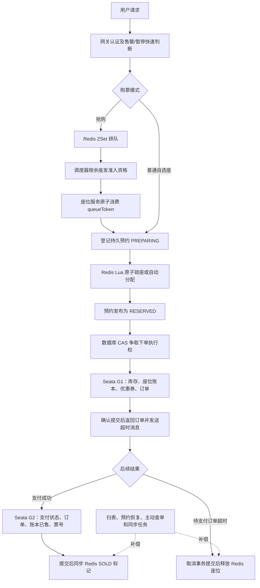
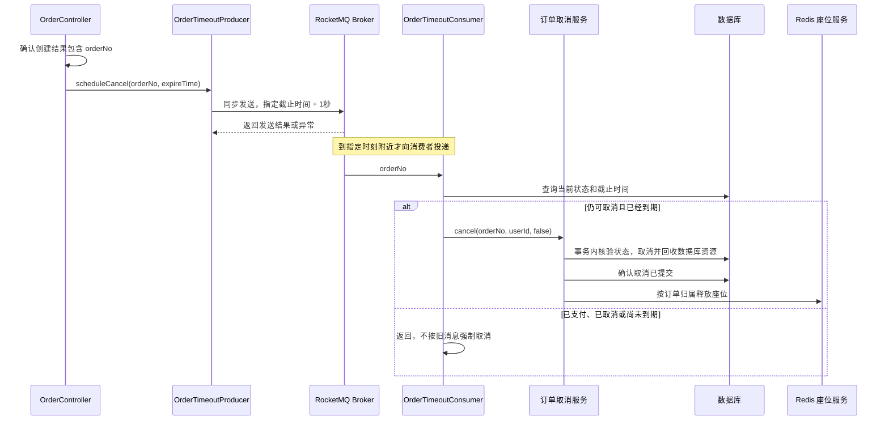

# 高并发购票实现与源码导读

本文依据 2026-10-24 的当前工作区源码，讲解项目如何处理抢票流量、座位竞争、重复下单、支付和超时回收。面向学习和面试，重点回答“代码在哪里、为什么这样写、解决了什么问题”。已有库运行这些改动前，需要按 [SQL 说明](sql/README.md) 完成迁移；本文描述的是源码实现，不表示已部署。

源码链接均相对于本文所在的 `docs/` 目录，带 `#L行号`；阅读器不支持行号跳转时，可打开文件搜索链接中给出的方法名。行号对应本文编写时的版本。

简历写法见 [项目亮点与简历描述](项目亮点与简历描述.md)。围绕核心难点可继续阅读三篇专题：[Redis 与数据库双层防超卖](亮点一-Redis与数据库双层防超卖.md)、[下单幂等与未决事务恢复](亮点二-下单幂等与未决事务恢复.md)、[RocketMQ 超时取消与支付回收协调](亮点三-RocketMQ超时取消与支付回收协调.md)。

## 1. 先理解整个购票链路

高并发购票需要同时做到两件事：让有限的服务资源承受住请求，并且在竞争、重试和故障下正确卖票。项目分别用排队准入、Redis 原子占座、数据库条件更新和事务协调处理这些问题。



这里的业务排队在 Redis 中完成。**当前实现没有把所有购票请求投进 RocketMQ 再异步创建订单**；下单仍由 HTTP 请求调用订单服务执行，RocketMQ 用于订单超时触发。

普通场次走自选座，抢购场次要求系统分配座位。两条路径最终都产生一个有截止时间的座位预约，再进入相同的下单与支付流程。

**主入口源码**：[SeatMapService.lockSeats()][seat-lock-java]、[SeatMapService.assignSeats()][seat-assign]、[OrderController.create()][order-controller]、[PaymentTxService.markPaid()][pay-tx]。

## 2. 三种 token 分别代表什么

| 名称 | 含义 | 不能据此推断什么 |
| --- | --- | --- |
| JWT | 用户登录身份，网关解析身份后传递给下游 | 登录成功不等于有抢票资格 |
| `queueToken` | 针对某场次、某用户的一次购票准入资格 | 拿到资格不等于有座位，更不等于已支付 |
| `lockToken` | 一次座位预约的稳定身份，后续也作为 `orderNo` | 锁座成功不等于订单已创建或票已售出 |

例如：用户先排队得到 `queueToken`，消费它后系统分配两个座位，返回 `lockToken`；用户再用这个 `lockToken` 创建订单。后续重试应查询或使用原身份，不能每次都生成新订单号来“防重复”。

**源码出处**：[JwtAuthFilter][jwt]、[QueueService.admit()][queue-admit-java]、[SeatMapService.assignSeats()][seat-assign]、[OrderService.createReserved()][order-create]。

## 3. 网关为什么能减轻下游压力

### 3.1 对售罄、暂停的场次快速返回

`RushGateFilter` 处理 `/api/seat/lock`、`/api/seat/assign`。它每约 1 秒从 Redis 的抢购注册表刷新一份本地 `rushState`，请求到来时先查本地 Map：

- 已售罄：直接返回业务错误。
- 已暂停：直接返回业务错误。
- 仍可继续：检查用户是否有该场次的准入 token，再决定是否转发。

这样，同一售罄场次的重复请求可以在网关结束，减少对座位服务的调用和这部分状态判断的 Redis 往返。JWT 认证等其他工作仍可能发生，不能把它理解成请求完全没有成本。

本地缓存也有代价：正常刷新期间，状态存在约一秒的更新延迟；刷新失败时保留旧快照，延迟可能更长。

### 3.2 为什么座位服务还要再校验一次

网关读取的是 URL 查询参数里的 `scheduleId`，由客户端提供，因此它只是提前过滤。座位服务按照实际请求中的场次、登录用户和 token 值进行消费核验，才是强制准入点。

**当前并未实现通用的网关 QPS 限流器。** 这里的资格控制也不是经典的“每秒补充固定数量令牌”的令牌桶算法。

**源码出处**：[RushGateFilter.filter()][gate-filter]、[refreshRushState()][gate-refresh]、[SeatMapService.spendQueueAdmission()][seat-admission]。

## 4. Redis 排队如何把请求分批放进来

### 4.1 用 ZSet 保存等待顺序

排队使用这些数据结构。表中的 `<id>` 表示实际编号，尖括号不是 Redis key 的组成部分。

| Key 示例 | 类型 | 内容和作用 |
| --- | --- | --- |
| `queue:wait:<scheduleId>` | ZSet | member 是用户 ID，score 是首次加入的毫秒时间 |
| `queue:inflight:<scheduleId>` | ZSet | 已放行、尚未消费的用户，score 是资格过期时间 |
| `queue:token:<scheduleId>:<userId>` | String | 准入 token 值，带 TTL |
| `rush:schedules` | Set | 需要调度的抢购场次 |

`QueueService.join()` 的核心代码是：

```java
redis.opsForZSet().addIfAbsent(waitKey, String.valueOf(userId),
        System.currentTimeMillis());
```

`addIfAbsent` 对应 `ZADD NX`：用户还在等待队列时，刷新或重复加入不会改变原来的 score，也不会给同一用户排出多个等待位置。前端通过 `position()` 查询排位或已放行的 token。

排序以毫秒时间为准，同一毫秒的不同用户会按 ZSet member 的字典序排序。因此这是按时间近似排序，不能宣传为严格的全局先来先服务，也没有保证“一人一生只能买一次”。

**源码出处**：[QueueService.join()][queue-join]、[position()][queue-position]、[CommonConstants 的 key 定义][constants-keys]。

### 4.2 根据余座计算这一轮放多少人

`AdmissionDispatcher` 默认每 200 毫秒调度一次，计算逻辑为：

```text
remaining = max(0, 总座位数 - Bitmap 中已占用位数)
target = ceil(remaining × admitFactor)
quota = min(maxBatch, max(0, target - inflight人数))
```

当前默认 `admitFactor=1.5`，`maxBatch=500`，准入 token 有效期 300 秒。以还剩 100 个座位、已有 120 个未消费资格为例，本轮计划再放 `150 - 120 = 30` 人。

为什么允许资格数多于座位数？部分用户拿到资格后会退出或不购买，适当多放人能减少空等。但这些人仍要竞争座位；资格数量也按“人”计算，用户每单购买的座位数可能不同，不能把资格数当成实际库存。

调度之前会清理已过期的 inflight 记录。售罄或暂停时停止继续放行。

**源码出处**：[AdmissionDispatcher.computeQuota()][dispatch-quota]、[dispatchOne()][dispatch-one]、[QueueService.remaining()][queue-remaining]、[配置文件][queue-config]、[QueueProperties][queue-properties]。

### 4.3 多个调度实例为什么不会按旧配额重复超发

只在 Java 里计算不够。假设两个实例同时读到 inflight=120，都认为还能再放 30 人，就可能合计放出 60 人。

因此 `queue_admit.lua` 在真正发资格前，重新读取共享的 inflight 数量：

```lua
local target = tonumber(ARGV[6])
quota = math.min(quota, math.max(0, target - redis.call('ZCARD', inflightKey)))
```

随后在同一个脚本里取出队首成员、移出等待队列、保存 token、加入 inflight。第二个脚本执行时能看到第一个脚本刚写入的数量。

这解决的是多实例共享准入额度的竞争，不需要给调度器额外套一把选主锁。但余座是脚本外读取的，资格会被并发消费，数据库也有后续工作，**它不是整个交易链路的严格并发上限**。

**源码出处**：[queue_admit.lua 配额复核][queue-admit-lua]、[QueueService.admit()][queue-admit-java]。

### 4.4 一次资格为什么只能消费一次

实际的核验和消费由 `queue_consume.lua` 一次完成：

```lua
if redis.call('GET', KEYS[1]) ~= ARGV[1] then return 0 end
redis.call('DEL', KEYS[1])
redis.call('ZREM', KEYS[2], ARGV[2])
return 1
```

两个请求同时携带同一 token 时，第一个核对并删除后，第二个只能失败。先比较完整 token 值，也能避免迟到的旧请求误删后来发给这个用户的新 token。

需要注意两个边界：

1. inflight 在**资格消费时**就删除，不会一直保留到下单或支付结束。因此它只统计尚未消费的资格。
2. 资格在锁座之前消费，后续分配失败不会自动返还原资格，通常需要重新排队。排队服务不可用时座位服务拒绝抢购请求。

**源码出处**：[queue_consume.lua][queue-consume]、[QueueService.consumeToken()][queue-consume-java]、[SeatMapService.spendQueueAdmission()][seat-admission]。

## 5. 场次缓存如何避免大量请求同时回源

排队要读取场次总座位数、抢购时间等信息。`QueueService.sessionOf()` 先查 Redis 场次缓存，缓存未命中时通过当前 JVM 的 `ConcurrentHashMap + CompletableFuture` 合并同场次请求：

```java
var existing = sessionLoads.putIfAbsent(scheduleId, loading);
if (existing != null) {
    return existing.join();
}
```

一个请求负责调用电影服务，其余请求等待同一个结果；争取加载权后还会再检查一次缓存，减少重复回源。读取失败后，对该场次短暂退避约 2 秒。场次缓存默认 60 秒。

这叫 single-flight，可以理解为“同一个实例里，相同数据同时只加载一份”。它没有合并不同服务实例之间的回源，也没有覆盖座位服务中的所有查询。售票规则仍会在锁座和数据库占库存阶段再次校验。

**源码出处**：[QueueService.sessionOf()][queue-session]、[QueueProperties][queue-properties]。

## 6. 两个人抢同一座位，Redis 如何仲裁

### 6.1 Bitmap 只表示是否不可选，归属还要另存

| Key 示例 | 类型 | 作用 |
| --- | --- | --- |
| `seat:map:<scheduleId>` | Bitmap | 一座一位，0 表示可选，1 表示已占用 |
| `seat:owner:<scheduleId>` | Hash | 座位索引 → `lockToken` 或 `SOLD:lockToken` |
| `seat:order:<lockToken>` | Set | 这个预约持有的座位索引 |
| `seat:delay:<scheduleId>` | ZSet | 预约 token → 固定过期时间 |
| `seat:active` | Set | 需要过期扫描的活跃场次 |
| `sold_out:<scheduleId>` | String | 位图已满的快速标志 |

例如，2000 个从 0 连续编号的座位，原始位数组只需约 250 字节；这不包含 Redis 对象、key、owner、订单集合等额外内存。

一个 bit 不能回答“这个座位属于谁、是否已支付”。所以还需要 owner、预约索引和数据库账本，不能只靠 Bitmap 做整个售票系统。

**源码出处**：[SeatBitmapService][bitmap-service]、[seat_lock.lua][seat-lock-lua]。

### 6.2 自选座：先检查全部座位，再全部写入

假设 A、B 同时要买座位 10。如果在 Java 中分别执行 `GETBIT` 和 `SETBIT`，就可能两人都读到 0，随后都报告锁座成功。

`seat_lock.lua` 把检查与写入放在同一个 Redis 脚本中。核心逻辑摘录如下：

```lua
-- 第一轮：有一个冲突就结束，此时还没写任何座位
for i = firstSeat, lastSeat do
    local seatIndex = tonumber(ARGV[i])
    if redis.call('GETBIT', mapKey, seatIndex) == 1 then
        return {0, seatIndex}
    end
end

-- 第二轮：全部通过后再写占用和归属
for i = firstSeat, lastSeat do
    local seatIndex = tonumber(ARGV[i])
    redis.call('SETBIT', mapKey, seatIndex, 1)
    redis.call('HSET', ownerKey, seatIndex, orderNo)
    redis.call('SADD', orderKey, seatIndex)
end
```

正常执行时，其他 Redis 命令无法插进这两轮之间：A 先成功，B 执行时就能看到占用，返回冲突。一次买两个座位时，也避免了“只拿到其中一个”的部分成功。

脚本还登记过期时间和活跃场次，并用 Redis `TIME` 拒绝截止时间已经过去的请求。这里的“锁座”是业务占用，核心靠 Lua 原子仲裁，不是给所有用户加一把 Redisson 全局互斥锁。

Lua 的原子性指执行不被其他命令插入，**不表示脚本运行错误会像 MySQL 事务一样自动撤销前面所有写入，也不覆盖 Redis 与 MySQL 之间的事务**。

**源码出处**：[seat_lock.lua 检查和写入][seat-lock-pass]、[SeatMapService.lockSeats()][seat-lock-java]、[SeatBitmapService][bitmap-service]。

### 6.3 抢购分配：Java 规划候选，Lua 决定最终取座

抢购用户选择票档、数量以及是否要求连座。`assignSeats()` 先根据票档取得座位布局，再用 `SeatRuns.plan()` 规划候选段。

连座同时要求同一排、列号连续、座位索引连续。这样不会把过道两侧或两排交界的座位误算成连座。

Java 规划只是告诉 Lua“到哪些区域找”，不能证明执行时座位仍为空闲。`seat_allocate.lua` 会重新读取位图，在找到足够数量后才统一写入。找不到完整连座时返回失败和搜索到的最长空闲连座长度；不要求相邻时可以跨候选段凑空座。

为了减少脚本内部逐个 `GETBIT` 的调用，分配脚本使用一次 `GETRANGE` 读取候选覆盖的字节区域，再在 Lua 内解析各个位。脚本仍会扫描座位，场馆越大、候选越多，执行时间越值得监测。

**源码出处**：[SeatMapService.assignSeats()][seat-assign]、[SeatRuns.plan()][seat-runs]、[seat_allocate.lua 位图读取][seat-allocate-read]、[seat_allocate.lua 写入][seat-allocate-write]。

## 7. 为什么 Redis 锁座后还要写持久预约

### 7.1 持久预约解决“锁座和下单之间”的协调

Redis 锁座成功后，用户可能还没有提交订单。若此时进程崩溃，或者下单响应超时，仅查看订单表不足以判断该不该释放座位。

当前流程是在 Redis 占座前写 `t_order_reservation` 的 `PREPARING` 记录，成功占座后再发布座位清单，使状态变为 `RESERVED`。记录中包含 token、用户、场次、座位和固定截止时间。

```text
PREPARING --成功发布座位--> RESERVED
RESERVED / RETRYABLE --获取执行权--> PROCESSING
PROCESSING --确认全局提交--> SUCCEEDED
PROCESSING --确认全局回滚--> RETRYABLE
PREPARING / RESERVED / RETRYABLE --到期或主动放弃--> CLOSED --> RELEASED
```

`PROCESSING` 记录还保存当前全局事务的 XID。这里的状态描述的是“创建订单的预约流程”，不是订单表里的支付状态。

锁座默认保留 15 分钟，截止时间在锁座阶段确定；下单重试沿用原截止时间，不能反复提交来无限续占。发布预约的响应丢失时也可能已登记成功，因此代码保留占用并交给查询和恢复流程处理。

**源码出处**：[SeatMapService.prepareHold()/publishHold()][hold-prepare]、[OrderCreationService.prepare()/publish()][reservation-prepare]、[预约表结构][reservation-schema]、[锁座时长配置][seat-config]。

### 7.2 重复下单：用稳定身份和条件更新争取执行权

两个请求用同一个 `lockToken` 同时提交时，不能只用“先查订单是否存在”来防重：两个请求可能都查到不存在。

真正的执行权由预约表条件更新决定。下列为 `claim()` 的 SQL 原文：

```sql
UPDATE t_order_reservation SET state='PROCESSING', xid=#{xid}, request_hash=#{hash}
WHERE token=#{token} AND state IN ('RESERVED','RETRYABLE') AND expires_at>#{now}
  AND (request_hash IS NULL OR request_hash=#{hash} OR (state='RETRYABLE' AND #{revise}=TRUE))
```

影响行数为 1 才能执行创建逻辑，另一个请求看到状态已经改变后只能查询原结果。这就是 CAS：更新时同时比较当前状态，满足预期才修改。

另外还有三层约束：

- token 绑定用户、场次和规范化的座位清单，不能拿别人的 token 下单。
- `request_hash` 绑定请求参数；只有明确回滚后的指定重试才能调整优惠券等受控参数。
- `lockToken` 直接作为 `orderNo`，订单号有唯一索引；同一请求重试复用原身份。

这就是下单幂等要解决的问题：**同一业务操作重试，不能产生多笔订单或重复扣库存**。每次重试都换一个新订单号，即使有唯一索引也无法识别它们是同一笔操作。

**源码出处**：[OrderCreationService.create()][reservation-create]、[OrderReservationMapper.claim()][reservation-claim]、[OrderService.createReserved()][order-create]、[订单唯一键][order-unique]。

### 7.3 下单超时为什么不能直接放座

网络超时可能有两种情况：服务器确实失败，或者服务器已经成功、只是响应丢失。如果一律释放座位，后一种情况就可能让已经有订单的座位再次被别人抢走。

当前处理方式是：

1. 在全局事务之外，独立提交 `PROCESSING + XID`，保留本次执行事实。
2. 执行 G1，并向 Seata TC 请求提交。
3. 明确提交才变成 `SUCCEEDED`；明确回滚才变成 `RETRYABLE`。
4. 提交响应超时、TC 不可用或状态未决时，保留 `PROCESSING` 和座位，查询原请求；清扫不能接管释放。
5. 后续查询或预约恢复任务继续核对 TC。请求过期也不能替代事务结果核验。

`outside()` 会临时解绑 XID，并要求没有 Spring 本地事务，让预约协调记录独立提交，不随业务分支回滚而消失。完成状态更新还会匹配 XID，避免旧尝试覆盖新尝试。

这不是“所有失败永远保留座位”：确认回滚后可以在原期限内重试；到期且已安全关闭的预约可以释放。长期未决则需要监控和人工处理。

**源码出处**：[OrderCreationService.create()][reservation-create]、[reconcile()][reservation-reconcile]、[outside()][reservation-outside]、[CreationTransactions][creation-transactions]、[OrderController.creationStatus()][order-query]。

## 8. 数据库怎样承担最终防超卖

Redis 可能故障、淘汰数据或在主从切换时丢失部分写入，程序也可能存在错误。因此数据库在正式下单时仍要独立拒绝不合法占用。

### 8.1 总量条件：不能超过场次容量

`SessionMapper.occupySeats()` 在一条 SQL 里同时检查库存和增加锁定数。下面是便于理解的节选，省略了开售时间、场次状态等其他条件：

```sql
UPDATE t_event_session
SET locked_seat = locked_seat + #{count}, update_time = NOW(3)
WHERE id = #{sessionId}
  AND locked_seat + sold_seat + #{count} <= total_seat
```

假设只剩 1 张票，两个订单各买 1 张。InnoDB 对这行的修改会串行执行，先成功的请求增加 `locked_seat` 后，后来的请求不再满足条件，影响行数为 0。

调用方必须检查影响行数，0 表示没有获得库存，不能继续报告下单成功。先 SELECT、在 Java 中判断、再无条件 UPDATE，会留下并发窗口。

**源码出处**：[SessionMapper.occupySeats()][stock-occupy]、[MovieInternalController.occupy()][movie-occupy]。

### 8.2 单座条件：同一座位不能属于两个订单

总量不超卖还不够：一场 100 座，两笔订单同时拿同一张椅子，即使总共只卖了 2 张，也已经错了。

`t_event_session_seat` 保存逐座位账本。状态为 `0=可售、1=锁定、2=已售`。`SessionSeatMapper.lockSeats()` 仅更新 `status=0` 的目标座位，并写入 `lock_order_no`。

请求锁 2 个座位时，调用方要求影响行数恰好为 2，否则抛异常，由事务回滚已经执行的数据库分支。支付出票时则要求 `status=1 AND lock_order_no=当前订单号`，防止使用已失效的旧订单占用别人的座位。

`(session_id, seat_id)` 和 `(session_id, seat_index)` 的唯一键保证账本没有重复座位行；**防止同一现有座位被并发占用，主要靠状态条件更新及事务，不能只归功于唯一索引**。

**源码出处**：[SessionSeatMapper.lockSeats()][ledger-lock]、[markSold()][ledger-sold]、[MovieInternalController.occupy()][movie-occupy]、[座位账本唯一键][ledger-unique]。

### 8.3 Seata 协调哪些数据，Redis 又在哪里

`OrderCreationService` 开启 G1，`OrderService.createReserved()` 执行创建逻辑，涉及：场次库存与座位账本、可选的优惠券锁定、订单主表和明细。远端返回的 `R` 也要检查业务成功标记，HTTP 200 不代表占库存成功。

Spring 本地事务处理本服务的数据库操作；Seata AT 协调参与的数据库分支。它们都不会自动回滚 Redis，也不会把外部支付渠道的收款撤销。

项目因此保留独立预约，在确认数据库结果后推进后续动作；Redis 的已售确认与释放采用提交后的同步及补偿。需要同时理解“事务范围”和“哪些动作在事务之外”，不能简单说“加了事务注解就全部一致”。

场次库存集中更新同一行，热点场次会有数据库行锁竞争。排队能减少集中到达量，不能消除这个瓶颈，也不能使吞吐无限增加。

**源码出处**：[CreationTransactions.begin()][creation-transactions]、[OrderService.createReserved()][order-create]、[OrderService.requireOk()][order-require-ok]。

## 9. 支付成功怎样防止重复处理和重复出票

### 9.1 支付也需要稳定身份

用户连续点击支付，或者调用渠道时响应丢失，不能每次创建新的支付身份。

`PaymentIntentService.getOrCreate()` 使用独立的 `REQUIRES_NEW` 事务，先持久化支付意图。支付表的 `order_no` 有唯一约束，并发请求最终复用该订单已有的 `paymentNo`，再用它调用或查询渠道。

创建支付时读取后端订单快照，核对归属、订单实付金额、状态和截止时间。金额以这笔订单为准，不能拿当前可能已修改的票档价格，也不能相信前端传来的金额。

**源码出处**：[PaymentIntentService.getOrCreate()][payment-intent]、[PaymentService.createForOrder()][payment-create]、[支付表唯一约束][payment-unique]。

### 9.2 回调竞争由行锁、状态条件和全局事务协调

`PaymentTxService.markPaid()` 的主要步骤是：

1. 对支付记录 `SELECT ... FOR UPDATE`，核对通知的验签结果、订单号、渠道交易号和金额。
2. 已成功的支付重复到达时返回，不重复推进出票。
3. 核验订单权威快照，使用 `casPaySuccess()` 将支付状态改为成功。
4. 推进订单已支付、座位账本已售，并生成订单明细票号；这些数据库动作由 G2 协调。
5. 全局事务提交确认后，再同步 Redis 的已售标记；失败可以继续补偿。

支付表和订单表的状态数字含义不同。例如支付表的成功是 `1`，订单表的已支付是 `2`。阅读 SQL 时不能混用。

当前支付 CAS 允许支付表的 `0/2` 转为成功，其中 `2` 是支付失败；这样合法的后续成功通知不会被早到的失败通知永久阻挡。反过来，失败通知不能覆盖已经成功的记录。回调日志用于审计，不能仅因“相同交易号已有日志”就跳过后续合法状态变化。

票号写在已有订单明细中，已经有票号的明细会跳过。正常支付入口先由支付记录行锁和状态幂等保护，再执行出票；不要把明细中“先判断 ticketNo 非空”单独当成任意并发入口下完整的防重方案。

**源码出处**：[PaymentTxService.markPaid()/requireBound()][pay-tx]、[PaymentMapper.casPaySuccess()][payment-cas]、[OrderService.markPaid()][order-paid]、[OrderStateMachine.markPaid()][state-paid]、[OrderInternalController.issueTickets()][issue-tickets]。

### 9.3 回调丢了或数据库已提交、Redis 同步失败怎么办

- `PaymentReconcileJob` 主动查询原 `paymentNo`。过期且渠道仍为待支付时尝试渠道关单；未知结果保持未决，明确成功再推进本地支付流程，明确关闭才关本地支付。
- `SeatSyncJob` 根据持久化的 `seat_synced/seat_released` 标记补同步。只有远端明确成功才标记完成；失败继续留待重试。
- Redis 确认已售时保留 Bitmap 的 1，将 owner 标记为 `SOLD:订单号`，并移出待超时索引。已售依然不可选，因此不能把 bit 清成 0。

这些任务默认约 10 秒运行一轮，部分记录还要至少 30 秒未更新才被处理，所以恢复存在延迟。

**源码出处**：[PaymentReconcileJob.reconcile()][pay-reconcile]、[SeatSyncJob.synchronizeSeats()][seat-sync]、[OrderService.confirmSeatHold()][order-confirm]、[seat_confirm.lua][seat-confirm-lua]。

## 10. 超时订单怎样回收，为什么不能只依赖 TTL

### 10.1 RocketMQ 负责较及时的超时触发

#### 10.1.1 RocketMQ 在本项目中解决什么问题

用户锁座后不付款，座位就需要在截止后回收，否则其他用户一直买不到。仅靠默认每 60 秒执行一次的扫表，刚错过一轮扫描的订单就要多等接近一轮；任务积压时还会更久。RocketMQ 定时消息为每笔订单安排一次到期检查，让正常情况下的回收更及时。

例如：用户 12:00 锁座，截止时间为 12:15；系统创建订单后，安排一条 12:15:01 投递的消息。消息到达时再判断订单是否仍待支付，而不是在发送时就决定一定取消。

| 机制 | 当前承担的职责 |
| --- | --- |
| Redis ZSet 排队和准入脚本 | 决定哪些抢购用户可以进入锁座流程 |
| Redis Bitmap、Lua 与数据库条件更新 | 仲裁座位竞争，防止重复占用和超卖 |
| RocketMQ 定时消息 | 在订单到期附近触发一次取消检查 |
| 定时扫表、预约恢复和座位扫描 | 补处理没有收到消息、未决或尚未回收的记录 |

因此，面试时应说“RocketMQ 用于超时订单的异步触发和解耦”。当前购票入口的流量削减主要由 Redis 排队准入承担；源码没有使用 RocketMQ 消息队列承接全部购票请求并异步建单。

#### 10.1.2 一条超时消息怎样走完整条链路



**发送入口**在 `OrderController.create()`：调用预约创建服务后，只有结果包含 `orderNo` 才安排消息。`creationStatus()` 查询到成功结果时也会安排消息，因此同一订单可能发送多次。

**消息内容**只有订单号；生产者同时把它设置为消息的 `KEYS`，便于按订单号查消息。主题默认 `maipiao-order-timeout`，消费组默认 `maipiao-order-timeout-consumer`。

**源码出处**：[OrderController.create()/creationStatus()][order-controller]、[OrderTimeoutProducer.scheduleCancel()][timeout-producer]、[OrderTimeoutConsumer.onMessage()][timeout-consumer]。

#### 10.1.3 生产者怎样安排定时投递

生产者使用 RocketMQ 5 的定时消息 API，核心代码摘录为：

```java
long deliverAt = expireTime.atZone(ZoneId.systemDefault()).toInstant().toEpochMilli()
        + SAFETY_MARGIN_MS;
Message<String> message = MessageBuilder.withPayload(orderNo)
        .setHeader(RocketMQHeaders.KEYS, orderNo)
        .build();
rocketMQTemplate.syncSendDeliverTimeMills(topic, message, deliverAt);
```

`SAFETY_MARGIN_MS` 为 1000，所以 `deliverAt` 是订单原截止时间加 1 秒。它使用原始截止时间，用户晚几分钟才创建订单也不会重新获得完整的 15 分钟。

`syncSendDeliverTimeMills()` 中的“同步”表示当前线程等待发送结果，**不表示当前线程等到 15 分钟后才返回**。消息保存后，由 Broker 在目标时刻附近投递。

这里没有使用经典的 `delayLevel` 固定档位：项目保留的档位表有 10 分钟和 20 分钟，没有正好 15 分钟，因此源码采用指定绝对时间的 API。1 秒余量只是减少时钟偏差导致的提前检查，不能保证准点完成取消；Broker 定时能力、消费积压和业务处理都需要验证。

当前订单服务配置发送超时为 5000 毫秒、同步发送失败重试次数为 2；依赖为 RocketMQ Spring Boot Starter 2.3.1、客户端 5.3.1，Docker 中声明的 Broker 也是 5.3.1。配置和调用存在不等于已验证部署环境的定时投递可用。

**源码出处**：[生产者发送实现][timeout-producer]、[订单服务 RocketMQ 配置][mq-config]、[依赖版本配置][mq-dependencies]、[Docker Broker 配置][mq-compose]、[Broker 配置文件][mq-broker-config]。

#### 10.1.4 消费者为什么必须查库，怎样处理重复消息

`OrderTimeoutConsumer` 实现 `RocketMQListener<String>`，收到订单号后按以下顺序处理：

1. 查不到订单：记录日志并返回。
2. 状态不属于 `OrderStatus.CANCELLABLE`：直接返回；当前只包含待支付状态 `0`。
3. 截止时间尚未到达：记录日志并返回，留待扫表处理，不提前剥夺支付时间。
4. 符合条件：调用 `orderService.cancel(orderNo, order.getUserId(), false)`，进入统一系统取消入口。

消息发送后用户可能已经支付，所以消息只代表“到时间检查一下”，数据库当前状态才决定业务动作。预查之后仍可能有并发变化，最终还要依靠取消服务中的行锁、状态条件和事务仲裁。

重复消息可能来自生产者发送重试、重复查询创建结果，也可能来自消费失败后的重投。消息 `KEYS=orderNo` 主要用于检索，**不会自动替业务去重**。当前取消幂等靠状态条件更新、账本归属条件，以及提交后按 owner 释放 Redis。已经取消的订单还可以幂等补回收，不能只理解成“重复消息全都丢弃”。

消费者没有把执行异常统一吞掉；异常可以交给客户端的重试机制处理。正常返回的提前消息或未知订单则不会由这段代码主动重新安排。重试耗尽、死信、积压告警和人工重放需要另行监控，不能把重投当作无限保证。

**源码出处**：[OrderTimeoutConsumer.onMessage()][timeout-consumer]、[OrderService.cancel()][order-cancel-entry]、[OrderCancellationService.cancel()][order-cancel]、[OrderStatus.CANCELLABLE][order-status]、[seat_release.lua][seat-release-lua]。

#### 10.1.5 发消息失败、服务崩溃时怎么办

| 故障或竞争 | 当前处理 |
| --- | --- |
| 订单成功后，Broker 不可用 | 生产者捕获发送异常、记录日志，保留订单成功结果，由扫表回收过期订单 |
| 订单提交后、发送前进程崩溃 | 此路径没有持久消息投递记录，由订单扫表兜底 |
| Broker 已接收，但发送响应丢失 | 重试可能形成重复消息，由业务取消幂等处理 |
| 消费时数据库或远端服务抛异常 | 消费失败可触发重投；扫表继续提供另一条触发路径 |
| 用户已支付，旧消息才到达 | 查当前状态，符合支付结果的订单不再按超时取消 |
| 取消已提交，Redis 释放失败 | 保留可恢复信息，由座位扫描和预约恢复继续处理 |

消息安排在确认创建成功之后，因为 Seata AT 的分支本地提交不等于全局事务已经提交。仅在 Spring 本地事务的 `afterCommit` 中发消息，不能证明跨服务的 G1 已完成。

当前方案也没有实现“订单和超时消息严格一起成功”：它选择提交后发送，再用数据库扫描补漏。若要加强消息投递本身的可恢复性，可以设计持久待投递记录及重试；采用 RocketMQ 事务消息时，也必须正确核对 Seata 全局结果，不能只看订单行暂时存在就确认消息。

退款章节提到的 outbox，目前由 `RefundRequestDispatcher` 定时调用支付服务投递退款申请；它与这里的 RocketMQ 超时消息是两条不同实现，不能因为 Broker 配置里写了事务回查参数，就说项目已经接入了事务消息。

**源码出处**：[生产者异常处理][timeout-producer]、[创建结果入口][order-controller]、[OrderTimeoutJob][timeout-job]、[OrderService.cancel()][order-cancel-entry]、[RefundRequestDispatcher][refund-dispatch]。

#### 10.1.6 为什么这里选择 RocketMQ，而不是 Kafka

从当前代码可以说明的直接理由是：**订单到期检查需要按指定时间投递，RocketMQ 5 提供了对应 API，当前项目已经围绕它接入生产者和消费者。** 不能仅凭源码推断作者所有选型动机，也没有两个产品在本项目下的性能对比数据。

Kafka 也可以承担业务消息，但若采用常规 Topic 和消费者，需要额外设计到期调度、延迟主题或借助外部调度设施，避免消费者为一条未来消息长时间阻塞分区。在当前超时取消需求下，RocketMQ 的定时消息减少了这部分自建逻辑。

这不意味着 Kafka 无法保证可靠性，也不意味着 RocketMQ 天然保证不重复。选型要看需要的投递方式、团队运维能力和已有基础设施。这里两者都不能代替数据库防超卖、支付幂等和取消状态协调。

面试可以这样回答：

> 我用 RocketMQ 5 的定时消息处理未支付订单超时。确认订单创建成功后，按原锁座截止时间加一秒安排消息，载荷只放订单号；消费时重新查库，再走统一取消事务和座位回收。消息可能重复或发送失败，所以取消必须幂等，并保留定时扫表兜底。这里选择 RocketMQ，主要是它的定时投递直接适合这个需求；抢购入口的排队准入由 Redis 实现。

### 10.2 定时扫表和 Redis 预约扫描一起兜底

| 任务 | 默认调度间隔 | 查什么、做什么 |
| --- | --- | --- |
| `OrderTimeoutJob.cancelExpiredOrders()` | 60 秒 | 分批查询已过期且订单状态为 0 的订单，执行取消 |
| `SeatExpiryJob.releaseExpiredHolds()` | 30 秒 | 从活跃场次的 delay ZSet 找过期 token，先请预约服务确认可关闭，再释放 Redis |
| `OrderCreationService.recover()` | 30 秒 | 恢复未决创建结果、到期预约和已关闭但尚未释放的记录 |

订单扫表按 `status、lock_expire_time` 的索引和 LIMIT 分批读取；不能每轮无界读取所有历史订单。相关超时扫描使用 Spring `@Scheduled`，订单与座位清扫还通过 ShedLock 减少多实例重复执行。业务自身的条件更新仍不可省，调度锁不能代替幂等。

扫描周期不是回收延迟的绝对上限：任务积压、服务故障和事务结果未知都可能使回收更晚。

**源码出处**：[OrderTimeoutJob][timeout-job]、[OrderMapper.selectExpired()][order-expired]、[订单扫描索引][order-expire-index]、[SeatExpiryJob][seat-expiry]、[OrderCreationService.recover()][reservation-recover]。

### 10.3 支付和取消同时发生，不能各自先读后改

关键是让状态判断落在更新条件和事务保护里：支付只接受订单的待支付/支付中状态，超时取消当前只接受待支付状态。取消事务还要回收数据库账本、库存和优惠券，确认取消已提交之后才允许释放 Redis。

清扫发现预约仍为 `PROCESSING`，或者查不到可靠的事务结果，就保留座位等下一轮。服务调用异常不能解释为“没有订单”。

当前还有明确边界：`PAYING=1` 的完整渠道查单/关单与取消协议尚未完成；对于已经取消订单的迟到收款，支付侧建立仅退款、不释放座位的退款意图。它避免重复出票或释放新买家的座位，但用户仍可能经历先扣款再退款。

**源码出处**：[OrderStatus.CANCELLABLE][order-status]、[OrderCancellationService.cancel()][order-cancel]、[OrderService.cancel()][order-cancel-entry]、[OrderCreationService.close()][reservation-close]、[PaymentTxService.markPaid()][pay-tx]。

### 10.4 为什么不直接给整个 Bitmap 设置 15 分钟 TTL

一场有很多订单，它们的锁座截止时间不同，Bitmap 中还有已支付座位。整个 key 到期会同时抹掉所有这些信息。

项目用 `seat:delay:<scheduleId>` 按 token 保存各自的过期时间，经过预约和订单状态确认后逐单回收。未决预约的 `seat:order` 索引也不会仅因固定两小时 TTL 就自动消失；已售确认后，订单座位索引才设置较长保留期。

**源码出处**：[seat_lock.lua 过期索引登记][seat-delay]、[SeatExpiryJob][seat-expiry]、[seat_confirm.lua][seat-confirm-lua]。

## 11. 迟到的释放任务为什么不能释放别人的座位

考虑这个顺序：A 的预约已被正常关闭并释放，B 随后抢到了相同座位，最后 A 的旧释放请求才因重试又到达。

如果只按座位号清 bit，就会把 B 的占用清掉。`seat_release.lua` 因此读取 owner，只清理当前仍属于请求订单的座位：

```lua
local mine  = owner == orderNo
local wasMine = includeSold and owner == ('SOLD:' .. orderNo)

if mine or wasMine or (force and not owner) then
    redis.call('SETBIT', mapKey, seatIndex, 0)
    redis.call('HDEL', ownerKey, seatIndex)
    released = released + 1
end
```

普通取消不传 `includeSold`，因此也不能清掉 `SOLD:订单号`；正常退款才显式允许释放本订单已售座位。`force` 是修复用途，正常流程不应启用。

数据库同样使用 `status + lock_order_no/sold_order_no` 的条件释放，并按照本次实际释放的账本座位数回收计数。重复释放没有匹配座位时不应再次扣减计数，不能仅用“库存不减到负数”来代替业务幂等。

**源码出处**：[seat_release.lua][seat-release-lua]、[SessionSeatMapper.releaseLockedSeats()][ledger-release-lock]、[releaseSoldSeats()][ledger-release-sold]、[MovieInternalController.release()][movie-release]。

退款申请本身还使用 outbox：订单进入 `REFUNDING` 与退款投递记录在同一本地事务落库，后续按原订单号持续投递；支付侧先保存稳定的退款号。这样网络超时后继续核对原退款，而不是换一个退款号再次退钱。

**源码出处**：[OrderRefundService.startRefund()][refund-start]、[RefundRequestDispatcher][refund-dispatch]、[RefundIntentService][refund-intent]。

## 12. 当前实现的边界，面试时要如实说明

| 已有实现 | 还需要完成或验证的部分 |
| --- | --- |
| Redis 排队、分批准入、资格原子消费 | 通用 QPS 限流、队列容量上限、熔断和资源隔离 |
| Lua 原子占座、数据库总量与单座条件更新 | 大场馆脚本耗时、热点库存行竞争、完整交易容量 |
| 预约 CAS、稳定身份、Seata 结果核对 | 长期未决告警、人工恢复和操作审计 |
| 冷位图从数据库占用账本补种 | Redis 整体丢失后的完整预约恢复与恢复期间闸门 |
| 多 key Lua 协调 | Redis Cluster 同槽 key 设计与集群恢复演练 |
| 每单购票数量限制 | 用户或实名证件跨订单累计限购、防刷 |
| 支付查单、迟到收款退款、Redis 补偿 | 支付中订单完整关单/取消协调、真实渠道沙箱验证 |

尤其要注意：当前冷位图补种是合并写入已知占用，不能覆盖所有“尚未正式建单但已预约”的恢复情况。不能据此声称 Redis 全量丢失后可以自动无损恢复交易。

容量也需要区分路径：[压测报告](压测报告.md) 中约 22k req/s 对应历史售罄拒绝路径，不能说成每秒成交 2.2 万单。分配锁座成功也不等于完整支付成交。已有正确性测试可以作为逻辑验证依据，不能替代完整交易压测。

**源码与现状依据**：[SeatMapService.loadOccupiedIndexes()/seedFromLedger()][bitmap-seed]、[第二轮优化实施记录](第二轮优化实施记录.md)。

## 13. 推荐的源码阅读顺序与面试表达

建议先读一条成功链路，再读异常恢复，不必从所有配置和工具类开始：

1. [AdmissionDispatcher][dispatch-quota] → [queue_admit.lua][queue-admit-lua]：谁被放行、放多少。
2. [SeatMapService.assignSeats()][seat-assign] → [seat_allocate.lua][seat-allocate-read]：资格消费、预约、原子分配。
3. [OrderCreationService.create()][reservation-create] → [OrderReservationMapper.claim()][reservation-claim]：重复请求如何争取执行权。
4. [OrderService.createReserved()][order-create] → [MovieInternalController.occupy()][movie-occupy] → [SessionMapper][stock-occupy] / [SessionSeatMapper][ledger-lock]：数据库如何最终拒绝超卖。
5. [PaymentTxService.markPaid()][pay-tx] → [OrderService.markPaid()][order-paid]：支付与出票怎样推进。
6. [OrderTimeoutConsumer][timeout-consumer] → [OrderCancellationService][order-cancel] → [SeatExpiryJob][seat-expiry] → [seat_release.lua][seat-release-lua]：超时与重复释放怎样处理。
7. [OrderCreationService.recover()][reservation-recover]、[PaymentReconcileJob][pay-reconcile]、[SeatSyncJob][seat-sync]：故障后怎样继续收敛。

面试时可以这样介绍，再根据追问展开源码：

> 我的项目通过分层控制处理抢票。网关缓存售罄和暂停状态，提前拒绝部分无效请求；抢购用户在 Redis ZSet 排队，调度器根据余座和未消费资格分批放行，Lua 保证多实例发资格和消费资格的原子性。拿到资格后，用 Bitmap 和 Lua 原子分配座位，数据库再通过带状态、归属和库存条件的 UPDATE 防止超卖。下单采用持久预约、稳定订单号和 CAS 控制重复执行，Seata 协调数据库分支；结果未知时保留原预约并查询事务结果。支付通过稳定支付号、状态条件和事务防重，超时用 RocketMQ 定时消息触发并由扫描任务兜底，Redis 同步失败则通过持久标记继续补偿。目前还需要完善通用限流、Redis 全量恢复以及完整交易压测。

理解这些实现后，可以用三个问题检查自己是否真正掌握：两个人抢同一座位，哪一行代码决定谁成功；同一请求超时重试，哪一个身份保持不变；一个旧取消任务迟到，哪个归属条件阻止它清掉新买家的座位。

<!-- source-references -->

[seat-lock-java]: ../maipiao-service/maipiao-seat/src/main/java/com/maipiao/seat/service/SeatMapService.java#L209
[seat-assign]: ../maipiao-service/maipiao-seat/src/main/java/com/maipiao/seat/service/SeatMapService.java#L272
[order-controller]: ../maipiao-service/maipiao-order/src/main/java/com/maipiao/order/controller/OrderController.java#L50
[pay-tx]: ../maipiao-service/maipiao-pay/src/main/java/com/maipiao/pay/service/PaymentTxService.java#L30
[jwt]: ../maipiao-gateway/src/main/java/com/maipiao/gateway/filter/JwtAuthFilter.java#L54
[queue-admit-java]: ../maipiao-service/maipiao-queue/src/main/java/com/maipiao/queue/service/QueueService.java#L187
[order-create]: ../maipiao-service/maipiao-order/src/main/java/com/maipiao/order/service/OrderService.java#L57
[gate-filter]: ../maipiao-gateway/src/main/java/com/maipiao/gateway/filter/RushGateFilter.java#L76
[gate-refresh]: ../maipiao-gateway/src/main/java/com/maipiao/gateway/filter/RushGateFilter.java#L151
[seat-admission]: ../maipiao-service/maipiao-seat/src/main/java/com/maipiao/seat/service/SeatMapService.java#L356
[queue-join]: ../maipiao-service/maipiao-queue/src/main/java/com/maipiao/queue/service/QueueService.java#L77
[queue-position]: ../maipiao-service/maipiao-queue/src/main/java/com/maipiao/queue/service/QueueService.java#L113
[constants-keys]: ../maipiao-common/common-core/src/main/java/com/maipiao/common/core/constant/CommonConstants.java#L55
[dispatch-quota]: ../maipiao-service/maipiao-queue/src/main/java/com/maipiao/queue/service/AdmissionDispatcher.java#L45
[dispatch-one]: ../maipiao-service/maipiao-queue/src/main/java/com/maipiao/queue/service/AdmissionDispatcher.java#L79
[queue-remaining]: ../maipiao-service/maipiao-queue/src/main/java/com/maipiao/queue/service/QueueService.java#L305
[queue-config]: ../maipiao-service/maipiao-queue/src/main/resources/application.yml#L58
[queue-properties]: ../maipiao-service/maipiao-queue/src/main/java/com/maipiao/queue/config/QueueProperties.java#L17
[queue-admit-lua]: ../maipiao-service/maipiao-queue/src/main/resources/lua/queue_admit.lua#L43
[queue-consume]: ../maipiao-service/maipiao-queue/src/main/resources/lua/queue_consume.lua#L3
[queue-consume-java]: ../maipiao-service/maipiao-queue/src/main/java/com/maipiao/queue/service/QueueService.java#L260
[queue-session]: ../maipiao-service/maipiao-queue/src/main/java/com/maipiao/queue/service/QueueService.java#L336
[bitmap-service]: ../maipiao-service/maipiao-seat/src/main/java/com/maipiao/seat/service/SeatBitmapService.java#L31
[seat-lock-lua]: ../maipiao-service/maipiao-seat/src/main/resources/lua/seat_lock.lua#L27
[seat-lock-pass]: ../maipiao-service/maipiao-seat/src/main/resources/lua/seat_lock.lua#L56
[seat-runs]: ../maipiao-service/maipiao-seat/src/main/java/com/maipiao/seat/service/SeatRuns.java#L49
[seat-allocate-read]: ../maipiao-service/maipiao-seat/src/main/resources/lua/seat_allocate.lua#L92
[seat-allocate-write]: ../maipiao-service/maipiao-seat/src/main/resources/lua/seat_allocate.lua#L162
[hold-prepare]: ../maipiao-service/maipiao-seat/src/main/java/com/maipiao/seat/service/SeatMapService.java#L442
[reservation-prepare]: ../maipiao-service/maipiao-order/src/main/java/com/maipiao/order/service/OrderCreationService.java#L47
[reservation-schema]: ../docs/sql/schema/07_order_reservation.sql#L3
[seat-config]: ../maipiao-service/maipiao-seat/src/main/resources/application.yml#L70
[reservation-create]: ../maipiao-service/maipiao-order/src/main/java/com/maipiao/order/service/OrderCreationService.java#L92
[reservation-claim]: ../maipiao-service/maipiao-order/src/main/java/com/maipiao/order/mapper/OrderReservationMapper.java#L28
[order-unique]: ../docs/sql/schema/02_order.sql#L70
[reservation-reconcile]: ../maipiao-service/maipiao-order/src/main/java/com/maipiao/order/service/OrderCreationService.java#L230
[reservation-outside]: ../maipiao-service/maipiao-order/src/main/java/com/maipiao/order/service/OrderCreationService.java#L296
[creation-transactions]: ../maipiao-service/maipiao-order/src/main/java/com/maipiao/order/service/CreationTransactions.java#L11
[order-query]: ../maipiao-service/maipiao-order/src/main/java/com/maipiao/order/controller/OrderController.java#L57
[stock-occupy]: ../maipiao-service/maipiao-movie/src/main/java/com/maipiao/movie/mapper/SessionMapper.java#L100
[movie-occupy]: ../maipiao-service/maipiao-movie/src/main/java/com/maipiao/movie/controller/MovieInternalController.java#L54
[ledger-lock]: ../maipiao-service/maipiao-movie/src/main/java/com/maipiao/movie/mapper/SessionSeatMapper.java#L65
[ledger-sold]: ../maipiao-service/maipiao-movie/src/main/java/com/maipiao/movie/mapper/SessionSeatMapper.java#L95
[ledger-unique]: ../docs/sql/schema/04_event.sql#L217
[order-require-ok]: ../maipiao-service/maipiao-order/src/main/java/com/maipiao/order/service/OrderService.java#L422
[payment-intent]: ../maipiao-service/maipiao-pay/src/main/java/com/maipiao/pay/service/PaymentIntentService.java#L21
[payment-create]: ../maipiao-service/maipiao-pay/src/main/java/com/maipiao/pay/service/PaymentService.java#L62
[payment-unique]: ../docs/sql/schema/03_pay.sql#L60
[payment-cas]: ../maipiao-service/maipiao-pay/src/main/java/com/maipiao/pay/mapper/PaymentMapper.java#L88
[order-paid]: ../maipiao-service/maipiao-order/src/main/java/com/maipiao/order/service/OrderService.java#L201
[state-paid]: ../maipiao-service/maipiao-order/src/main/java/com/maipiao/order/service/OrderStateMachine.java#L52
[issue-tickets]: ../maipiao-service/maipiao-order/src/main/java/com/maipiao/order/controller/OrderInternalController.java#L102
[pay-reconcile]: ../maipiao-service/maipiao-pay/src/main/java/com/maipiao/pay/job/PaymentReconcileJob.java#L25
[seat-sync]: ../maipiao-service/maipiao-pay/src/main/java/com/maipiao/pay/job/SeatSyncJob.java#L25
[order-confirm]: ../maipiao-service/maipiao-order/src/main/java/com/maipiao/order/service/OrderService.java#L230
[seat-confirm-lua]: ../maipiao-service/maipiao-seat/src/main/resources/lua/seat_confirm.lua#L20
[timeout-producer]: ../maipiao-service/maipiao-order/src/main/java/com/maipiao/order/mq/OrderTimeoutProducer.java#L81
[mq-config]: ../maipiao-service/maipiao-order/src/main/resources/application.yml#L54
[mq-dependencies]: ../pom.xml#L127
[mq-compose]: ../docker/docker-compose.yml#L168
[mq-broker-config]: ../docker/config/rocketmq/broker.conf#L2
[timeout-consumer]: ../maipiao-service/maipiao-order/src/main/java/com/maipiao/order/mq/OrderTimeoutConsumer.java#L56
[timeout-job]: ../maipiao-service/maipiao-order/src/main/java/com/maipiao/order/job/OrderTimeoutJob.java#L62
[order-expired]: ../maipiao-service/maipiao-order/src/main/java/com/maipiao/order/mapper/OrderMapper.java#L103
[order-expire-index]: ../docs/sql/schema/02_order.sql#L72
[seat-expiry]: ../maipiao-service/maipiao-seat/src/main/java/com/maipiao/seat/job/SeatExpiryJob.java#L75
[reservation-recover]: ../maipiao-service/maipiao-order/src/main/java/com/maipiao/order/service/OrderCreationService.java#L241
[order-status]: ../maipiao-service/maipiao-order/src/main/java/com/maipiao/order/entity/OrderStatus.java#L53
[order-cancel]: ../maipiao-service/maipiao-order/src/main/java/com/maipiao/order/service/OrderCancellationService.java#L28
[order-cancel-entry]: ../maipiao-service/maipiao-order/src/main/java/com/maipiao/order/service/OrderService.java#L128
[reservation-close]: ../maipiao-service/maipiao-order/src/main/java/com/maipiao/order/service/OrderCreationService.java#L189
[seat-delay]: ../maipiao-service/maipiao-seat/src/main/resources/lua/seat_lock.lua#L75
[seat-release-lua]: ../maipiao-service/maipiao-seat/src/main/resources/lua/seat_release.lua#L58
[ledger-release-lock]: ../maipiao-service/maipiao-movie/src/main/java/com/maipiao/movie/mapper/SessionSeatMapper.java#L116
[ledger-release-sold]: ../maipiao-service/maipiao-movie/src/main/java/com/maipiao/movie/mapper/SessionSeatMapper.java#L136
[movie-release]: ../maipiao-service/maipiao-movie/src/main/java/com/maipiao/movie/controller/MovieInternalController.java#L118
[refund-start]: ../maipiao-service/maipiao-order/src/main/java/com/maipiao/order/service/OrderRefundService.java#L112
[refund-dispatch]: ../maipiao-service/maipiao-order/src/main/java/com/maipiao/order/service/RefundRequestDispatcher.java#L19
[refund-intent]: ../maipiao-service/maipiao-pay/src/main/java/com/maipiao/pay/service/RefundIntentService.java#L26
[bitmap-seed]: ../maipiao-service/maipiao-seat/src/main/java/com/maipiao/seat/service/SeatMapService.java#L144
